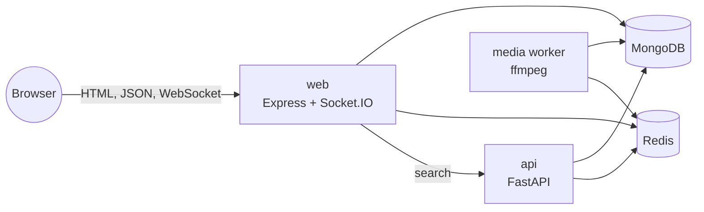

# Oremus

Oremus is a full-stack social network built with Express, MongoDB, Redis, FastAPI, Socket.IO and Tailwind CSS. People can post text, photos and videos, react and comment, add friends and follow people, join groups, chat in real time, share 24-hour stories, search, and get live notifications.

## Table of contents

**In this file**

- [Quick start with Docker](#quick-start-with-docker)
- [Run the source locally](#run-the-source-locally)
- [Commands](#commands)
- [Project structure](#project-structure)
- [Known limits](#known-limits)

**Documentation** (in [`docs/`](docs/README.md))

| Topic | Page |
|---|---|
| Start here | [Overview](docs/OVERVIEW.md) · [Development guide](docs/DEVELOPMENT.md) · [Architecture](docs/ARCHITECTURE.md) |
| Data | [Data model](docs/DATA_MODEL.md) |
| Security | [Authentication and security](docs/AUTHENTICATION.md) |
| Features | [Posts and feed](docs/POSTS_AND_FEED.md) · [Media uploads and compression](docs/MEDIA.md) · [People and relationships](docs/SOCIAL_GRAPH.md) · [Profiles](docs/PROFILES.md) · [Groups](docs/GROUPS.md) · [Messaging and notifications](docs/MESSAGING_AND_NOTIFICATIONS.md) · [Stories](docs/STORIES.md) · [Search and places](docs/SEARCH_AND_PLACES.md) |
| User interface | [Frontend](docs/FRONTEND.md) |
| Reference | [API reference](docs/API_REFERENCE.md) |
| Operations | [Deployment and operations](docs/DEPLOYMENT.md) · [Caching](docs/CACHING.md) · [Performance and memory](docs/PERFORMANCE.md) |

## At a glance



## Quick start with Docker

1. Copy `.env.example` to `.env` and replace both JWT secrets with two different random values of at least 32 characters.
2. Start everything:

   ```powershell
   docker compose up --build -d
   ```

3. Create indexes and sample data:

   ```powershell
   docker compose exec web node dist/scripts/migrate.js
   docker compose exec web node dist/scripts/seed.js
   ```

4. Open [http://localhost:3000](http://localhost:3000) and sign in with `maya@example.com` / `CircleSpace123`.

Useful URLs:

- FastAPI docs: [http://localhost:8001/docs](http://localhost:8001/docs)
- Health: `/health` on both services
- Cache statistics (signed in): `/api/dev/cache`

## Run the source locally

MongoDB and Redis must be running (for example `docker compose up -d mongo redis`).

```powershell
Copy-Item .env.example .env
npm install
python -m pip install -r apps/api/requirements.txt
npm run db:setup
npm run dev
```

In a second terminal, start the search API:

```powershell
Set-Location apps/api
python -m uvicorn app.main:app --reload --port 8001
```

Optional third terminal, the video compression worker (needs `ffmpeg` on the PATH):

```powershell
npm --workspace @oremus/web run dev:worker
```

Without the worker, videos still upload and play; they are compressed once it runs. The full step-by-step guide is in [docs/DEVELOPMENT.md](docs/DEVELOPMENT.md).

## Commands

```powershell
npm run typecheck
npm run lint
npm run test
npm run build
python -m pytest -q apps/api/tests
docker compose config --quiet
```

`npm run db:setup` prepares a database in one step (indexes, migrations, sample data). `npm run db:migrate` syncs MongoDB indexes and runs pending data migrations; it is safe to run many times. See [Database setup and migrations](docs/DATABASE.md).

## Project structure

```text
apps/web/     Express app: routes, services, models, EJS views, client script, media worker
apps/api/     FastAPI search and ranking service
docs/         Documentation
```

See [Overview](docs/OVERVIEW.md#repository-layout) for the full tree.

## Known limits

- Uploads are stored on a local volume. Use S3-compatible storage before running several web servers.
- Password reset shows its link only in development; production needs an email provider.
- Search uses simple case-insensitive matching. For large data, swap the FastAPI internals for Atlas Search or OpenSearch without changing the web app.
- Presence, typing indicators, ads and machine-learning recommendations are out of scope.

More detail in [Deployment and operations](docs/DEPLOYMENT.md#production-checklist).
