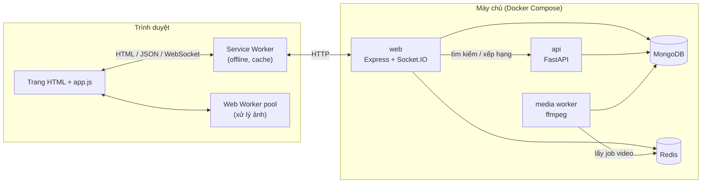
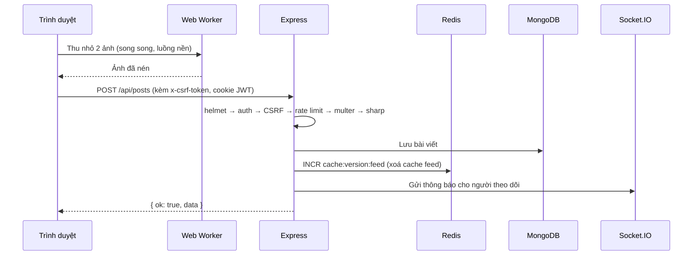

# Oremus: Mạng xã hội full-stack (Đồ án môn Web Development)

> Tài liệu này dùng để thuyết trình đồ án. Nội dung gồm: web làm được gì, kiến trúc gồm những phần nào, các phần nói chuyện với nhau ra sao, và đoạn code chính của từng tính năng.
> Hướng dẫn cài đặt và vận hành chi tiết nằm ở [README.md](README.md) và thư mục [docs/](docs/README.md).

---

## 1. Giới thiệu

**Oremus** là một mạng xã hội lấy cảm hứng từ Facebook. Người dùng có thể:

- Đăng bài viết kèm ảnh/video, thả cảm xúc, bình luận, chia sẻ, check-in địa điểm.
- Kết bạn, theo dõi, chặn người dùng khác.
- Tạo và tham gia **nhóm** (công khai/riêng tư, có duyệt bài).
- **Nhắn tin thời gian thực** và nhận **thông báo tức thì**.
- Đăng **story 24 giờ** có chữ, font, màu, hiệu ứng.
- Tìm kiếm người, nhóm, bài viết.
- Dùng web khi **mất mạng** (trang offline, ảnh đã cache) và xử lý ảnh nặng ở **luồng nền** để giao diện không bị giật.

## 2. Công nghệ sử dụng

| Tầng | Công nghệ | Lý do chọn |
|---|---|---|
| Server chính | **Node.js 22 + Express 5 + TypeScript** | Phổ biến, nhẹ, có kiểu dữ liệu tĩnh nên ít lỗi |
| Giao diện | **EJS** (render phía server) + **TypeScript** thuần + **Tailwind CSS** | Trang tải nhanh, tốt cho SEO, không cần framework nặng |
| Cơ sở dữ liệu | **MongoDB** (Mongoose) | Dữ liệu mạng xã hội dạng document (bài viết, bình luận, media) |
| Cache, hàng đợi, pub/sub | **Redis** | Cache feed, giới hạn request, hàng đợi xử lý video, đồng bộ Socket.IO |
| Realtime | **Socket.IO** | Nhắn tin và thông báo tức thì qua WebSocket |
| Dịch vụ phụ | **FastAPI** (Python) | Tìm kiếm và xếp hạng feed |
| Xử lý media | **sharp** (ảnh), **ffmpeg** (video) | Nén ảnh sang WebP, chuyển mã video |
| Trình duyệt | **Service Worker**, **Web Worker + OffscreenCanvas** | Hỗ trợ offline, xử lý ảnh đa luồng |
| Triển khai | **Docker Compose** | Chạy cả hệ thống bằng một lệnh |
| Kiểm thử | **Vitest + Supertest**, ESLint | Test API/HTTP, kiểm tra chất lượng code |

## 3. Kiến trúc tổng thể



Hệ thống gồm **5 dịch vụ**, mỗi dịch vụ là một container:

1. **web**: server chính. Render trang HTML, cung cấp REST API `/api/*`, xử lý đăng nhập, upload và Socket.IO.
2. **api**: dịch vụ Python FastAPI, lo tìm kiếm và xếp hạng bài viết.
3. **media**: tiến trình chạy nền, lấy job từ Redis và chuyển mã video bằng ffmpeg. Video nặng nên nhóm em tách ra khỏi web server để không làm chậm các request khác.
4. **MongoDB**: lưu dữ liệu chính.
5. **Redis**: cache, rate limit, hàng đợi job, và adapter để nhiều instance web dùng chung Socket.IO.

### Cấu trúc thư mục

```
apps/
├── web/                     # Server chính (Express)
│   ├── src/
│   │   ├── app.ts           # Khởi tạo Express, thứ tự middleware
│   │   ├── server.ts        # Mở cổng HTTP + Socket.IO
│   │   ├── media-worker.ts  # Tiến trình xử lý video
│   │   ├── routes/          # Định nghĩa URL  →  controller
│   │   ├── controllers/     # Nhận request, gọi service, trả response
│   │   ├── services/        # Nghiệp vụ (feed, bài viết, tin nhắn...)
│   │   ├── models/          # Schema MongoDB (Mongoose)
│   │   ├── middleware/      # Auth, CSRF, upload, rate limit, lỗi
│   │   ├── sockets/         # Socket.IO
│   │   ├── views/           # Template EJS
│   │   ├── views-or-client/ # Code chạy trên trình duyệt (app.ts, sw.ts, workers)
│   │   └── tests/           # Test Vitest
│   └── public/              # File tĩnh đã build (app.js, styles.css, sw.js)
└── api/                     # Dịch vụ FastAPI (Python)
```

Code server chia theo mô hình **Route → Controller → Service → Model**. Mỗi tầng chỉ làm một việc: route khai báo URL, controller đọc request, service xử lý nghiệp vụ, model làm việc với database.

## 4. Một request đi qua hệ thống như thế nào?

Ví dụ: người dùng bấm **"Đăng bài"** kèm 2 ảnh.



Thứ tự middleware trong [`app.ts`](apps/web/src/app.ts) rất quan trọng: lớp bảo mật chạy trước, file tĩnh được phục vụ sớm, và mọi phản hồi động bị cấm cache:

```ts
app.use(helmet({ contentSecurityPolicy: { /* chỉ cho phép script từ 'self' */ } }));
app.use(compression());
app.use(cookieParser());
app.use('/assets', express.static('public/assets', { setHeaders: setAssetCacheHeaders }));
app.use('/uploads', express.static('uploads', { maxAge: '1y', immutable: true }));
// Mọi phản hồi còn lại là dữ liệu cá nhân hoặc có CSRF token  →  không được cache
app.use((_req, res, next) => { res.setHeader('Cache-Control', 'no-store'); next(); });
app.use(csrfToken);
app.use(requireCsrf);
app.use('/auth', authRoutes);
app.use('/api', apiRoutes);
app.use(pageRoutes);
app.use(errorHandler);
```

## 5. Các tính năng chính và code tương ứng

### 5.1 Đăng nhập: JWT trong cookie + chống CSRF

**Cơ chế:**

- Đăng nhập thành công thì server cấp 2 token và lưu trong **cookie `httpOnly`**, nên JavaScript trên trang không đọc được (chống đánh cắp token qua XSS):
  - **Access token**: sống 15 phút, gửi kèm mọi request.
  - **Refresh token**: sống lâu. Mỗi lần dùng sẽ được **xoay vòng** (cấp token mới, huỷ token cũ).
- Mật khẩu được băm bằng **bcrypt** (cost 12).
- Khi đăng xuất, mã `jti` của token được đưa vào **danh sách chặn trong Redis**, nên token cũ không dùng lại được.

[`middleware/auth.ts`](apps/web/src/middleware/auth.ts):

```ts
const token = req.cookies?.access_token;
const claims = jwt.verify(token, env.JWT_ACCESS_SECRET) as AccessClaims;
// Token hợp lệ VÀ chưa bị thu hồi (đăng xuất) thì mới chấp nhận
if (claims.type === 'access' && !(await redis.exists(`deny:${claims.jti}`))) {
  req.user = await User.findOne({ _id: claims.sub, deletedAt: null });
}
// Access token hết hạn  →  dùng refresh token để tự gia hạn phiên
```

**Chống CSRF** theo kiểu *double-submit cookie*: server đặt một token ngẫu nhiên vào cookie và vào thẻ `<meta>`. Mọi request thay đổi dữ liệu (POST/PATCH/DELETE) phải gửi lại token đó trong header. So sánh bằng `timingSafeEqual` để không lộ thông tin qua thời gian phản hồi.

[`middleware/request.ts`](apps/web/src/middleware/request.ts):

```ts
export const requireCsrf: RequestHandler = (req, _res, next) => {
  if (['GET', 'HEAD', 'OPTIONS'].includes(req.method)) return next();
  const supplied = req.header('x-csrf-token') || req.body?._csrf;
  const cookie = req.cookies?.csrf;
  if (!cookie || !supplied || !crypto.timingSafeEqual(Buffer.from(cookie), Buffer.from(supplied)))
    return next(Object.assign(new Error('Your form expired.'), { status: 403 }));
  next();
};
```

Ngoài ra còn **rate limit bằng Redis**, ví dụ tối đa 20 bài viết mỗi giờ cho một người dùng:

```ts
const count = await redis.incr(`rate:${scope}:${identity}`);
if (count === 1) await redis.expire(key, windowSeconds);
if (count > limit) throw new AppError(429, 'Too many requests.');
```

### 5.2 Upload ảnh/video: nén ảnh ngay, xử lý video ở hàng đợi

Mỗi route upload là một chuỗi middleware, mỗi bước làm đúng một việc:

```ts
apiRoutes.post('/posts',
  rateLimit('post', 20, 3600),   // chống spam
  postUpload.array('images'),     // multer: nhận file, kiểm tra loại file
  enforcePostMediaSize,           // ảnh tối đa 20 MB
  compressUploadedImages,         // sharp: chuyển sang WebP
  asyncHandler(controller.createPost));
```

**Ảnh** được nén ngay bằng `sharp`: tự xoay theo EXIF, xoá metadata (GPS), thu nhỏ về cạnh tối đa 2048px, lưu thành WebP chất lượng 80. Kết quả thường nhỏ hơn ảnh gốc từ điện thoại 5–15 lần ([`media/image.ts`](apps/web/src/media/image.ts)):

```ts
sharp(inputPath, { animated: ANIMATED_TYPES.has(mimeType) })
  .autoOrient()
  .resize({ width: 2048, height: 2048, fit: 'inside', withoutEnlargement: true })
  .webp({ quality: 80 })
  .toFile(output);
```

**Video** chuyển mã mất nhiều thời gian, nên web server chỉ **đẩy job vào Redis** rồi trả kết quả ngay cho người dùng. Tiến trình `media-worker` lấy job ra và chạy ffmpeg. Lệnh `BLMOVE` chuyển job sang danh sách "đang xử lý", nên nếu worker bị tắt giữa chừng thì job **không bị mất** mà được đưa lại vào hàng đợi.

[`media-worker.ts`](apps/web/src/media-worker.ts):

```ts
while (!stopping) {
  // Chờ tối đa 5 giây để có job mới; chuyển job từ "jobs" sang "active"
  const raw = await blocking.blMove(VIDEO_JOBS, VIDEO_ACTIVE, 'RIGHT', 'LEFT', 5);
  if (!raw) continue;
  try { await processJob(JSON.parse(raw)); }    // chạy ffmpeg
  finally { await redis.lRem(VIDEO_ACTIVE, 1, raw); }
}
```

Đây là mô hình **Producer/Consumer**: web là producer, media worker là consumer.

### 5.3 Nhắn tin và thông báo thời gian thực (Socket.IO)

**Cơ chế:**

1. Khi trình duyệt kết nối WebSocket, server đọc `access_token` từ cookie để biết đó là ai.
2. Mỗi người dùng được đưa vào một **room riêng** `user:<id>`.
3. Khi có tin nhắn hoặc thông báo, server chỉ cần gửi vào room của người nhận.
4. **Redis adapter** giúp chạy được nhiều instance web: một instance phát sự kiện thì Redis chuyển sang instance đang giữ kết nối của người nhận.

[`sockets/index.ts`](apps/web/src/sockets/index.ts):

```ts
const io = new Server(server);
io.adapter(createAdapter(pub, sub));                 // đồng bộ qua Redis pub/sub
io.use((socket, next) => {                           // xác thực khi kết nối
  const claims = jwt.verify(accessTokenFromCookie, env.JWT_ACCESS_SECRET);
  socket.data.userId = claims.sub; next();
});
io.on('connection', (socket) => socket.join(`user:${socket.data.userId}`));
setNotifier((userId, event, payload) => io.to(`user:${userId}`).emit(event, payload));
```

Phía trình duyệt ([`views-or-client/app.ts`](apps/web/src/views-or-client/app.ts)):

```ts
const socket = io();
socket.on('notification:new', (notification) => { /* tăng badge, hiện toast */ });
socket.on('message:new', (message) => { /* thêm tin nhắn vào khung chat */ });
```

Trước khi gửi thông báo, service kiểm tra người nhận có **chặn** người gửi không ([`notification.service.ts`](apps/web/src/services/notification.service.ts)).

### 5.4 Cache newsfeed bằng Redis: xoá toàn bộ cache chỉ với 1 lệnh

**Vấn đề:** feed cần một truy vấn aggregate phức tạp (bài của mình, bài công khai, bài của người mình theo dõi, bài trong nhóm, trừ người bị chặn). Cache lại thì nhanh, nhưng khi có bài mới thì feed của **rất nhiều người** cùng bị cũ. Xoá từng key `feed:*` thì phải quét toàn bộ Redis, độ phức tạp O(n).

**Giải pháp:** gắn **số phiên bản** (generation) vào tên key. Khi cần xoá cache, chỉ cần tăng số phiên bản lên 1 (`INCR`, O(1)). Key cũ không ai đọc nữa và tự hết hạn sau 45 giây.

[`services/feed.service.ts`](apps/web/src/services/feed.service.ts) và [`cache.service.ts`](apps/web/src/services/cache.service.ts):

```ts
export async function getFeed(userId: string, page = 1, limit = 15) {
  const version = await feedCacheVersion();                  // ví dụ "42"
  const key = `feed:${version}:${userId}:${page}:${limit}`;
  const cached = await cacheGet(key);
  if (cached) return { items: cached, cached: true };        // cache hit
  const items = await Post.aggregate([ /* truy vấn feed */ ]);
  await cacheSet(key, items, 45);                            // TTL 45 giây
  return { items, cached: false };
}

export async function invalidateFeedCaches() {
  await redis.incr('cache:version:feed');                    // 42  →  43: mọi feed cũ bị bỏ qua
}
```

### 5.5 Hoạt động khi offline: Service Worker

**Service Worker** là một script chạy riêng trong trình duyệt và đứng giữa trang web với mạng, nên có thể quyết định trả dữ liệu từ cache hay từ server.

Mỗi loại request dùng một chiến lược riêng:

| Loại request | Chiến lược | Lý do |
|---|---|---|
| Trang HTML | **Network-first**, mất mạng thì hiện trang `/offline` | Trang chứa dữ liệu cá nhân và CSRF token nên **không bao giờ cache** |
| CSS/JS có version (`?v=hash`) | **Cache-first** | Nội dung không đổi khi hash không đổi |
| Ảnh người dùng `/uploads` | **Cache-first**, tối đa 300 ảnh | Tên file là UUID nên ảnh không bao giờ thay đổi |
| Font, CDN | **Stale-while-revalidate** | Trả bản cache ngay, cập nhật ngầm |
| `/api`, `/auth`, POST… | **Không can thiệp** | Luôn cần dữ liệu mới nhất |

[`views-or-client/sw.ts`](apps/web/src/views-or-client/sw.ts):

```ts
sw.addEventListener('fetch', (event) => {
  const { request } = event;
  if (request.method !== 'GET') return;                       // không đụng request ghi dữ liệu
  const url = new URL(request.url);
  if (request.mode === 'navigate') {                          // mở một trang
    event.respondWith(fetch(request).catch(() => caches.match('/offline')));
    return;
  }
  if (url.pathname.startsWith('/assets/'))  event.respondWith(cacheFirst(request, STATIC_CACHE));
  if (url.pathname.startsWith('/uploads/')) event.respondWith(cacheFirst(request, UPLOADS_CACHE, 300));
});
```

Một số chi tiết:

- **Cập nhật phiên bản:** tên cache gắn với hash của bản build (`oremus-static-<hash>`). Mỗi lần deploy, Service Worker mới tự xoá cache cũ ở sự kiện `activate`.
- **Bảo mật:** khi đăng xuất, cache ảnh bị xoá, vì có thể chứa ảnh của bài viết riêng tư.
- **Trải nghiệm:** khi mất mạng, trang hiện thông báo *"You're offline"*. Khi có mạng lại thì hiện *"Back online"*.

### 5.6 Xử lý đa luồng trên trình duyệt: Web Worker pool

**Vấn đề:** JavaScript trên trang chỉ chạy **một luồng**. Giải mã và nén một ảnh 12 MP từ điện thoại mất vài trăm mili giây, làm giao diện bị **đứng** (không cuộn, không gõ phím được).

**Giải pháp:** chuyển việc xử lý ảnh sang **Web Worker** (luồng riêng) và dùng `OffscreenCanvas` để vẽ ảnh mà không cần DOM. Nhóm em dùng một **pool** gồm tối đa 4 worker (số nhân CPU − 1). Nhiều ảnh được xử lý **song song**, mỗi job được giao cho worker đang rảnh nhất.

Hai việc được chuyển sang worker:

1. **Crop** ảnh đại diện và ảnh bìa.
2. **Thu nhỏ ảnh trước khi upload** về 2048px. Ví dụ đo được: ảnh 3000×2000 giảm từ 1.9 MB xuống 0.5 MB, nên upload nhanh hơn và tốn ít băng thông hơn.

Pool phân việc ([`views-or-client/workers.ts`](apps/web/src/views-or-client/workers.ts)):

```ts
const POOL_SIZE = Math.max(1, Math.min(4, navigator.hardwareConcurrency - 1));

function pickSlot(): Slot {
  const idle = slots.find((slot) => slot.busy === 0);
  if (idle) return idle;                                     // có worker rảnh
  if (slots.length < POOL_SIZE) return spawn();              // tạo thêm worker
  return slots.reduce((a, b) => (b.busy < a.busy ? b : a)); // chọn worker ít việc nhất
}

export function runImageJob(job: ImageJob): Promise<Blob | null> {
  return new Promise((resolve, reject) => {
    const slot = pickSlot(); const id = nextId++;
    pending.set(id, { resolve, reject, slot });              // chờ worker trả kết quả theo id
    slot.busy += 1;
    slot.worker.postMessage({ id, job });
  });
}

// Tối ưu tất cả ảnh trong form cùng lúc
const values = await Promise.all(entries.map(([, v]) => (v instanceof File ? optimizeUpload(v) : v)));
```

Code chạy trong worker ([`views-or-client/image-worker.ts`](apps/web/src/views-or-client/image-worker.ts)):

```ts
const bitmap = await createImageBitmap(file, { imageOrientation: 'from-image' });
const scale = Math.min(1, maxEdge / Math.max(bitmap.width, bitmap.height));
const canvas = new OffscreenCanvas(bitmap.width * scale, bitmap.height * scale);
canvas.getContext('2d')!.drawImage(bitmap, 0, 0, canvas.width, canvas.height);
const blob = await canvas.convertToBlob({ type: 'image/jpeg', quality: 0.92 });
return blob.size < file.size ? blob : null;                  // chỉ dùng khi thật sự nhỏ hơn
```

**Fallback:** nếu trình duyệt không hỗ trợ `OffscreenCanvas` hoặc worker gặp lỗi, web quay về cách xử lý cũ trên luồng chính. Tính năng vẫn chạy, chỉ chậm hơn.

## 6. Bảo mật: tóm tắt

| Mối đe doạ | Cách phòng chống |
|---|---|
| XSS | Helmet **Content-Security-Policy** chỉ cho phép script từ chính domain. EJS tự escape (`<%= %>`). `sanitize-html` lọc nội dung |
| Đánh cắp token | JWT trong cookie `httpOnly`, `SameSite=Lax`, `Secure` khi chạy HTTPS |
| CSRF | Double-submit token + so sánh `timingSafeEqual` |
| Dò mật khẩu, spam | Rate limit bằng Redis, bcrypt cost 12 |
| Lộ dữ liệu qua cache | `Cache-Control: no-store` cho trang động. Service Worker không cache HTML |
| Lộ vị trí qua ảnh | Xoá metadata EXIF/GPS cả ở trình duyệt lẫn server |
| Upload file độc hại | Chỉ nhận đúng MIME type cho phép, giới hạn dung lượng, encode lại toàn bộ ảnh |

## 7. Hiệu năng: tóm tắt

- **Server-side rendering**: trang có nội dung ngay khi tải, không phải chờ JavaScript.
- **Asset có hash**: `app.js?v=<hash>` được cache 1 năm (`immutable`). Deploy mới thì hash đổi, nên trình duyệt tự tải bản mới.
- **Nén gzip** mọi phản hồi (`compression`).
- **Redis cache** cho feed, profile, nhóm, tìm kiếm. Xoá cache feed chỉ tốn O(1).
- **Ảnh WebP** nhỏ hơn 5–15 lần. Ảnh được nén sẵn trên trình duyệt trước khi upload.
- **Video xử lý bất đồng bộ** ở tiến trình riêng.
- **Web Worker** giúp giao diện luôn mượt khi xử lý ảnh.

## 8. Chạy thử và kiểm thử

```bash
cp .env.example .env          # rồi điền 2 JWT secret
docker compose up --build -d  # chạy cả 5 dịch vụ
npm run db:setup              # tạo index + dữ liệu mẫu
```

Mở `http://localhost:3000`.

```bash
npm run lint && npm run typecheck && npm test
```

Bộ test có **71 test** (Vitest + Supertest), gồm: xác thực trang, chính sách cache HTTP, Service Worker và trang offline, media, story, quan hệ xã hội.

## 9. Kịch bản demo gợi ý (khoảng 5 phút)

1. **Đăng nhập** và mở DevTools → Application → Cookies: chỉ ra token là `httpOnly`.
2. **Đăng bài kèm ảnh lớn**: mở tab Network để thấy file gửi lên đã nhỏ hơn ảnh gốc (nhờ Web Worker).
3. Mở **2 trình duyệt** với 2 tài khoản rồi **nhắn tin**: tin nhắn và thông báo hiện tức thì, không cần tải lại trang.
4. Tải lại trang chủ nhiều lần: endpoint `/api/dev/cache` cho thấy tỉ lệ cache hit tăng.
5. DevTools → Network → chọn **Offline** rồi chuyển trang: hiện trang *"You're offline"*, ảnh đã xem vẫn hiển thị.
6. DevTools → Application → **Service Workers / Cache Storage**: chỉ ra các cache `oremus-*`.

## 10. Hạn chế và hướng phát triển

- Chưa có **hàng đợi gửi bài khi offline** (đăng bài lúc mất mạng rồi tự gửi khi có mạng lại, dùng Background Sync).
- Chưa có **push notification** khi đã đóng tab (Web Push API).
- File upload đang lưu trên ổ đĩa server. Muốn mở rộng nhiều server thì cần chuyển sang object storage (S3, MinIO).
- Có thể chuyển mã video sang nhiều độ phân giải (HLS) để xem mượt hơn trên mạng yếu.

---

**Tài liệu chi tiết:** [Kiến trúc](docs/ARCHITECTURE.md) · [Xác thực](docs/AUTHENTICATION.md) · [Cache](docs/CACHING.md) · [Media](docs/MEDIA.md) · [Nhắn tin & thông báo](docs/MESSAGING_AND_NOTIFICATIONS.md) · [API](docs/API_REFERENCE.md)
