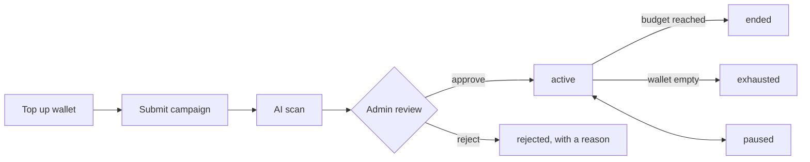

# Ads

Members can run ads from `/ads/manage`, and anyone can opt out of them by advertiser or topic.

## Lifecycle

Changing a campaign sends it back to review.

## Serving

Ads appear in two places. Any failure loading ads gives the page without them.

- **Home feed:** `withAds` in `services/ads.service.ts` runs after `getFeed`, so ads stay out of the 45-second feed cache and each person gets fresh ones. The first card goes after the 3rd organic post, then one after every 8 more (11th, 19th, …). The `o<n>` cursor counts organic posts only, so ads cannot shift paging.
- **Search:** `adForSearch` puts one card above the results when the search words name an ad topic ("game" is Gaming), on the All and Posts tabs. Only ads with that topic qualify. This uses the search itself, not anything stored about the person.

An ad is left out when:

- the viewer blocked its advertiser or any of its topics, or hid it;
- the viewer and advertiser are blocked in either direction, or the viewer chose to see less of them;
- it reached 3 views for that viewer today;
- it hit its daily or total budget.

Campaigns are ranked by bid, plus some randomness, with a 1.5x boost when a topic matches:

- the interests the viewer picked in onboarding, or
- topics from what they recently searched for, read and opened (`behaviourTopics` in `services/activity.service.ts`: the same decaying profile as suggestions, its top 3 topics, cached 5 minutes and dropped on every new signal).

Both are dropped if the viewer turned off "Use my interests". "Why am I seeing this?" says which one matched. Topics come from the interest list in `shared/interests.ts`. There is no targeting by sensitive traits, age or location.

**Advertisers see their own ads.** One of their own running campaigns takes the first slot, marked "Your preview". Its views and clicks are never counted or charged, and its menu has no hide, block or report.

The ad card has no `data-post-id` and no `/posts/` link on purpose: the reading tracker and post viewer would otherwise treat it as a post.

## Measuring and money

All money is in whole VND.

- **Views:** half the card on screen for a full second, once per rendered card. The card carries a signed token tied to the viewer.
- **Clicks:** `/ads/click/:token` redirects to the campaign's reviewed link from the database, never to anything in the request. Only `https://` links are accepted.
- **Charging:** a worker settles views every minute. A campaign is only charged up to its total budget and wallet balance, so views served just before it stops cost the advertiser nothing. The daily budget is checked on serving from a live counter, so it can be slightly exceeded.
- **Ledger:** `LedgerEntry` is the record of truth and is append-only. MongoDB here runs without transactions, so the entry is written first under a unique key (repeats do nothing), then the balance. If the process dies between the two, a job rebuilds the balance from the ledger within 15 minutes.

## Free test credit

While there is no payment provider, members can add credit to their own wallet from `/ads/manage`. `ADS_SELF_TOPUP` controls this: unset means on, except when `NODE_ENV=production`. It is free advertising for anyone who asks, so leave it off on a real launch. Each use is recorded in the ledger with the note "Free test credit" and in the audit log.

## VNPay

Set `VNPAY_TMN_CODE` and `VNPAY_HASH_SECRET` from your [sandbox account](https://sandbox.vnpayment.vn/devreg). Without them, the wallet page says online payment is not set up, and an admin can credit a wallet by hand (*Ad Account → Adjust balance*).

In the VNPay merchant portal, set the IPN URL to `https://<your-domain>/payments/vnpay/ipn`. It must be publicly reachable.

Only the signed IPN adds money, and it checks the signature, the amount and whether the order was already paid. The return URL only tells the buyer how it went, because a browser can fake it.

The integration uses the community `vnpay` npm package, which is not an official SDK. It has only been tested here with correctly signed simulated callbacks, not against VNPay's sandbox. Taking real money also needs a merchant agreement with VNPay.

## Before charging real money

Check Vietnamese advertising and tax rules with someone qualified. Refunds of unused balance are manual today, through *Adjust balance*.
