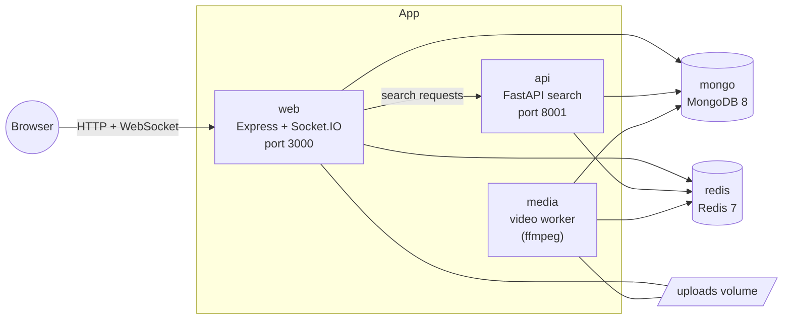
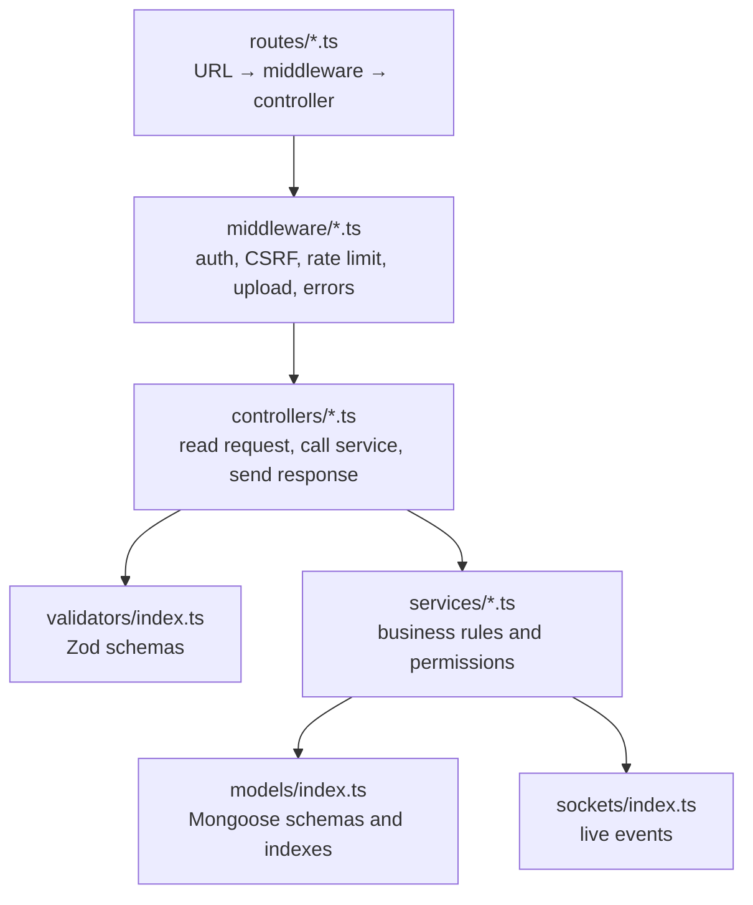
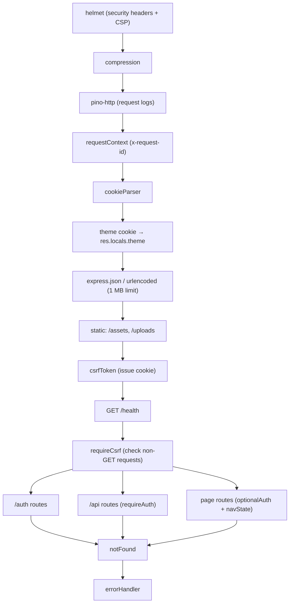
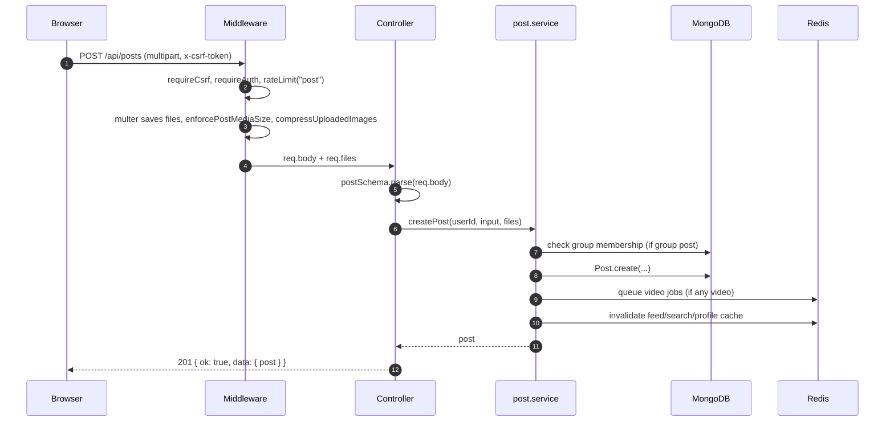
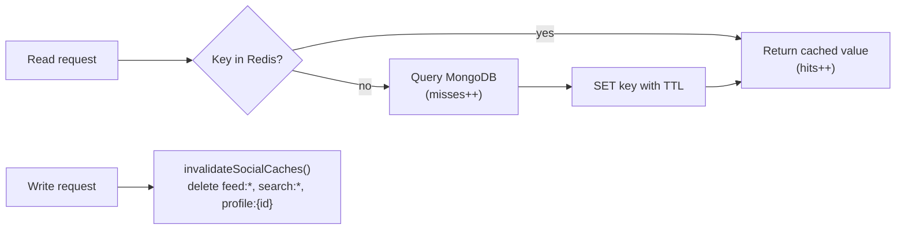

# Architecture

This page explains how the pieces of Oremus fit together: the services, the layers inside the web app, the order of middleware, how caching works and what runs in the background.

## Services

Oremus runs as five containers (see `docker-compose.yml`).



| Service | Code | Job |
|---|---|---|
| `web` | `apps/web/src/server.ts` | Renders pages, serves the JSON API, handles uploads, runs Socket.IO |
| `media` | `apps/web/src/media-worker.ts` | Takes video jobs from Redis and compresses them with ffmpeg |
| `api` | `apps/api/app/main.py` | Search across users, posts and groups; optional feed ranking endpoint |
| `mongo` | MongoDB 8 | Main database |
| `redis` | Redis 7 | Cache, rate limits, token denylist, Socket.IO pub/sub, video job queue |

`web` and `media` are built from the same Dockerfile. The `media` stage only adds ffmpeg and starts a different entry file. They share the `uploads` volume so the worker can read and write the same files.

## Layers inside the web app

Each layer has one job. A request flows from top to bottom.



| Layer | Rule of thumb |
|---|---|
| Routes | Only wiring. No logic. |
| Middleware | Things every request needs: who is the user, is the CSRF token valid, too many requests, files, errors. |
| Controllers | Thin. Parse input with Zod, call one service, return `{ ok: true, data }` or render a view. |
| Services | All rules live here: who can see a post, who can approve a member, what happens when you block someone. |
| Models | Data shape, defaults, enums and indexes. |
| Sockets | Push events to users. Services call `emitUserEvent()` and never touch Socket.IO directly. |

## Middleware order

The order in `apps/web/src/app.ts` matters. For example, the CSRF check runs before any route, and errors are handled last.



## Life of an API request

Example: creating a post with two photos.



## Responses and errors

Every JSON response has the same shape, so the client handles them in one place.

```json
{ "ok": true, "data": { "post": { } } }
```

```json
{ "ok": false, "error": { "code": "POST_FORBIDDEN", "message": "This post is not available to you." }, "requestId": "..." }
```

- Services throw `AppError(status, message, code)` from `utils/errors.ts`.
- Zod errors become `422 VALIDATION_ERROR` with the first readable message.
- Multer errors (file too large) become `413` or `422`.
- Anything unexpected becomes `500` with a generic message; the real error is logged with the request id.
- For page requests (not `/api` or `/auth`), the same handler renders `views/error.ejs` instead of JSON.

## Caching

Redis caches expensive reads for a short time. Writes delete the matching keys so users see fresh data quickly.

| Data | Key | TTL | Deleted when |
|---|---|---:|---|
| Home feed page | `feed:{user}:{page}:{limit}` | 45 s | post, reaction, comment, follow, membership change |
| Profile summary | `profile:{user}` | 120 s | profile or follow change |
| Group details | `group:{group}` | 180 s | group or membership change |
| Search results (FastAPI) | `search:{sha256(query)}:{limit}` | 30 s | social or content change |
| Place search | `places:v2:...` | 24 h | never (expires only) |



Hit and miss counts are stored in the `cache:stats` hash. Signed-in developers can see them at `/api/dev/cache`.

Invalidation is intentionally broad (all `feed:*` keys). This is simple and always correct for a small app. At a larger scale, replace it with per-follower keys.

## Rate limits

`middleware/rate-limit.ts` counts requests per user (or per IP when signed out) in Redis with `INCR` + `EXPIRE`.

| Scope | Limit | Window |
|---|---:|---|
| `auth` (register, login) | 10 | 15 min |
| `refresh` | 30 | 15 min |
| `reset` / `reset-confirm` | 5 / 8 | 1 h |
| `post` | 20 | 1 h |
| `comment` | 60 | 1 h |
| `message` (chat and story replies) | 120 | 1 min |
| `story` | 30 | 1 h |
| `group` (create) | 5 | 1 h |
| `group-invite` | 60 | 1 h |
| `profile-photo` | 30 | 1 h |
| `places` | 60 | 1 min |

When the limit is passed the API returns `429 RATE_LIMITED`.

## Background work

| Work | Where | Trigger |
|---|---|---|
| Video compression | `media` worker | Redis list `media:video:jobs` |
| Deleting replaced video originals | `media` worker | Redis sorted set `media:trash`, 15 min after the swap |
| Expiring refresh tokens | MongoDB TTL index | `expiresAt` on `RefreshToken` |
| Expiring stories | Query filter | Stories with `expiresAt` in the past are simply not returned |

See [Media](MEDIA.md) for the full video pipeline.

## Real-time delivery

Socket.IO uses a Redis adapter, so several `web` instances can send events to the same user. Every connected user joins a room called `user:{id}`. See [Messaging and notifications](MESSAGING_AND_NOTIFICATIONS.md).

## Verification matrix

| Acceptance path | Proof |
|---|---|
| Password/auth validation | Vitest auth policy tests + API validation |
| Refresh replay handling | Hashed refresh records, family revocation branch |
| Post ownership | Shared permission test + service guard |
| Six reaction types | Table-driven Vitest coverage |
| Group approval | Admin/moderator service guard + upserted membership |
| Message delivery | Persisted message + recipient user Socket.IO room emit |
| Friendship-gated chat | Canonical pair state + service, page, API and socket checks |
| Notification delivery | Persisted notification + user Socket.IO room emit |
| Media compression | Vitest image tests (resize, WebP, EXIF strip, animation) + ffmpeg argument tests |
| Redis behaviour | Explicit cache/invalidation service + diagnostic endpoint |
| Responsive UI | Desktop grid, mobile bottom navigation, semantic forms/focus states |

## Design decisions

- **MongoDB with Mongoose.** Documents fit social data well. Values read together are embedded (`profile` in `User`, `media` in `Post`), while large or independent relationships get their own collection (follows, reactions, comments, memberships).
- **Server-rendered pages.** EJS gives a fast first load and works without a client framework. One bundled script adds the interactive parts.
- **FastAPI for search.** Search is a separate service so it can later move to Atlas Search or OpenSearch without changing the web app.
- **Redis is part of the core.** It is used for caching, rate limiting, logout (token denylist), live events and the video queue.
- **Soft delete.** Posts, comments, stories and users use `deletedAt` instead of being removed, so mistakes can be undone and references stay valid.

## Known limits

- Uploads are stored on a local disk volume. Use S3-compatible storage before running several web servers.
- Password reset returns the token only in development. Production needs an email provider.
- Search uses case-insensitive regex. For large data, switch to a real search engine.
- The video worker should run as a single instance.
