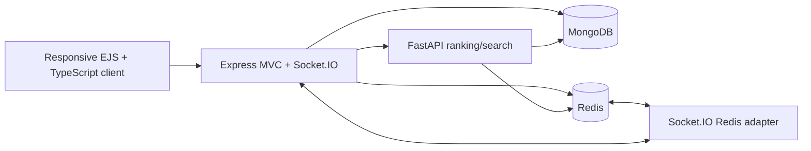
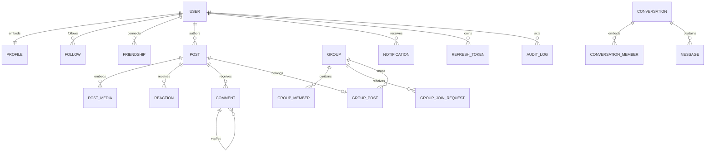

# Oremus architecture

## Service flow

Express controllers only translate HTTP. Services own business rules, Mongoose models own persistence constraints, Zod validators own request shapes, middleware owns cross-cutting auth/CSRF/rate-limit/upload concerns, and sockets own live delivery.

## Document model

MongoDB embeds values that are read and updated with their parent: `Profile` inside `User`, `PostMedia` inside `Post`, and conversation member IDs inside `Conversation`. High-cardinality or independently updated relationships use collections.

Compound unique indexes protect follow pairs, canonical friendship pairs, user/post reactions, memberships, and active identity fields. Friendships move from `pending` to `accepted`; accepting creates or promotes the private conversation. TTL removes expired refresh records. Posts and comments use `deletedAt` soft deletion.

Follow remains independent of friendship. Home posts sort by followed authors first, newest follow first, then newest post within each author, before pagination. Take a break saves private `SocialPreference` settings: hide an author's home posts/stories or restrict follower-only content shared with them; public content remains accessible and friendship/chat stay intact. `Block` denies profile/content/social/chat access in both directions, removes friendship and bilateral follows, and retains message history. Unblocking does not restore those relationships. The existing-chat friendship backfill runs only once, preventing migrations from resurrecting removed relationships.

## Route map

| Surface | Routes | Responsibility |
|---|---|---|
| Pages | `/`, `/login`, `/register`, `/reset-password` | Authentication and ranked home feed |
| People | `/profile/:username`, `PATCH /api/profile`, `POST /api/users/:id/friendship` | Profiles plus friend request/accept/cancel/decline/unfriend state |
| Social actions | `/profile/:username?q=...`, `/api/users/:id/follow`, `/api/users/:id/break`, `/api/users/:id/block` | Profile search, independent follow, private break settings, block/unblock |
| Posts | `/posts/:id`, `/api/posts/*` | Create/edit/delete, media, reactions, comments/replies |
| Groups | `/groups`, `/groups/:slug`, `/api/groups/*`, `/api/group-requests/*` | Discovery, membership, moderation, group posting |
| Messaging | `/messages/:conversationId`, `/api/conversations/*` | Friends-only conversation history and real-time messages |
| Activity | `/notifications`, `/api/notifications/*` | Notification inbox and read state |
| Discovery | `/search`, `/api/search`, FastAPI `/v1/search` | Users, posts, groups |
| Ranking | MongoDB home-feed aggregation; FastAPI `/v1/feed/rank` | Home follow-recency priority; optional ranking endpoint |
| Operations | `/health`, FastAPI `/health`, `/api/dev/cache` | Readiness and cache diagnostics |

## Cache policy

| Data | Key | TTL | Invalidation |
|---|---|---:|---|
| Home feed | `feed:{user}:{page}:{limit}` | 45s | post, reaction, comment, follow, membership |
| Profile summary | `profile:{user}` | 120s | profile or follow change |
| Group metadata | `group:{group}` | 180s | group/membership changes plus short TTL |
| Search | `search:{sha256(query)}:{limit}` | 30s | social/content mutations plus TTL |

Cache accesses increment `cache:stats` hit/miss counters. Broad feed invalidation favors correctness for this first production slice; at scale, replace it with follower-set fanout keys.

## Verification matrix

| Acceptance path | Proof |
|---|---|
| Password/auth validation | Vitest auth policy tests + API validation |
| Refresh replay handling | hashed refresh records, family revocation branch |
| Post ownership | shared permission test + service guard |
| Six reaction types | table-driven Vitest coverage |
| Group approval | admin/moderator service guard + upserted membership |
| Message delivery | persisted message + recipient user Socket.IO room emit |
| Friendship-gated chat | canonical pair state + service, page, API and socket authorization checks |
| Notification delivery | persisted notification + user Socket.IO room emit |
| Redis behavior | explicit cache/invalidation service + diagnostic endpoint |
| Responsive UI | desktop grid, mobile bottom navigation, semantic forms/focus states |

