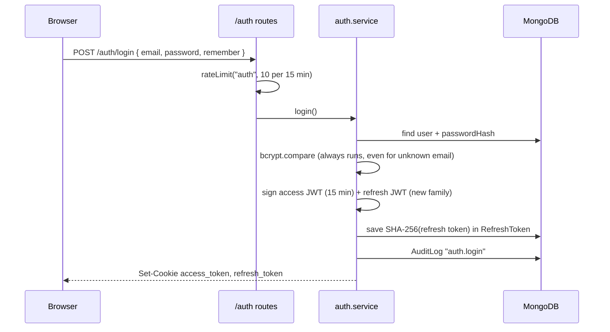
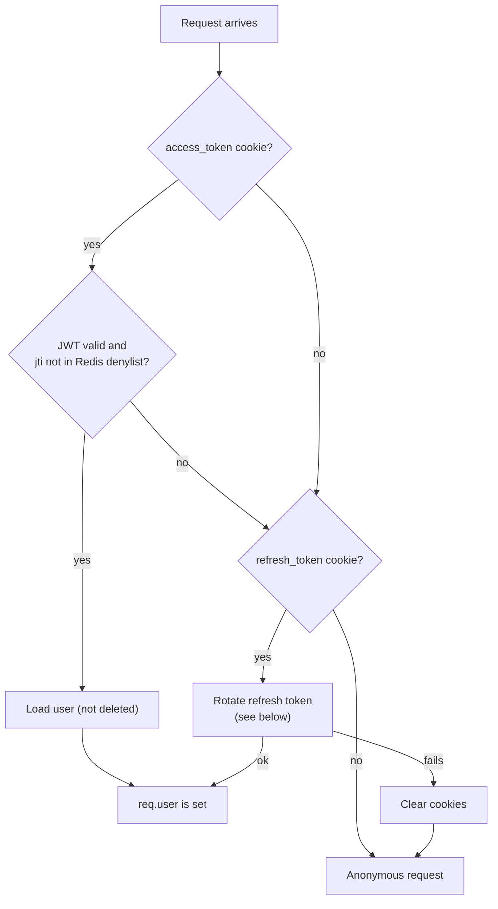
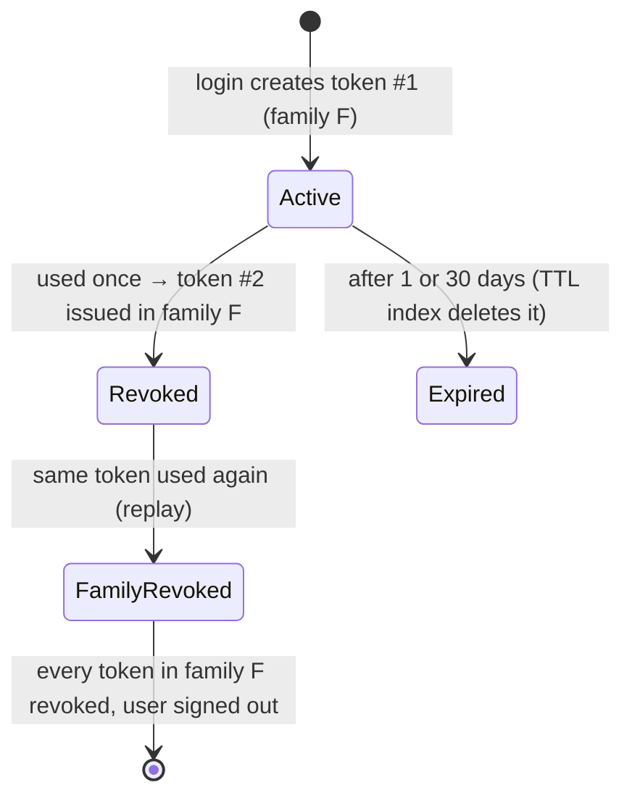
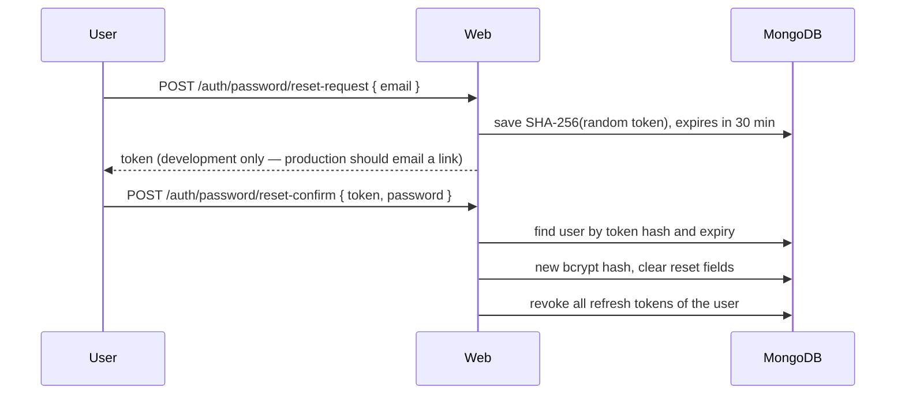

# Authentication and security

This page explains how users sign in, how sessions stay alive, and the security protections around every request.

Main files:

- [`services/auth.service.ts`](../apps/web/src/services/auth.service.ts) — register, login, refresh, logout, password reset
- [`middleware/auth.ts`](../apps/web/src/middleware/auth.ts) — finds the current user on each request
- [`middleware/request.ts`](../apps/web/src/middleware/request.ts) — request id and CSRF
- [`validators/index.ts`](../apps/web/src/validators/index.ts) — password and form rules

## Tokens and cookies

Oremus uses two JSON Web Tokens stored in **HTTP-only cookies**. JavaScript in the page cannot read them.

| Cookie | Contents | Lifetime | Purpose |
|---|---|---|---|
| `access_token` | JWT with user id (`sub`) and a unique id (`jti`) | 15 minutes | Proves who you are on each request |
| `refresh_token` | JWT with a `family` id | 1 day, or 30 days with "remember me" | Gets a new access token when the old one expires |
| `csrf` | Random string (readable by JS) | 1 day | Protects against cross-site form posts |
| `theme` | `light`, `dark` or `system` | 1 year | Renders the right theme without a flash |

Without "remember me" the cookies are session cookies: closing the browser ends the session.

Cookies use `SameSite=Lax`, `HttpOnly` (except `csrf` and `theme`) and `Secure` when `COOKIE_SECURE=true`.

## Register and log in

- Passwords are hashed with **bcrypt** (cost 12).
- When the email does not exist, the code still compares against a dummy hash. This keeps response time the same, so attackers cannot discover which emails are registered.
- Password rules: 10–128 characters, at least one lowercase letter, one uppercase letter and one number.
- Usernames: 3–24 characters, letters, numbers or underscore.

## How the current user is found

Every page and API request goes through `resolveUser()`:

Three guards use this:

| Guard | Used by | When there is no user |
|---|---|---|
| `optionalAuth` | All page routes | Continue as guest |
| `requireAuth` | All `/api` routes, logout | `401 AUTH_REQUIRED` |
| `requirePageAuth` | Home, messages, stories, settings, search, notifications | Redirect to `/login` |

## Refresh token rotation and reuse detection

Each refresh token can be used **once**. Using it creates a new one in the same family and marks the old one as revoked. If someone tries to use a revoked token again (for example a stolen copy), the whole family is revoked and the user must sign in again.

Only the SHA-256 hash of the refresh token is stored in MongoDB, so a database leak does not expose working tokens.

## Log out

`POST /auth/logout`:

1. Marks the refresh token as revoked.
2. Writes `deny:{jti}` to Redis for 15 minutes, so the current access token stops working immediately (it would otherwise be valid until it expires).
3. Clears both cookies.

## Password reset

After a reset, every device is signed out.

## CSRF protection

All `POST`, `PATCH`, `PUT` and `DELETE` requests must send the CSRF token, either:

- in the `x-csrf-token` header (the client script does this for every `fetch`), or
- as a `_csrf` form field.

The server compares it with the `csrf` cookie using a timing-safe comparison. If they do not match the response is `403 CSRF_INVALID` ("Your form expired"). The token is also printed in a `<meta name="csrf-token">` tag so the client can read it.

## Other protections

| Protection | Where |
|---|---|
| Content Security Policy and security headers | `helmet` in `app.ts`. Scripts only from self and `cdn.socket.io`; media only from self and `blob:` |
| Input validation | Zod schemas for every body and query |
| HTML stripping | `sanitize-html` removes all tags from posts, comments and stories |
| Upload safety | Random file names, MIME allow-list, size limits, server-side re-encoding (see [Media](MEDIA.md)) |
| Ownership checks | `assertOwner()` and per-feature permission checks in services |
| Block checks | `assertNotBlocked()` before any interaction between two people |
| Rate limits | Redis counters per user/IP (see [Architecture](ARCHITECTURE.md#rate-limits)) |
| Body size | JSON and form bodies limited to 1 MB |
| Request ids | Every response has `x-request-id`; errors are logged with it |
| Audit log | Login, register and post deletion are written to `AuditLog` |
| Socket auth | Socket.IO reads the `access_token` cookie during the handshake and rejects unknown users |
