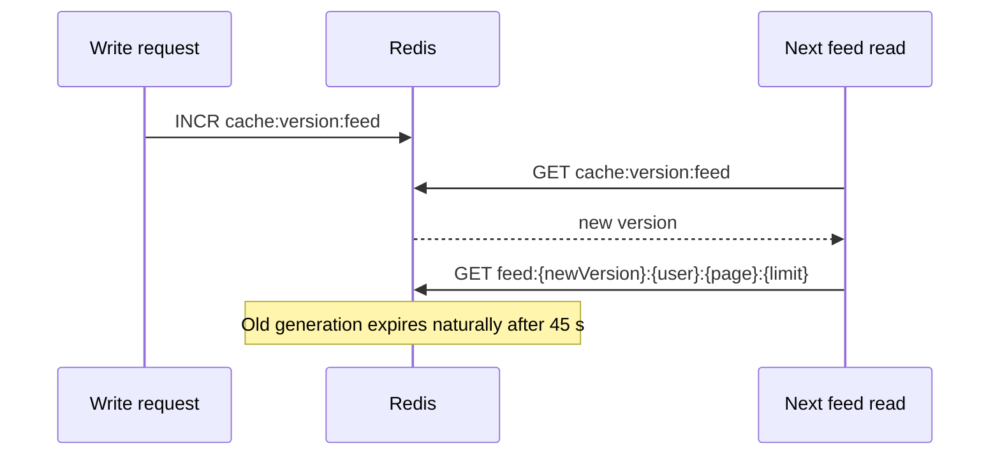

# Caching

Oremus uses two cache layers: browser HTTP caching for files and Redis caching for expensive reads. The policy keeps immutable files fast while preventing personalized pages, API responses and CSRF tokens from being stored.

## HTTP cache policy

The Express middleware order matters: static assets and uploads are served first, then every remaining dynamic response receives `Cache-Control: no-store`.

| Response | `Cache-Control` | Reason |
|---|---|---|
| `/assets/app.js?v={buildHash}` | `public, max-age=31536000, immutable` | The build hash changes when JavaScript or CSS changes |
| `/assets/styles.css?v={buildHash}` | `public, max-age=31536000, immutable` | The build hash prevents stale bundles |
| Other `/assets/*` files | `public, max-age=604800` | These filenames are not content-hashed, so they use a bounded seven-day cache |
| `/uploads/{uuid}.*` | `public, max-age=31536000, immutable` | Upload filenames are random UUIDs and files are never overwritten |
| HTML, JSON APIs and health responses | `no-store` | Responses can be personalized or contain CSRF/session-related data |

In development, all `/assets/*` responses use `no-store`. Docker Compose explicitly sets `NODE_ENV=production` for `web` and `media`, even if the local `.env` says `development`.

Do not add `immutable` to an asset whose URL can serve different bytes later. Either give it a content-hashed filename/query value or keep a bounded TTL.

## Redis caches

| Data | Key | TTL | Invalidation |
|---|---|---:|---|
| Home feed | `feed:{version}:{user}:{page}:{limit}` | 45 s | Increment `cache:version:feed` |
| Profile summary | `profile:{user}` | 120 s | Delete the exact affected profile keys |
| Group details | `group:{group}` | 180 s | Delete the exact group key |
| Search results | `search:{sha256(query)}:{limit}` | 30 s | Scan/delete only after searchable profile, group or post content changes |
| Place search | `places:v2:...` | 24 h | TTL only |

All cached values are JSON. `cacheGet()` records hit/miss diagnostics asynchronously so metrics do not add another Redis round trip to the response path.

## Feed generation invalidation

Every feed can contain public posts and changing engagement counts, so a write may affect many users. Deleting every `feed:*` key would require an O(n) Redis keyspace scan. Oremus instead uses a generation number:



This makes global feed invalidation O(1). Old keys become unreachable immediately and disappear through their normal TTL.

## Domain-specific invalidation

`invalidateSocialCaches(userIds, { search })` always:

- increments the feed generation;
- deletes the exact profile summaries listed in `userIds`.

Search invalidation is opt-in. Use `{ search: true }` only when a write changes fields returned by search:

- profile name, username, bio or avatar;
- group name, description, cover or visibility;
- non-group post content or deletion state.

Reactions, comments, follows, friendship changes, blocks and group membership changes refresh feeds/profiles but do not clear search results.

## Diagnostics

Signed-in developers can inspect aggregate hit/miss counts at:

```text
GET /api/dev/cache
```

Useful local checks:

```powershell
# Verify runtime mode
docker exec oremus-web-1 sh -lc 'printf "NODE_ENV=%s\n" "$NODE_ENV"'

# Inspect HTTP policies
curl.exe -I http://localhost:3000/assets/app.js
curl.exe -I http://localhost:3000/login

# Inspect cache keys and the current feed generation
docker exec oremus-redis-1 redis-cli --scan --pattern 'feed:*'
docker exec oremus-redis-1 redis-cli GET cache:version:feed
docker exec oremus-redis-1 redis-cli HGETALL cache:stats
```

Expected production headers:

- bundles and uploads include `immutable`;
- unversioned assets have a seven-day `max-age`;
- dynamic pages and APIs return `no-store`.

## Change checklist

When adding or changing cached data:

1. Include every input that changes the result in the cache key.
2. Give every read cache a finite TTL.
3. Add invalidation at the write boundary that owns the changed data.
4. Prefer exact `DEL` or version increments over prefix scans.
5. Invalidate search only when indexed output changes.
6. Add a regression test for the key or header policy.
7. Update this page and [Architecture](ARCHITECTURE.md) when the strategy changes.

