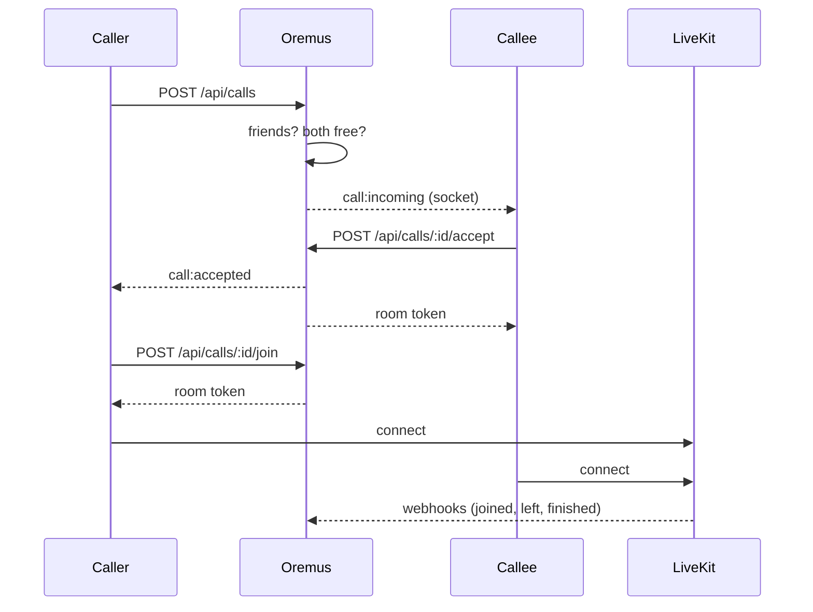

# Voice and video calls

One-to-one calls between friends, using [LiveKit](https://livekit.io) for media. Nothing is recorded, and calls do not pass through content moderation.

## Flow



`Call.status` is decided on the server. Every ending goes through `finishCall`, which only one caller can win, so hang-ups, webhooks and timeouts can race safely. Ending a call frees both people, closes the room and leaves a summary line in the chat.

| Situation | Result |
|---|---|
| No answer in 40 s | `missed`, plus a notification |
| Answered, but both are not in the room within 45 s | `failed` |
| Browser crash or network gone | LiveKit's webhook ends it |
| Either person blocks the other, or is suspended or banned | Ended at once |
| Page reloaded mid-call | The new page rejoins |

Room tokens only exist after an answer, last two minutes (for joining), open one room, and a voice call's token cannot publish a camera. `livekit.js` (about 560 KB) only loads when a call connects.

## Running it

Locally:

```bash
docker compose --profile calls up -d livekit
```

Then set in `.env`:

```
LIVEKIT_URL=ws://localhost:7880
LIVEKIT_API_KEY=devkey
LIVEKIT_API_SECRET=devsecret-devsecret-devsecret-devsecret
```

Calling buttons only appear when these are set.

On a VPS, set `LIVEKIT_NODE_IP` to the server's public address, use a long random key and secret, and:

1. Open in the firewall: `7881/tcp`, `50000-50200/udp`, `3478/udp`.
2. Proxy a subdomain to `127.0.0.1:7880` with HTTPS, and set `LIVEKIT_URL=wss://rtc.<your-domain>`. WebSockets must pass through.
3. Add `calls` to `COMPOSE_PROFILES`.

Browsers only allow the microphone and camera on HTTPS or localhost.

To use LiveKit Cloud instead, leave the profile off and set the three variables, plus `LIVEKIT_HOST`. Point its webhook at `https://<your-domain>/webhooks/livekit`.

## Limits

- **Closed tabs do not ring.** There is no web push yet, so someone with Oremus closed sees a missed call later.
- **Restrictive networks:** the Compose setup has TURN over UDP only. Networks that block UDP fall back to TCP on 7881, and some corporate networks will still fail without TURN over TLS on 443, which needs a certificate and is not configured.
- **One-to-one only**, because conversations are. LiveKit can do groups when that changes.
- **Tested** with two Chrome browsers and fake media through a local LiveKit server, not across real networks.
