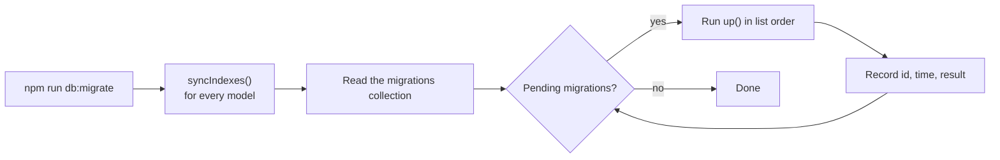

# Database setup and migrations

Everything you need to get a working MongoDB for Oremus, and to change its data safely later. For the collections themselves, see [Data model](DATA_MODEL.md).

## Fast setup (new machine)

MongoDB and Redis must be running. The quickest way is Docker:

```powershell
docker compose up -d mongo redis
```

Then, from the repository root:

```powershell
npm install
npm run db:setup
```

`db:setup` runs `migrate` (indexes + data migrations) and then `seed` (sample data). Sign in with `maya@example.com` / `CircleSpace123`.

Using the full Docker stack instead? The image ships compiled scripts:

```powershell
docker compose exec web node dist/scripts/migrate.js
docker compose exec web node dist/scripts/seed.js
```

The connection comes from `MONGODB_URI` in `.env` (default `mongodb://localhost:27017/oremus`). When running the app on your machine, it must point to `localhost`, not to the Docker host name `mongo`.

## Commands

Run from the repository root.

| Command | What it does | Safe to repeat? |
|---|---|---|
| `npm run db:setup` | `db:migrate`, then `seed` | Yes |
| `npm run db:migrate` | Syncs indexes for every model, then runs pending migrations in order | Yes |
| `npm run db:status` | Lists applied / pending migrations. Changes nothing | Yes |
| `npm run seed` | Upserts sample users, posts, a group, chats and stories | Yes |
| `npm run db:reset -- --yes` | **Drops the whole database.** Refuses when `NODE_ENV=production` or without `--yes` | Destructive |

Docker equivalents: `node dist/scripts/migrate.js --status`, `node dist/scripts/db-reset.js --yes`.

Start over from an empty database (deletes all local data, cannot be undone):

```powershell
npm run db:reset -- --yes
npm run db:setup
```

`db:reset` only clears MongoDB. Uploaded files (`apps/web/uploads`) and Redis caches are kept.

## How migrations work



- **Indexes** are declared on the Mongoose schemas in [`models/index.ts`](../apps/web/src/models/index.ts). `migrate` syncs every registered model, so a new index or collection needs no migration file. Production runs with `autoIndex: false`, so run `db:migrate` on every deploy.
- **Data migrations** live in [`apps/web/src/migrations/`](../apps/web/src/migrations/). Each one runs once per database; its `id` is stored in the `migrations` collection with the time it finished and its result line.
- Migrations run in the order of the list in [`migrations/index.ts`](../apps/web/src/migrations/index.ts). If one fails, the run stops and nothing is recorded for it, so fix the problem and run `db:migrate` again.

### Current migrations

| Id | What it does |
|---|---|
| `friendship-existing-chats-v1` | Turns old two-person chats into accepted friendships, because messaging now requires a friendship. Skipped when friendships or blocks already exist |

## Adding a migration

You need one when existing documents must change: a renamed field, a backfilled value, data moved between collections. New optional fields with a schema default usually don't (for example, stories without `style` simply read as `null`).

1. Copy [`migrations/_template.ts`](../apps/web/src/migrations/_template.ts) to the next number, e.g. `002-post-visibility-default.ts`.
2. Give it a unique `id` (add `-v1`) and a description. Never rename an `id` once it has shipped, or it will run again.
3. Write `up()`. Make it idempotent: filter for documents that still need the change, so running it twice does no harm. Return a short summary such as `updated 120 posts`.
4. Append it to the list in `migrations/index.ts`.
5. Check with `npm run db:status`, then apply with `npm run db:migrate`.

```ts
import { Post } from '../models/index.js';
import type { Migration } from './types.js';

export const postVisibilityDefault: Migration = {
  id: 'post-visibility-default-v1',
  description: 'Give posts without a visibility the public visibility.',
  async up() {
    const result = await Post.updateMany({ visibility: { $exists: false } }, { $set: { visibility: 'public' } });
    return `updated ${result.modifiedCount} posts`;
  }
};
```

Back up production before a migration that rewrites data (`mongodump --uri "$MONGODB_URI"`), since migrations only go forward.

## Troubleshooting

| Problem | Fix |
|---|---|
| `connect ECONNREFUSED 127.0.0.1:27017` | MongoDB isn't running: `docker compose up -d mongo redis` |
| `getaddrinfo ENOTFOUND mongo` | Running locally with the Docker `MONGODB_URI`. Use `mongodb://localhost:27017/oremus` |
| Index build fails with `E11000 duplicate key` | Existing data breaks a new unique index. Clean up the duplicates (a migration is a good place), then migrate again |
| Seed login doesn't work | Run `npm run seed` again; it resets the sample users' password |
