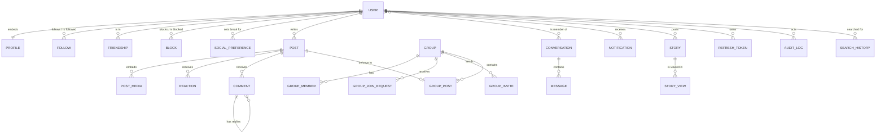

# Data model

All MongoDB collections are defined in one file: [`apps/web/src/models/index.ts`](../apps/web/src/models/index.ts). This page describes every collection, how they relate and why some data is embedded.

## Big picture

## Embed or separate collection?

| Embedded inside the parent | Separate collection |
|---|---|
| `profile` in `User` — always read with the user | `Follow`, `Friendship`, `Block` — many per user, change independently |
| `media` in `Post` — always shown with the post | `Reaction`, `Comment` — can be thousands per post |
| `memberIds` in `Conversation` — always two people | `GroupMember` — groups can be large |
| `rules`, `questions`, `settings` in `Group` | `Message` — grows without limit |
| `feeling`, `place` in `Post` | `Notification`, `StoryView` |

Counters such as `Post.reactionCount`, `Post.commentCount`, `Group.memberCount` and `Story.viewCount` are stored on the parent so lists can show them without counting each time.

## Common conventions

- `createdAt` and `updatedAt` are added automatically (`timestamps: true`).
- Soft delete: `deletedAt: null` means alive. Queries always filter `deletedAt: null`.
- `seedKey` (hidden) lets the seed script upsert sample data safely.
- Secrets are never selected by default (`select: false`): `passwordHash`, `passwordResetHash`.

## Collections

### User

| Field | Type | Notes |
|---|---|---|
| `email` | string | Unique, lowercase |
| `username` | string | Unique, 3–24 chars, lowercase |
| `displayName` | string | Max 60 |
| `passwordHash` | string | bcrypt, hidden |
| `profile` | Profile | Embedded, see below |
| `passwordResetHash`, `passwordResetExpiresAt` | string, date | Hidden; SHA-256 of the reset token |
| `lastSeenAt` | date | |
| `deletedAt` | date | Soft delete |

Text index on `displayName` and `username`.

**Profile (embedded):**

| Field | Type | Notes |
|---|---|---|
| `bio` | string | Max 240 |
| `location`, `hometown` | string | Current city and hometown, max 80 |
| `website` | string | http(s) URL |
| `avatarUrl`, `coverUrl` | string | Current photos |
| `avatarHistory`, `coverHistory` | string[] | Previous photos for the picker, newest first, max 12 |
| `privacy` | `public` or `followers` | Who can see any details at all |
| `storyAudience` | `public` or `followers` | Default story audience |
| `work` | WorkEntry[] | Max 10: `company`, `position`, `city`, `description`, `startDate`, `endDate`, `current` |
| `education` | EducationEntry[] | Max 10: `school`, `level` (`college` or `high_school`), `concentration`, `degree`, `startYear`, `endYear`, `graduated` |
| `links` | LinkEntry[] | Max 10: `platform` (`website`, `facebook`, `instagram`, `x`, `threads`, `tiktok`, `youtube`, `linkedin`, `github`, `discord`, `other`), `url` |
| `relationship` | string | e.g. `single`, `married`, `complicated`, or empty |
| `birthDay`, `birthMonth`, `birthYear` | number | Each optional |
| `gender` | string | `male`, `female`, `nonbinary`, `other` or empty |
| `pronouns` | string | `he/him`, `she/her`, `they/them` or empty |
| `languages`, `hobbies` | string[] | Max 10 and 20 |
| `phone`, `publicEmail` | string | Contact shown on the profile (not the login email) |
| `otherNames`, `about`, `quotes` | string | Max 60, 1000 and 500 |
| `introHidden` | string[] | Intro items turned off: `work`, `education`, `location`, `hometown`, `relationship`, `birthday`, `joined`, `followers`, `links`, `hobbies` |
| `audience` | object | One of `public`, `friends`, `only_me` for each of `work`, `education`, `location`, `hometown`, `birthday`, `birthYear`, `relationship`, `gender`, `pronouns`, `languages`, `contact`, `links`. `birthYear` and `contact` default to `only_me`, the rest to `public`. |

Work, education and link entries have their own `_id` so they can be edited and removed one by one. See [Profiles](PROFILES.md) for how these fields are shown and protected.

### Follow

One-way "A follows B". Unique on `(followerId, followingId)`.

### Friendship

Two-way relationship stored **once per pair**. The two ids are sorted so `userAId < userBId`; this makes "A and B" and "B and A" the same document.

| Field | Notes |
|---|---|
| `userAId`, `userBId` | Sorted pair, unique together |
| `requesterId` | Who sent the request |
| `status` | `pending` or `accepted` |
| `acceptedAt` | Used to sort the friends list |

### Block and SocialPreference

- `Block(blockerId, blockedId)` — unique pair. Checked in both directions.
- `SocialPreference(userId, targetId)` — the "take a break" settings:
  - `seeLess: true` hides the target's posts and stories from your home feed and tray.
  - `restrictPosts: true` stops the target from seeing your followers-only content.

### Post

| Field | Type | Notes |
|---|---|---|
| `authorId` | User | Indexed |
| `groupId` | Group or null | Set for group posts |
| `content` | string | Max 5000, HTML stripped |
| `media` | PostMedia[] | Embedded, unlimited |
| `visibility` | enum | `public`, `followers`, `private` |
| `feeling` | object or null | `{ type: 'feeling' or 'activity', key, text }` |
| `place` | object or null | `{ id, name, address, lat, lon }` from OpenStreetMap |
| `groupStatus` | enum | `approved`, `pending`, `declined` (group post approval) |
| `reactionCount`, `commentCount` | number | Cached counters |
| `editedAt`, `deletedAt` | date | |

Indexes: `(createdAt desc, authorId)`, text index on `content`.

**PostMedia (embedded, each has its own `_id`):**

| Field | Notes |
|---|---|
| `url` | `/uploads/<uuid>.<ext>` |
| `mimeType` | `image/webp` after compression, `video/mp4` after transcoding |
| `alt` | Optional alt text |
| `status` | `ready`, `processing` (video waiting for the worker), `failed` |
| `poster` | Poster image URL for videos |

### Reaction

`(userId, postId)` is unique, so each person has at most one reaction per post. `type` is one of `like`, `love`, `haha`, `wow`, `sad`, `angry`.

### Comment

`postId`, `authorId`, `content` (max 1500), `parentId` (null for top-level, otherwise the comment being replied to). Index `(postId, createdAt)`.

### Group

| Field | Notes |
|---|---|
| `name`, `slug` | `slug` is unique and used in URLs |
| `description`, `coverUrl`, `location`, `tags` | |
| `privacy` | `public` (anyone sees posts) or `private` (members only) |
| `visibility` | `visible` or `hidden` (not in directory or search) |
| `groupType` | `general`, `social`, `learning`, `hobbies`, `buy_sell`, `gaming`, `jobs`, `parenting`, `work` |
| `rules[]`, `questions[]` | Shown when joining a private group |
| `settings.whoCanPost` | `anyone` or `admins` |
| `settings.postApproval` | Member posts wait for admin approval |
| `settings.whoCanApprove` | Who reviews join requests: `admins` or `anyone` (any member) |
| `ownerId`, `memberCount` | |

Related collections:

- `GroupMember(groupId, userId, role)` — role is `admin`, `moderator` or `member`. Unique pair.
- `GroupJoinRequest` — `status` `pending` / `approved` / `rejected`, answers to questions, `agreedToRules`, reviewer.
- `GroupInvite(groupId, userId, invitedBy, byAdmin)` — invites from admins skip approval.
- `GroupPost(groupId, postId, authorId)` — index of posts per group.

### Conversation and Message

- `Conversation.memberIds` — always two users. `lastMessageAt` sorts the inbox.
- `Message` — `conversationId`, `senderId`, `content` (max 3000), `readBy[]` (user ids who have read it).

### Notification

`recipientId`, `actorId`, `type`, `entityType` + `entityId` (what it is about), `text`, `readAt`.

Types: `reaction`, `comment`, `follow`, `friend_request`, `friend_accept`, `group_request`, `group_invite`, `group_post`, `message`, `story_reaction`.

### Story and StoryView

- `Story` — `authorId`, `media` (photo) or `text` + `background`, `audience` (`public` / `followers`), `viewCount`, `expiresAt` (24 h after creation), `deletedAt`.
- `StoryView(storyId, viewerId, reaction)` — one row per viewer; `reaction` is null or one of `love`, `haha`, `angry`, `sad`, `like`.

### RefreshToken

`userId`, `tokenHash` (SHA-256, never the raw token), `family` (all tokens from one login), `expiresAt` (MongoDB TTL index deletes expired rows), `revokedAt`, `replacedByHash`, `userAgent`, `ip`.

### SearchHistory and SearchTerm

- `SearchHistory(userId, kind, key, query, refId)` — one row per keyword, profile or group a user searched for. `kind` is `query`, `user` or `group`. `key` is `q:<lowercase keyword>` or `<kind>:<id>`; it is unique per user, so repeating a search only updates `updatedAt`. At most 30 rows per user are kept. Indexes: `{ userId, key }` (unique) and `{ userId, updatedAt }`.
- `SearchTerm(term, count)` — how many times each lowercase keyword was searched across Oremus. Feeds keyword completions. Indexes: `term` (unique) and `count`.

See [Search and places](SEARCH_AND_PLACES.md#search-box-recent-searches-and-suggestions).

### AuditLog

`actorId`, `action` (e.g. `auth.login`, `post.delete`), `targetType`, `targetId`, `metadata`, `ip`. Written for important actions.

## Migrations and seed data

- `npm run db:migrate` runs [`scripts/migrate.ts`](../apps/web/src/scripts/migrate.ts). It syncs the indexes of every model and runs pending data migrations from [`src/migrations/`](../apps/web/src/migrations/); the `migrations` collection records which ones already ran. See [Database setup and migrations](DATABASE.md).
- `npm run seed` runs [`scripts/seed.ts`](../apps/web/src/scripts/seed.ts). It upserts sample users, posts, a group, conversations and stories. It is safe to run many times. The sample login is `maya@example.com` / `CircleSpace123`.

