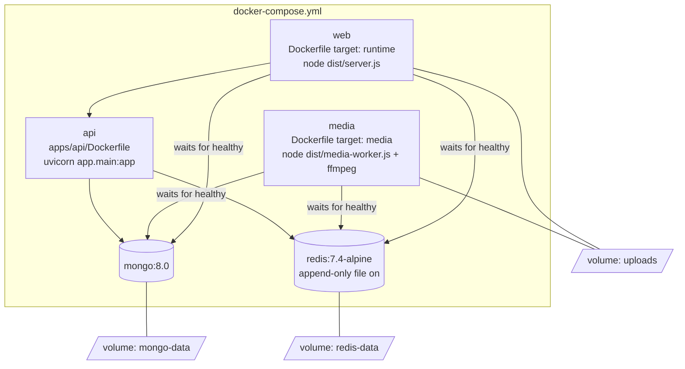
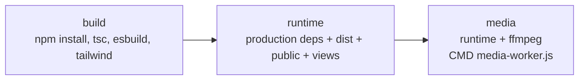
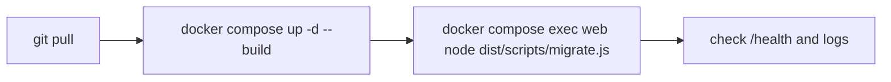

# Deployment and operations

How Oremus is packaged, which settings it needs, how to check that it is healthy, and what to change before a real production launch.

## Containers



### Web image build

`apps/web/Dockerfile` has three stages:



Both `web` and `media` come from the same build, so they always run the same code version.

## Environment variables

Set in `.env` (see `.env.example`). Docker Compose overrides the database hosts with the internal container names.

| Variable | Default | Used by | Meaning |
|---|---|---|---|
| `NODE_ENV` | `development` | web, media | `production` turns off automatic index creation and enables long asset caching |
| `WEB_PORT` | `3000` | web | HTTP port |
| `API_PORT` | `8001` | compose | Host port for FastAPI |
| `MONGO_DB_NAME` | `oremus` | compose | Database name |
| `MONGODB_URI` | `mongodb://localhost:27017/oremus` | web, media, api | MongoDB connection |
| `REDIS_URL` | `redis://localhost:6379` | web, media, api | Redis connection |
| `JWT_ACCESS_SECRET` | dev value | web | Signs access tokens. **Must be changed**, 32+ chars |
| `JWT_REFRESH_SECRET` | dev value | web | Signs refresh tokens. **Must be changed**, different from the access secret |
| `ACCESS_TOKEN_TTL` | `15m` | web | Access token lifetime |
| `REFRESH_TOKEN_DAYS` | `30` | web | "Remember me" session length |
| `COOKIE_SECURE` | `false` | web | Set `true` behind HTTPS |
| `FASTAPI_URL` | `http://localhost:8000` | web | Search service URL |
| `APP_ORIGIN` | `http://localhost:3000` | web | Allowed origin for Socket.IO |
| `PLACES_URL` | `https://photon.komoot.io` | web | Place search provider |
| `FFMPEG_PATH` | `ffmpeg` | media | Path to the ffmpeg binary |
| `LOG_LEVEL` | `info` | web, media | pino log level |

## Health checks

See [Caching](CACHING.md) for the complete HTTP and Redis cache policy and verification commands.

| Check | How | Healthy response |
|---|---|---|
| Web | `GET /health` | `{ ok: true, infrastructure: { mongodb: "ok", redis: "ok" } }` |
| Search API | `GET http://localhost:8001/health` | `{ status: "ok" }` |
| MongoDB / Redis | Built-in Compose health checks | `docker compose ps` shows `healthy` |
| Cache | `GET /api/dev/cache` (signed in) | Hit/miss counts and hit rate |
| Media worker | `docker compose logs media` | "Media worker is ready", then one line per compressed video |

## Logs

- The web app and worker log JSON with pino. Each HTTP request is logged with its `x-request-id`.
- Errors with status 500 are logged with the full error and request id. Users only see a generic message.
- `AuditLog` in MongoDB keeps important actions (register, login, post deletion).

```powershell
docker compose logs -f web
docker compose logs -f media
```

## Updating



Run the migration after every update that adds indexes. It is safe to run many times.

## Production checklist

| Item | Why |
|---|---|
| Strong, different JWT secrets | Anyone with the secret can sign in as any user |
| `NODE_ENV=production` | Correct caching and no automatic index building |
| HTTPS in front (reverse proxy) and `COOKIE_SECURE=true` | Cookies only over encrypted connections. `trust proxy` is already set to 1 |
| Correct `APP_ORIGIN` | Socket.IO rejects other origins |
| Do not expose MongoDB and Redis ports publicly | Compose maps them to the host for development only |
| Back up the `mongo-data` and `uploads` volumes | User data and files |
| Connect an email provider for password reset | Reset tokens are only shown in development |
| Move uploads to S3-compatible storage before scaling out | The local volume cannot be shared by many servers |
| Run exactly one `media` worker | The worker's crash recovery assumes it is alone |
| Allow enough upload size in the proxy | Videos can be up to 200 MB per file |
| Add `Story`, `StoryView` and `GroupInvite` to `scripts/migrate.ts` | With `autoIndex` off, their indexes are otherwise not created |

## Scaling notes

- **Web** can run several instances: sessions are stateless JWTs, rate limits and caches are in Redis, and Socket.IO uses the Redis adapter. Shared file storage is required first.
- **Search** is stateless and can scale freely.
- **Feed cache invalidation** increments a shared version in O(1); old generations expire after 45 seconds without a keyspace scan.
- **Search** uses regex queries. For large data, move to MongoDB Atlas Search or OpenSearch behind the same `/v1/search` API.
