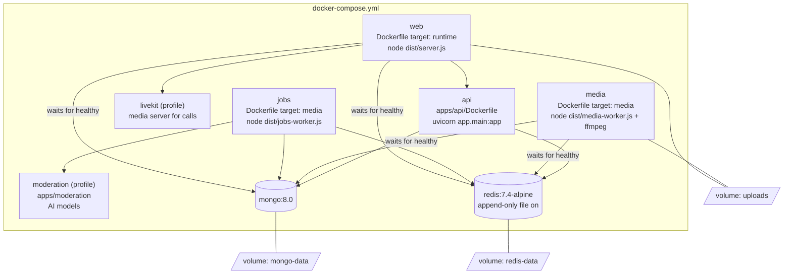
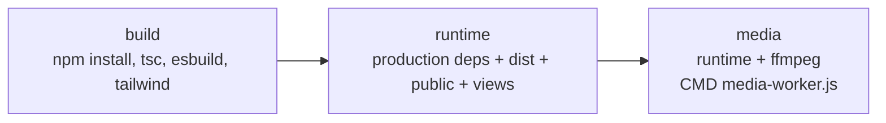
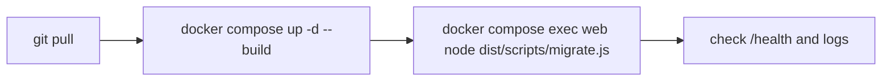

# Deployment and operations

How Oremus is packaged, which settings it needs, how to check that it is healthy, and what to change before a real production launch.

## Containers



### Web image build

`apps/web/Dockerfile` has three stages:



Both `web` and `media` come from the same build, so they always run the same code version.

## Environment variables

Set in `.env` (see `.env.example`). Docker Compose overrides the database hosts with the internal container names.

| Variable | Default | Used by | Meaning |
|---|---|---|---|
| `NODE_ENV` | `development` | web, media | `production` turns off automatic index creation and enables long asset caching |
| `WEB_PORT` | `3000` | web | HTTP port |
| `API_PORT` | `8001` | local development only | Optional host port when running the API outside production Compose |
| `MONGO_DB_NAME` | `oremus` | compose | Database name |
| `MONGODB_URI` | `mongodb://localhost:27017/oremus` | web, media, api | MongoDB connection |
| `REDIS_URL` | `redis://localhost:6379` | web, media, api | Redis connection |
| `JWT_ACCESS_SECRET` | dev value | web | Signs access tokens. **Must be changed**, 32+ chars |
| `JWT_REFRESH_SECRET` | dev value | web | Signs refresh tokens. **Must be changed**, different from the access secret |
| `ACCESS_TOKEN_TTL` | `15m` | web | Access token lifetime |
| `REFRESH_TOKEN_DAYS` | `30` | web | "Remember me" session length |
| `COOKIE_SECURE` | `false` | web | Set `true` behind HTTPS |
| `TRUST_PROXY` | `false` | web | Trusted reverse-proxy hop count; the production override pins this to `1` |
| `FASTAPI_URL` | `http://localhost:8000` | web | Search service URL |
| `APP_ORIGIN` | `http://localhost:3000` | web | Comma-separated allowed origins for Socket.IO |
| `PLACES_URL` | `https://photon.komoot.io` | web | Place search provider |
| `FFMPEG_PATH` | `ffmpeg` | media | Path to the ffmpeg binary |
| `LOG_LEVEL` | `info` | web, media | pino log level |
| `COMPOSE_PROFILES` | none | compose | Optional services to run: `moderation`, `calls` |
| `MODERATION_MODE` | `off` | web, jobs | `off`, `shadow` or `enforce`. See [Moderation](MODERATION.md) |
| `MODERATION_SECRET` | none | web, jobs, moderation | Shared secret for the AI service. Without it the service refuses everything |
| `MODERATION_THREADS` / `MODERATION_MEMORY` | `2` / `3g` | moderation | CPU threads and memory limit |
| `AD_TOKEN_SECRET` | derived | web | Signs ad view and click tokens |
| `VNPAY_TMN_CODE` / `VNPAY_HASH_SECRET` | none | web | VNPay credentials. See [Ads](ADS.md) |
| `VNPAY_HOST` / `VNPAY_RETURN_URL` | sandbox / derived | web | VNPay address and return page |
| `LIVEKIT_URL` / `LIVEKIT_API_KEY` / `LIVEKIT_API_SECRET` | none | web, jobs | Calling is off while unset. See [Calls](CALLS.md) |
| `LIVEKIT_NODE_IP` | `127.0.0.1` | livekit | The server's public address |
| `ADMIN_JS_TMP_DIR` | `.adminjs` | web | Where the admin panel's client is bundled. Compose sets it |

## Health checks

See [Caching](CACHING.md) for the complete HTTP and Redis cache policy and verification commands.

| Check | How | Healthy response |
|---|---|---|
| Web | `GET /health` | `{ ok: true, infrastructure: { mongodb: "ok", redis: "ok" } }` |
| Search API | Run its `/health` check from inside the Compose network | `{ status: "ok" }` |
| MongoDB / Redis | Built-in Compose health checks | `docker compose ps` shows `healthy` |
| Cache | `GET /api/dev/cache` (signed in) | Hit/miss counts and hit rate |
| Media worker | `docker compose logs media` | "Media worker is ready", then one line per compressed video |

## Logs

- The web app and worker log JSON with pino. Each HTTP request is logged with its `x-request-id`.
- Errors with status 500 are logged with the full error and request id. Users only see a generic message.
- `AuditLog` in MongoDB keeps important actions (register, login, post deletion).

```powershell
docker compose logs -f web
docker compose logs -f media
```

## Updating



Run the migration after every update that adds indexes. It is safe to run many times.

## One-command VPS deployment

On a Linux VPS, prepare `.env` once with strong JWT secrets and the public URL in
`APP_ORIGIN`, then run. The script combines `docker-compose.yml` with
`docker-compose.prod.yml`, which forces production mode, secure cookies, and one
trusted reverse-proxy hop:

```sh
sudo sh scripts/deploy-vps.sh
```

The equivalent npm alias is `sudo npm run deploy:vps` when `npm` is available
on root's `PATH`.

The deploy command validates the Compose configuration, builds and starts the
containers, runs database migrations, and waits for the web health check. The web
port is bound to `127.0.0.1` for a local HTTPS reverse proxy. MongoDB, Redis, and
the internal search API are available only on the private Compose network.

Configure Caddy, Nginx, or an equivalent reverse proxy to terminate HTTPS on
ports 80/443 and forward to `127.0.0.1:WEB_PORT`. Do not expose `WEB_PORT`
through the host or cloud firewall.

## Production checklist

| Item | Why |
|---|---|
| Strong, different JWT secrets | Anyone with the secret can sign in as any user |
| `NODE_ENV=production` | Correct caching and no automatic index building |
| HTTPS in front (reverse proxy) | Production refuses HTTP origins, forces secure cookies, trusts one proxy hop, and binds the app to loopback |
| Correct `APP_ORIGIN` | Socket.IO rejects other origins |
| Do not expose MongoDB, Redis, or FastAPI ports | Production Compose keeps all three on its private network |
| Limit post media | A request accepts at most 12 files; the reverse proxy should also enforce a total request-body limit |
| Back up the `mongo-data` and `uploads` volumes | User data and files |
| Connect an email provider for password reset | Reset tokens are only shown in development |
| Move uploads to S3-compatible storage before scaling out | The local volume cannot be shared by many servers |
| Make the first admin with `grant-role` | See [Admin](ADMIN.md). Add two-factor sign-in for staff before launch |
| Try `MODERATION_MODE=shadow` before `enforce` | See [Moderation](MODERATION.md), including what the models cannot detect |
| Run exactly one `media` worker | The worker's crash recovery assumes it is alone |
| Allow enough upload size in the proxy | Videos can be up to 200 MB per file |
| Run `dist/scripts/migrate.js` after schema changes | Production has `autoIndex` off; the migration synchronizes indexes for all exported models |

## Scaling notes

- **Web** can run several instances: sessions are stateless JWTs, rate limits and caches are in Redis, and Socket.IO uses the Redis adapter. Shared file storage is required first.
- **Search** is stateless and can scale freely.
- **Feed cache invalidation** increments a shared version in O(1); old generations expire after 45 seconds without a keyspace scan.
- **Search** uses regex queries. For large data, move to MongoDB Atlas Search or OpenSearch behind the same `/v1/search` API.
