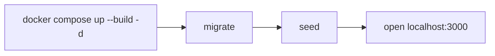
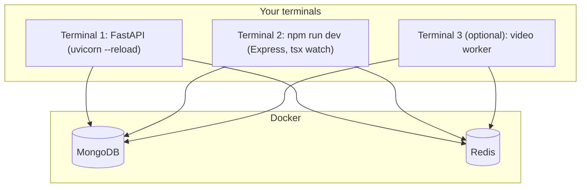

# Development guide

How to set up Oremus for the first time, run it, and use the everyday commands.

## 1. Requirements

- Git
- Node.js 22 or newer, with npm
- Python 3.13 or newer
- Docker Desktop with Docker Compose
- ffmpeg (only if you run the video worker outside Docker)

Check versions:

```powershell
node --version
npm --version
python --version
docker --version
docker compose version
ffmpeg -version
```

## 2. Environment variables

From the repository root:

```powershell
Copy-Item .env.example .env
```

Open `.env` and replace `JWT_ACCESS_SECRET` and `JWT_REFRESH_SECRET` with two **different** secrets of at least 32 characters. You can generate one with PowerShell (run it twice):

```powershell
[Convert]::ToBase64String([Security.Cryptography.RandomNumberGenerator]::GetBytes(48))
```

All variables are explained in [Deployment](DEPLOYMENT.md#environment-variables).

Default ports:

| Service | URL / port |
|---|---|
| Express web | `http://localhost:3000` |
| FastAPI | `http://localhost:8001` |
| FastAPI interactive docs | `http://localhost:8001/docs` |
| MongoDB | `localhost:27017` |
| Redis | `localhost:6379` |

## 3. Option A: run everything with Docker

The quickest way to get the full system running.



```powershell
docker compose up --build -d
docker compose ps
docker compose exec web node dist/scripts/migrate.js
docker compose exec web node dist/scripts/seed.js
```

Open `http://localhost:3000` and sign in with the sample account:

- Email: `maya@example.com`
- Password: `CircleSpace123`

### Logs

```powershell
docker compose logs -f web
docker compose logs -f media
docker compose logs -f api
```

Press `Ctrl+C` to stop following; containers keep running.

### Applying code changes

Compose does not mount the source code. After changing code, rebuild the service:

```powershell
docker compose up -d --build web media
docker compose up -d --build api
```

### Stopping

```powershell
docker compose down
```

This keeps MongoDB, Redis and uploaded files. To delete **all** local data as well (cannot be undone):

```powershell
docker compose down -v
```

## 4. Option B: run the source locally

Best while developing: the server reloads when you save. MongoDB and Redis still run in Docker.



### Step 1: start the databases

If the full Docker stack is running, stop the app containers first so ports do not clash:

```powershell
docker compose stop web media api
docker compose up -d mongo redis
```

### Step 2: install Node dependencies

```powershell
npm install
```

### Step 3: create a Python virtual environment

```powershell
python -m venv .venv
.\.venv\Scripts\Activate.ps1
python -m pip install --upgrade pip
python -m pip install -r apps/api/requirements.txt
```

If PowerShell blocks the activate script, call `.\.venv\Scripts\python.exe` directly.

### Step 4: prepare data

```powershell
npm --workspace @oremus/web run migrate
npm run seed
```

### Step 5: start FastAPI (terminal 1)

```powershell
Set-Location apps/api
python -m uvicorn app.main:app --reload --port 8001
```

### Step 6: start the web app (terminal 2)

```powershell
npm run dev
```

`tsx` restarts the server when TypeScript changes. Client code and styles are built once at start; after editing `apps/web/src/views-or-client/app.ts` or `styles.css`, rebuild:

```powershell
npm --workspace @oremus/web run build:client
npm --workspace @oremus/web run build:css
```

### Step 7 (optional): start the video worker (terminal 3)

```powershell
npm --workspace @oremus/web run dev:worker
```

Without it, videos still upload and play, but they are not compressed. See [Media](MEDIA.md).

## 5. Commands

Run from the repository root:

| Purpose | Command |
|---|---|
| Run Express in dev mode | `npm run dev` |
| Run the video worker in dev mode | `npm --workspace @oremus/web run dev:worker` |
| Production build | `npm run build` |
| Type-check | `npm run typecheck` |
| Lint | `npm run lint` |
| Web tests | `npm test` |
| FastAPI tests | `python -m pytest -q apps/api/tests` |
| MongoDB indexes + migrations | `npm --workspace @oremus/web run migrate` |
| Sample data | `npm run seed` |
| Check Docker Compose file | `docker compose config --quiet` |
| Container status | `docker compose ps` |

Before handing over code, run:

```powershell
npm run typecheck
npm run lint
npm test
npm run build
python -m pytest -q apps/api/tests
docker compose config --quiet
```

## 6. Tests

| Suite | File | Covers |
|---|---|---|
| Core | `tests/core.test.ts` | Password policy, post/reaction validation, ownership, friendship states |
| Page auth | `tests/page-auth.test.ts` | Protected pages redirect, API returns 401, validation messages |
| Social | `tests/social.test.ts` | Friend controls HTML, block authorization |
| Stories and posts | `tests/story.test.ts` | Story audience and tray order, view helpers, profile and group validation, feelings, post media layout |
| Media | `tests/media.test.ts` | Image resize, WebP, EXIF removal, rotation, animation, ffmpeg arguments |
| Ranking | `apps/api/tests/test_ranking.py` | Feed scoring formula |

## 7. Where to add things

```mermaid
flowchart LR
  Need["New feature"] --> Model["1. Model field or collection<br/>models/index.ts"]
  Model --> Validator["2. Zod schema<br/>validators/index.ts"]
  Validator --> Service["3. Business rule<br/>services/*.service.ts"]
  Service --> Controller["4. Thin handler<br/>controllers/*.ts"]
  Controller --> Route["5. Route + middleware<br/>routes/*.ts"]
  Route --> View["6. Markup<br/>views/*.ejs"]
  View --> Client["7. Interactivity<br/>views-or-client/app.ts"]
  Client --> Test["8. Test<br/>tests/*.test.ts"]
  Test --> Docs["9. Update docs/"]
```



## 8. Troubleshooting

### Docker still shows the old version

Rebuild and restart the service, then reload the page:

```powershell
docker compose up -d --build web
```

### Port 3000 or 8001 is already in use

Change `WEB_PORT` or `API_PORT` in `.env` and restart Docker Compose.

### The web app cannot connect to MongoDB or Redis

```powershell
docker compose ps
docker compose logs --tail 100 mongo redis web
```

When running the web app locally, `MONGODB_URI` and `REDIS_URL` in `.env` must point to `localhost`, not to Docker host names.

### "Your form expired"

Reload the page to get a new CSRF token and submit again.

### Videos stay "Optimizing video…"

The video worker is not running. Start it (Docker `media` service or `dev:worker`) and check its logs.

### Duplicate sample data

The seed script uses upserts, so it is safe to run again. For a completely clean database, stop the stack and remove the volumes as shown above (this deletes all local data).
