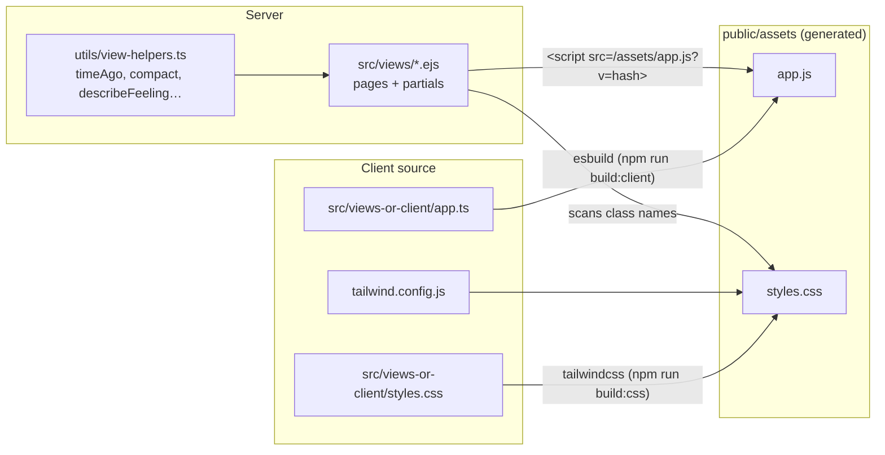
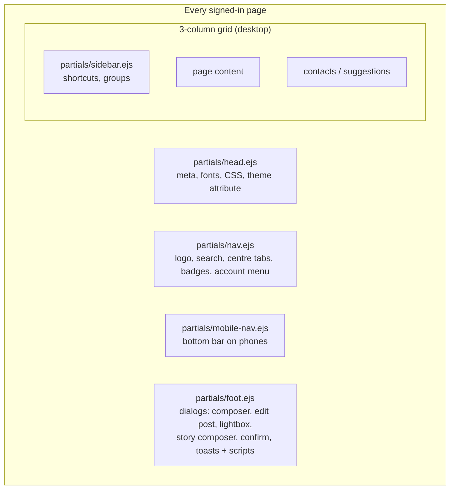
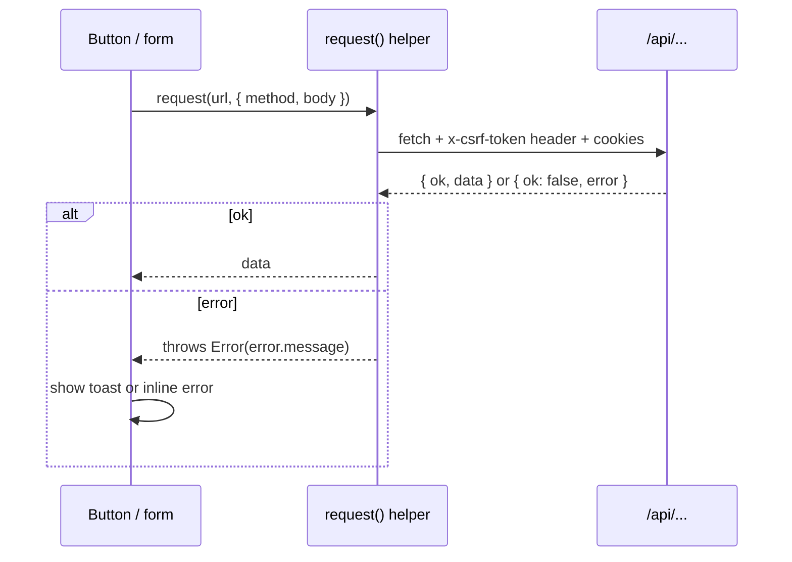
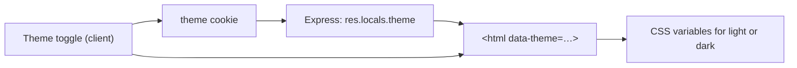

# Frontend: views, client script and styles

The UI is rendered on the server with EJS. One TypeScript file adds interactivity, and Tailwind CSS provides the styles. There is no client framework.

## How the pieces connect

Built files get a `?v=<hash>` suffix (`assetVersion()` in `app.ts`), so browsers always load the latest build.

> After changing `app.ts` or `styles.css`, run `npm --workspace @oremus/web run build:client` or `build:css`. `npm run dev` builds both once at start.

## Pages

| URL | View | Needs login |
|---|---|---|
| `/` | `home.ejs` — story tray, composer, feed, shortcuts, contacts | Yes |
| `/login`, `/register`, `/reset-password` | `auth/*.ejs` | No |
| `/profile/:username` | `profile.ejs` — tabs: posts, about (`?tab=about&section=`), media (`?tab=media&type=&sort=`) | No |
| `/posts/:postId` | `post.ejs` — single post with all comments | No (public posts) |
| `/groups` | `groups/index.ejs` — directory | No |
| `/groups/:slug`, `/g/:groupId` | `groups/detail.ejs` | No (visible groups) |
| `/stories`, `/stories/:username` | `stories/index.ejs` — full-screen viewer | Yes |
| `/stories/archive` | `stories/archive.ejs` | Yes |
| `/messages`, `/messages/:conversationId` | `messages.ejs` | Yes |
| `/notifications` | `notifications.ejs` | Yes |
| `/search` | `search.ejs` | Yes |
| `/settings` | `settings.ejs` — profile, photos, story audience, theme | Yes |

## Page layout

Reusable partials:

| Partial | Purpose |
|---|---|
| `post-card.ejs` | One post: header, text, media grid, reactions, comments |
| `comment.ejs` | One comment |
| `composer.ejs` | "What's on your mind?" box that opens the composer dialog |
| `story-tray.ejs` | Row of story circles |
| `avatar.ejs` | Avatar image or coloured initials |
| `follow-button.ejs`, `friend-controls.ejs` | Relationship buttons |
| `break-dialog.ejs` | Take a break / block dialog |
| `profile-dialogs.ejs` | Edit profile, Edit details (Intro switches), photo picker and cropper |
| `post-extra-views.ejs`, `post-place-card.ejs` | Feeling/activity picker, check-in search and map card shared by the Create post and Edit post dialogs |
| `profile-intro.ejs` | Intro card on the profile Posts tab |
| `profile-about.ejs` | About tab: section nav, detail rows, inline editors, audience selectors |
| `media-tile.ejs` | Square photo or video tile with play button and owner menu |
| `search-box.ejs` | Search field with the recent/suggestions dropdown (header and `/search`) |
| `icons.ejs` | Inline SVG sprite: icons (`#i-*`) and reaction emoji (`#r-*`) |

## Client script (`app.ts`)

The script is organised in sections. Each section looks for its elements by `data-*` attributes, so it only runs where the markup exists.

| Section | What it does |
|---|---|
| Shared helpers | `$`, `$$`, `request()` (fetch with CSRF header and JSON errors), toasts, avatars |
| Theme | Light / dark / system switch, saved in the `theme` cookie |
| API forms | Any `<form data-api-form>` is sent with `fetch`; shows errors inline, redirects or reloads on success |
| Confirm dialog | Promise-based "Are you sure?" |
| Menus | `
` dropdowns close on outside click |
| Reactions | Hover bar with six reactions, optimistic update of the card |
| Composer | Create post dialog, feeling/activity picker, check-in search with map, emoji picker |
| Photo picker and cropper | Choose or upload avatar/cover, then pan and zoom before saving |
| Photo actions | Draft photo/video tiles in the composer and edit dialog, "…" menus on media |
| Viewer | Full-screen photo/video viewer with zoom, arrows and the post column (react, comment) |
| Groups | Create/edit group dialog, join questions, invites |
| Global click delegation | One `click` listener handles follow, friend, block, copy link, delete and more via `data-*` |
| Inline comments | Post a comment without reloading |
| Messenger | Send messages, append incoming ones, Socket.IO listeners |
| Story viewer | Progress bars, auto-advance, pause, reactions, replies, viewers list |
| Profile About | `<select data-autosubmit>` saves an audience as soon as it changes; `data-profile-item-delete` removes a workplace, school or link; "I currently work here" hides the end date |

The search dropdown lives in its own module, [`search-box.ts`](../apps/web/src/views-or-client/search-box.ts), imported by `app.ts`. It sets up every `<form data-search-box>` on the page. See [Search and places](SEARCH_AND_PLACES.md#search-box-recent-searches-and-suggestions).

### Talking to the server

## Styling and theming

- Tailwind CSS 3 with design tokens in `tailwind.config.js`.
- Colours are CSS variables (`--c-ink`, `--c-surface`, `--c-brand-500`, …) defined in `styles.css` for light and dark.
- Dark mode follows the `data-theme` attribute on `<html>`: `light`, `dark`, or `system` (uses the OS setting).
- The theme is read from the cookie on the server, so the first paint already has the right colours (no flash).
- Font: Be Vietnam Pro, chosen because Vietnamese diacritics render well at every weight.
- Component classes (`.card`, `.btn-primary`, `.input`, `.media-grid`, `.field-bare`, …) live in `styles.css`.

## Accessibility notes

- Dialogs use the native `<dialog>` element (focus trap and Escape for free).
- Icon-only buttons have `aria-label`s.
- Keyboard users get a visible focus ring (`:focus-visible`). Borderless writing areas use `.field-bare` because the dialog around them already shows focus.
- Reactions, menus and the viewer can be used with the keyboard (arrow keys in the viewer).
- The search field is an ARIA combobox: arrow keys move through suggestions, Tab accepts the inline completion, Esc closes.
