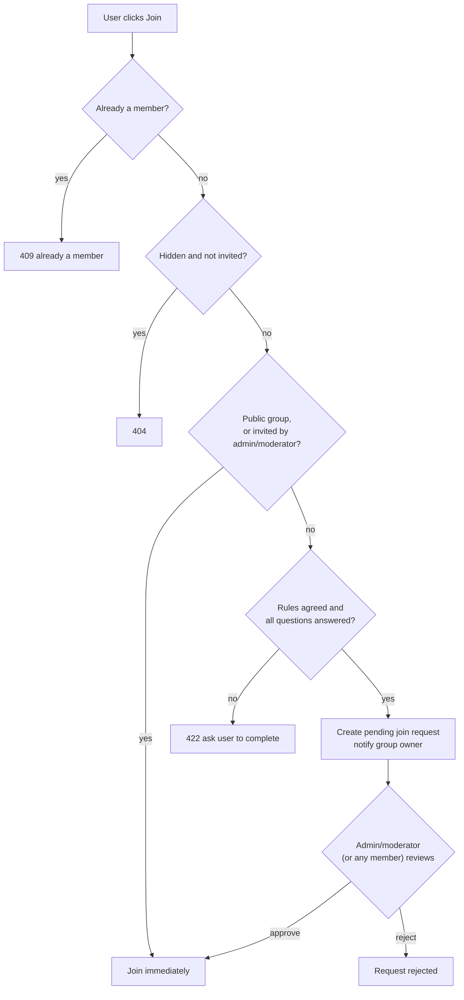
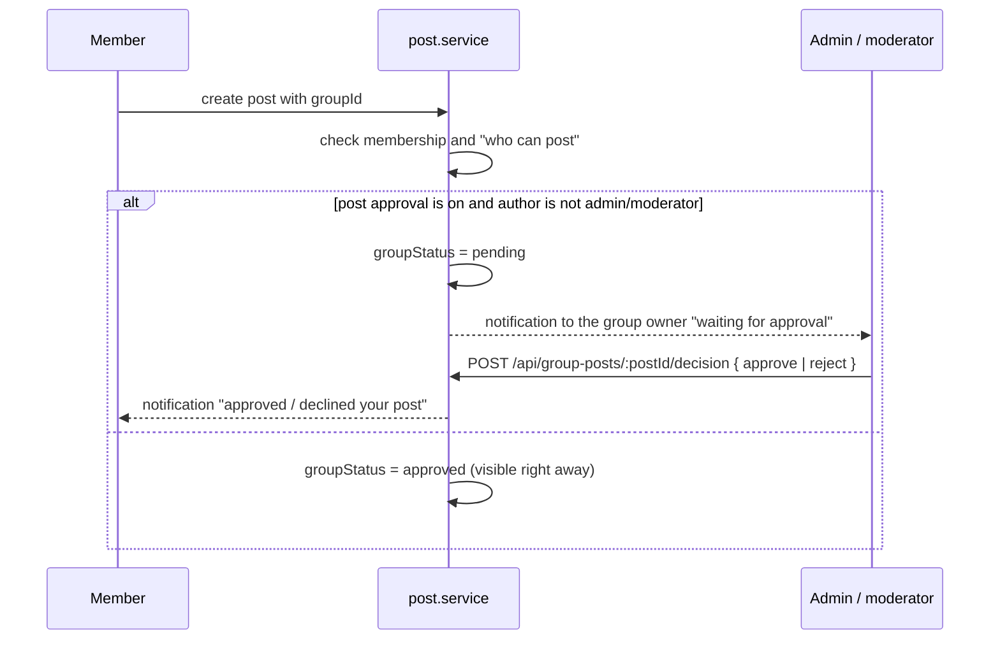

# Groups

Groups are communities with their own feed, members and rules.

Main files:

- [`services/group.service.ts`](../apps/web/src/services/group.service.ts)
- Views: `views/groups/index.ejs` (directory), `views/groups/detail.ejs` (a group), `views/groups/_dialogs.ejs` (create, edit, join, invite)

## Group settings

| Setting | Options | Meaning |
|---|---|---|
| Privacy | `public` / `private` | Who can see posts and members. Public: anyone. Private: members only. |
| Visibility | `visible` / `hidden` | Hidden groups do not appear in the directory or search. Only members and invited people can open them. Only private groups can be hidden. |
| Who can post | `anyone` / `admins` | Restrict posting to admins and moderators |
| Post approval | on / off | Member posts wait for an admin or moderator |
| Who can approve members | `admins` / `anyone` | Let any member review join requests |
| Rules | up to 10, title + details | Must be accepted to join a private group |
| Membership questions | up to 3 | Must be answered to join a private group |
| Type, location, tags, cover | | Shown on the group card |

The cover can be uploaded, picked from built-in artwork, or picked from the creator's own photos.

## Roles

| Role | Can do |
|---|---|
| `admin` | Everything: edit settings, review members and posts, invite. The creator is an admin. |
| `moderator` | Review members and pending posts, post when posting is admin-only, invite (invites skip approval) |
| `member` | Post (if allowed), invite (invites still need approval), review requests if "anyone" can approve |

The group creator cannot leave the group.

## Joining

## Inviting

`POST /api/groups/:groupId/invites { userIds }`

- Only members can invite.
- Invite candidates are people you follow or who follow you, who are not already members.
- Each invited person gets a `group_invite` notification.
- If the inviter is an admin or moderator, the invite lets the person join without approval.

## Posting in a group

Pending and declined posts never appear in the group feed or the home feed. Admins and moderators see the pending queue on the group page; the author sees how many of their posts are waiting.

## Where group posts appear

- On the group page (`/groups/:slug`), for anyone who can see the group.
- In the home feed of every member.
- Not in search (search only returns public posts outside groups).

## Group page tabs

The group page is split into tabs. Each tab is its own URL, so it can be linked and reloaded.

| Tab | URL | Who sees it | Content |
|---|---|---|---|
| Discussion | `/groups/:slug` | Everyone who can see the group | Composer, posts, short About card with **See more**, rules. Admins also get a "Needs your review" banner when there are requests or pending posts. |
| About | `?tab=about` | Everyone | Description, privacy and visibility explained, type, location, tags, creation date; **Activity** (new posts today, posts and new members in the last month); rules; admins and moderators |
| Members | `?tab=members` | Everyone (the full list only for public groups or members) | Admins and moderators, then the 200 newest members |
| Member requests | `?tab=requests` | People who can approve requests | Pending join requests with answers |
| Pending posts | `?tab=pending` | Admins and moderators | Posts waiting for approval |

- An unknown tab, or a tab the viewer may not open, shows the Discussion.
- Admins and moderators are listed on About and Members even for private groups, as on Facebook.
- Old links that used anchors (`#about`, `#rules`, `#requests`, `#pending-posts`) are sent to the matching tab by `app.ts`.

## Caching

Group details are cached for 3 minutes under `group:{id}` and cleared when settings or membership change. `memberCount` is updated with `$inc` when people join or leave.
