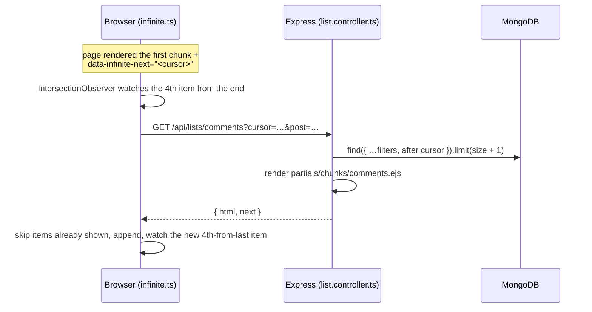

# Endless lists (infinite scroll)

Every list that can grow without limit loads in chunks while the user scrolls. A page renders only the first chunk; the next one is requested when the reader reaches the item **4 positions from the end** (photo grids start a little earlier), so it is usually ready before they get there.

## Which lists

| List | Page | Chunk size | Direction | Order / cursor |
|---|---|---:|---|---|
| `feed` | Home | 10 posts | down | Follow priority, then newest (offset) |
| `group-posts` | Group → Discussion | 10 posts | down | Newest first (time) |
| `profile-posts` | Profile → Posts (and profile search) | 10 posts | down | Newest first (time) |
| `profile-media` | Profile → Media | 12 posts' photos/videos | down | Newest, oldest, most reactions or comments (offset) |
| `comments` | Post page and photo viewer | 10 top-level comments + their replies | down | Oldest first (time) |
| `messages` | Chat and mini chat | 30 messages | **up** (older above) | Newest first (time) |
| `conversations` | Chat list | 20 chats | down | Latest activity (time) |
| `notifications` | Notifications (All / Unread) | 20 | down | Newest first (time) |
| `story-archive` | Story archive | 20 stories | down | Newest first (time) |
| `groups` | Groups directory | 12 groups | down | Most members (offset) |
| `group-members` | Group → Members | 20 members | down | Newest first (time) |

Story trays are not chunked: they only hold stories from the last 24 hours. Search results come from the FastAPI service (top 24).

## How it works



### Server

- **One endpoint:** `GET /api/lists/:name?cursor=…` in [`list.controller.ts`](../apps/web/src/controllers/list.controller.ts). A registry maps each name to a loader and to the partial in `views/partials/chunks/<name>.ejs`. Pages include the **same partial** for their first chunk, so items loaded later look and behave exactly the same.
- **Loaders re-check access** because chunks are fetched on their own: private groups need membership, profile posts follow the same visibility rules as the profile page, chats need friendship, and notifications, chats and the archive need a signed-in user. Public profiles and groups also work signed out.
- **Cursors** ([`utils/paginate.ts`](../apps/web/src/utils/paginate.ts)):
  - Time cursors `t<ms>_<id>` mean "items after this one". New items arriving at the top never shift later chunks, so nothing is repeated or skipped. The `_id` breaks ties between items with the same timestamp.
  - Offset cursors `o<n>` are used where the order is not by time (feed priority, member count, reactions).
  - Each query fetches one row more than the chunk size. That extra row only tells whether another chunk exists, so no count query is needed.
  - Malformed cursors are ignored and never reach MongoDB.
- **Totals come from the database**, not from loaded items: a post's comment count, a chat's message count and start date, group member count, and the profile's photo and video counts.

### Browser

[`infinite.ts`](../apps/web/src/views-or-client/infinite.ts) turns any server-rendered list into an endless list:

```html
<ul data-infinite="comments" data-infinite-next="<cursor>" data-infinite-query="post=123">…</ul>
```

| Attribute | Meaning |
|---|---|
| `data-infinite` | List name (endpoint and partial) |
| `data-infinite-next` | Cursor for the next chunk; empty when everything is shown |
| `data-infinite-query` | Extra query parameters (post id, group id, filters) |
| `data-infinite-root` | Scroll container: `self` or a CSS selector. Default is the page |
| `data-infinite-reverse` | Load older items at the top (chat). The reading position is kept |
| `data-infinite-prefetch` | Trigger distance in items (default 4) |
| `[data-infinite-done="name"]` | Element shown once the list is complete ("You're all caught up", the chat intro) |

- Items carry `data-key` (post cards use `data-post-id`). Items already on the page are skipped, for example when a new post shifts an offset-based chunk.
- A spinner shows while loading. A failed chunk shows **Try again** and is retried automatically when the connection returns.
- New items get the few per-element bindings they need (maps, comment forms, long-press reactions, story text styles) through `initDynamic()`. Everything else uses delegated listeners.
- The photo viewer comments and the mini chat build their items in JavaScript. They use `createInfiniteList()` directly with the raw items, which the endpoint also returns for those lists (`items`).
- Images keep `loading="lazy"`, so photos inside loaded chunks download only when they near the screen.

## Adding a new endless list

1. Write a loader that returns `{ items, next }` with `afterCursor` / `cursorSort` / `timeChunk` (or the offset helpers), and check access inside it.
2. Register it in `LISTS` in `list.controller.ts`.
3. Move the item markup into `views/partials/chunks/<name>.ejs`, give each item a `data-key`, and include it from the page.
4. Put `data-infinite`, `data-infinite-next` and any `data-infinite-query` on the list container.
