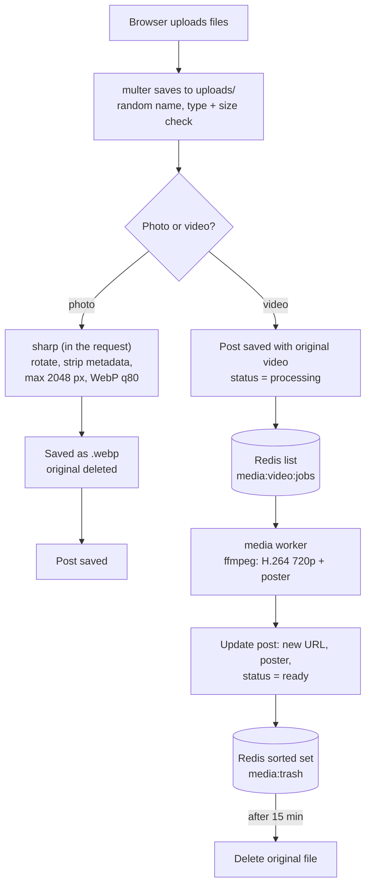
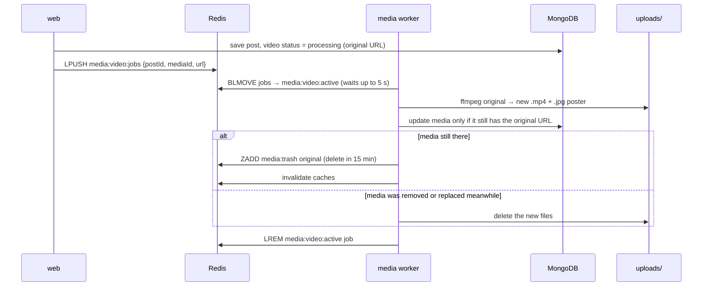
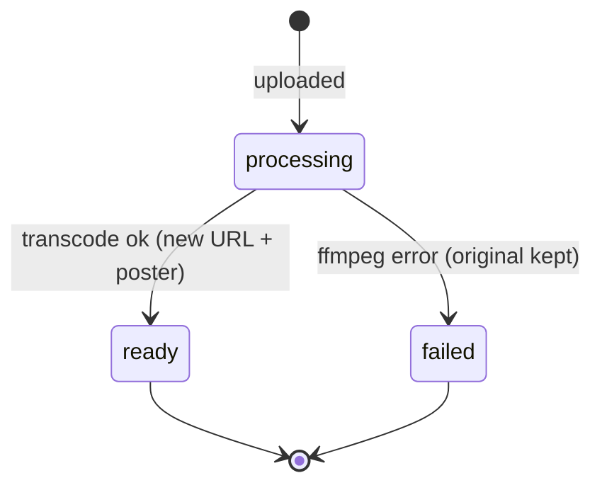

# Media uploads and compression

Photos and videos are compressed on the server so pages load fast and storage stays small, while quality stays good.

Main files:

- [`middleware/upload.ts`](../apps/web/src/middleware/upload.ts) — accepted types and size limits (multer)
- [`media/image.ts`](../apps/web/src/media/image.ts) — image compression with sharp
- [`media/video.ts`](../apps/web/src/media/video.ts) — ffmpeg settings
- [`media/queue.ts`](../apps/web/src/media/queue.ts) — Redis job queue
- [`media-worker.ts`](../apps/web/src/media-worker.ts) — the background worker

## Accepted files

| Where | Types | Max size per file | Count |
|---|---|---|---|
| Posts | JPEG, PNG, WebP, GIF, MP4, WebM, MOV | Photos 20 MB, videos 200 MB | Unlimited |
| Avatar, cover, group cover, story | JPEG, PNG, WebP, GIF | 20 MB | 1 (avatar + cover together on profile edit) |

Uploaded files get a random UUID name and are stored in `apps/web/uploads/`, served at `/uploads/<name>`.

## The full pipeline

## Photos

Photos are compressed **during the upload request**, because it is fast (about 100 ms per photo). This applies to every image upload: posts, avatars, covers, group covers and stories.

| Setting | Value | Reason |
|---|---|---|
| Output format | WebP | 25–35% smaller than JPEG at the same quality; supported by all modern browsers |
| Quality | 80 | Looks almost the same as the original |
| Max size | 2048 px on the long edge | Sharp on any screen; a 12 MP phone photo becomes ~3 MP |
| Rotation | Applied from EXIF | Photos from phones always appear the right way up |
| Metadata | Removed | Removes GPS location and camera details (privacy) |
| Animated GIF/WebP | Kept animated | Converted to animated WebP, usually much smaller |
| Flat graphics | Lossless WebP if smaller | Screenshots and logos can grow with lossy compression |

If a file cannot be read as an image the request fails with `422 INVALID_IMAGE` and all uploaded files are removed.

## Videos

Video compression is slow (seconds to minutes), so it runs in the background.

| Setting | Value | Reason |
|---|---|---|
| Codec | H.264 video + AAC audio in MP4 | Plays in every browser and phone |
| Max size | 1280 px on the long edge (720p) | Good on phones and laptops, much smaller than 1080p/4K |
| Quality | CRF 23, max 4 Mbps | Balanced quality and size |
| Frame rate | Max 30 fps | 60 fps doubles the size for little visible gain on a feed |
| Speed preset | `faster` | Keeps CPU time reasonable on a small server |
| Audio | 128 kbps stereo | |
| Metadata | Removed | Removes GPS and device info |
| `faststart` | On | Playback can start before the whole file downloads |
| Poster | One representative frame as JPEG | The feed shows the poster instead of loading the video |

A test 6-second 1080p 60 fps clip went from 16.8 MB to 1.1 MB in about 3 seconds.

### Video job lifecycle

Important behaviour:

- **No waiting for users.** The post appears at once and plays the original video until the compressed one is ready. The author sees an "Optimizing video…" label.
- **Safe swaps.** The worker updates the post only if the media entry still points to the original file. If the author edited the post in the meantime, the result is discarded.
- **Old links keep working.** The original file is deleted 15 minutes after the swap, so pages that were already open can still play it.
- **Failures are safe.** If ffmpeg fails, the media is marked `failed` and the original keeps playing.
- **Crash recovery.** Jobs being processed are kept in `media:video:active`. When the worker starts, it moves them back to the queue.
- **One worker only.** Run a single worker instance; the crash recovery assumes no other worker is running.
- **Timeout.** A single ffmpeg run is killed after 20 minutes.

### Video states

## Running the worker

| Environment | How |
|---|---|
| Docker | The `media` service in `docker-compose.yml` (includes ffmpeg) |
| Local | `npm --workspace @oremus/web run dev:worker` (needs `ffmpeg` on PATH, or set `FFMPEG_PATH`) |

Without the worker, videos still upload and play; they are compressed once a worker runs.

## Tuning

The settings are constants at the top of the files:

| What | File | Constant |
|---|---|---|
| Photo max size and quality | `media/image.ts` | `IMAGE_MAX_EDGE`, `IMAGE_QUALITY` |
| Video max size and quality | `media/video.ts` | `VIDEO_MAX_EDGE`, `VIDEO_CRF`, and the ffmpeg arguments |
| Upload size limits | `middleware/upload.ts` | `IMAGE_MAX_BYTES`, `VIDEO_MAX_BYTES` |
| Grace period before deleting originals | `media-worker.ts` | `ORIGINAL_GRACE_MS` |

## Limits

- Media that existed before compression was added is not re-processed.
- Files removed from a post (edit, delete) stay on disk.
- Files are on a local volume. For several servers, move to S3-compatible storage.
