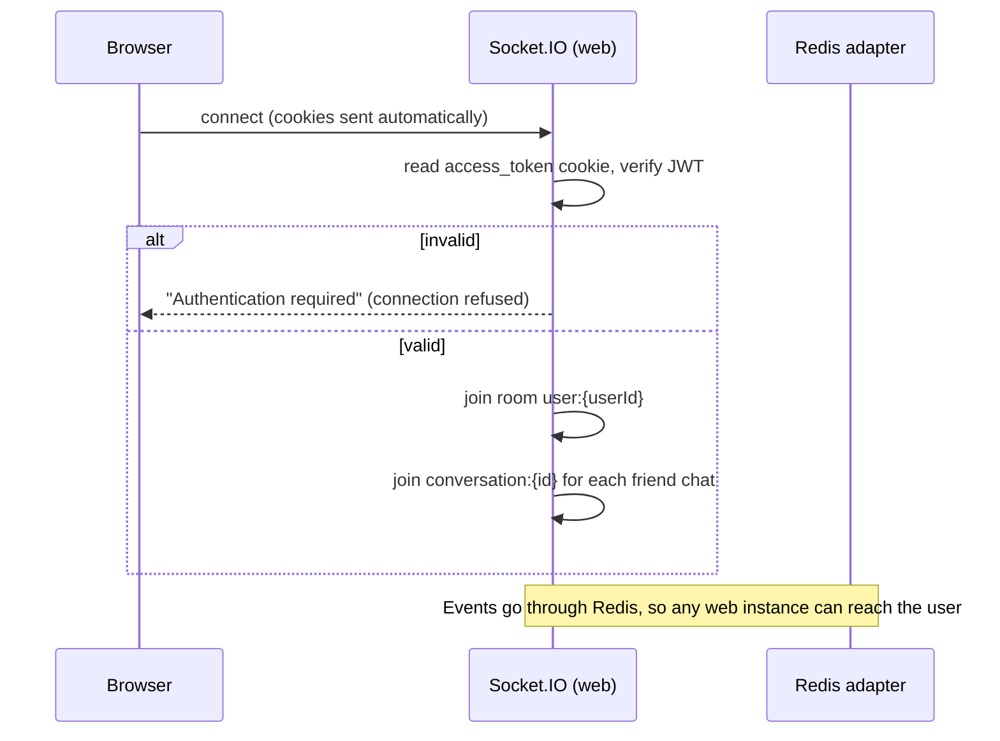
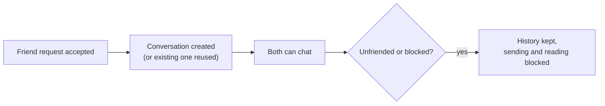
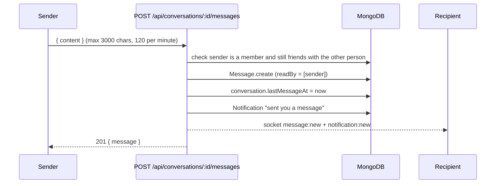
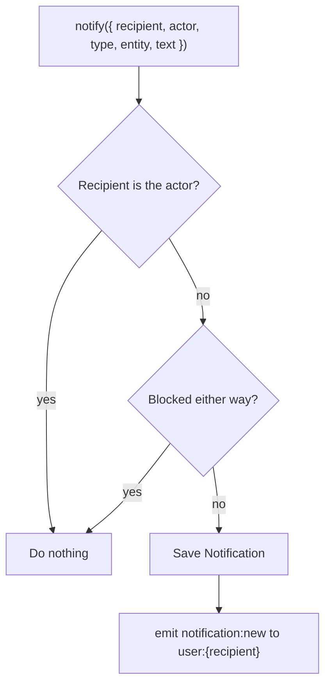

# Messaging, notifications and real-time events

Main files:

- [`services/message.service.ts`](../apps/web/src/services/message.service.ts) — conversations and messages
- [`services/notification.service.ts`](../apps/web/src/services/notification.service.ts) — `notify()` and `emitUserEvent()`
- [`sockets/index.ts`](../apps/web/src/sockets/index.ts) — Socket.IO server
- Client: the "Messenger" section of [`views-or-client/app.ts`](../apps/web/src/views-or-client/app.ts)

## Real-time connection

Services never talk to Socket.IO directly. They call `emitUserEvent(userId, event, payload)`, which sends the event to the room `user:{userId}`.

### Events sent to the browser

| Event | When | What the client does |
|---|---|---|
| `notification:new` | A notification is created for you | Shows a toast and increases the bell badge (skipped for messages in the chat you have open) |
| `message:new` | Someone sends you a message (or story reply) | Appends the message if that chat is open |
| `friendship:changed` | A friendship action involving you | Updates friend and follow buttons; on the Messages page it reloads the inbox |
| `social:changed` | Block or unblock involving you | Reloads the page (or the inbox) so hidden content disappears |

### Events sent by the browser

| Event | Purpose |
|---|---|
| `conversation:join` | Join a conversation room when opening a chat (only allowed if you are friends) |

## Messaging

Chat is one-to-one and **only between friends**.

### Sending a message

- `/messages` lists conversations with friends, newest first, with the last message and an unread flag.
- Opening `/messages/:conversationId` marks all messages as read (adds you to `readBy`).
- The header badge counts conversations that have unread messages.
- Story replies are sent as normal messages that start with "Replied to your story:".

## Notifications

`notify()` is the single function that creates notifications.

| Type | Triggered by |
|---|---|
| `reaction` | Someone reacts to your post |
| `comment` | Someone comments or replies on your post |
| `follow` | Someone follows you |
| `friend_request` | Someone sends you a friend request (removed if cancelled/declined/accepted) |
| `friend_accept` | Someone accepts your request |
| `group_request` | Someone asks to join your group |
| `group_invite` | Someone invites you to a group |
| `group_post` | A post waits for approval, or your post was approved/declined |
| `message` | A new chat message |
| `story_reaction` | Someone reacts to your story |

- `/notifications` shows the inbox. `GET /api/notifications` returns it as JSON.
- `POST /api/notifications/read` marks all as read.
- The header badge counts unread notifications, ignoring people in a block relationship.
