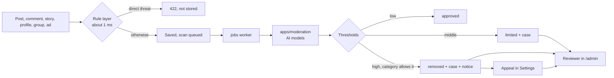

# Content moderation

Self-hosted, so nothing leaves the server. A write passes through three layers, and a person has the last word.

## Modes

`MODERATION_MODE`:

| Mode | What happens |
|---|---|
| `off` | Nothing is scanned or refused. The default. |
| `shadow` | Everything is scanned and recorded in `ModerationScan`. Members notice nothing, even for a would-be refusal. |
| `enforce` | Decisions apply. |

Run `shadow` on real traffic first, and read `ModerationScan` in the admin panel before switching.

## What each status means

Defined in `moderation/visibility.ts`. A missing status means approved, so older content needs no migration.

| Status | Who sees it |
|---|---|
| `pending` | Everyone. Text waiting for its scan, usually seconds. |
| `held` | Only the author. Photos and videos waiting for their scan. |
| `approved` | Everyone. |
| `limited` | Opens by direct link, but stays out of feeds, suggestions and search until a person decides. |
| `removed` | Only the author and staff. Files move to `uploads/.quarantine`, which `/uploads` cannot serve. |

Files already in a browser's or service worker's cache cannot be recalled.

## The models

`apps/moderation` is a small FastAPI service with pinned model revisions. It takes about 1.45 GB of memory once loaded, and about 190 ms per short text on two CPU threads. The first start downloads about 2.5 GB.

| Model | Used for | License |
|---|---|---|
| `tarudesu/ViHateT5-base-HSD` | Vietnamese | **None declared.** The card asks for a citation. Clear this with the author before commercial use. |
| `unitary/multilingual-toxic-xlm-roberta` | Other languages | Apache-2.0 |
| `Falconsai/nsfw_image_detection` | Images and video frames | Apache-2.0 |

Text with Vietnamese diacritics goes to the first; text without them that looks like Vietnamese goes to both, because unaccented abuse is common.

## Measured results

`python apps/moderation/eval/evaluate.py` scores 169 hand-labelled Vietnamese samples in `eval/vi_samples.tsv`. Re-run it after changing a model or threshold. These samples were written for this project rather than drawn from real traffic, so treat the numbers as an upper bound.

| Score | Threshold | Precision | Recall |
|---|---|---|---|
| harassment | 0.6 | 0.955 | 0.914 |
| harassment | 0.9 | 1.000 | 0.714 |
| harassment | 0.97 | 1.000 | 0.529 |
| hate | 0.7 | 0.333 | 0.800 |
| hate | 0.95 | 0.238 | 0.250 |

Auto-removal needs precision of at least 0.9 at the block threshold, and that decided the defaults in `moderation.service.ts`:

- **harassment** may auto-remove, at 0.97.
- **hate** may not. The model also labels plain insults as hate, so it can only raise a case.
- **sexual** may not. Across 300 ordinary profile photos, one portrait of a woman scored 0.9989 and another 0.70, so a person always decides.

Admins can change these per category under *Moderation Policy*.

## What it does not do

- **Images:** the model only looks for nudity. It does not recognize violence or gore.
- **Child safety:** this is not a CSAM solution. There is no hash matching or reporting pipeline, and that needs a legal process of its own before launch.
- **Video:** only up to five frames are sampled.
- **Audio** and **calls** are not scanned.
- **Private messages** only get the rule layer. They never reach the models.

## Rule layer

`moderation/rules.ts`. A `block` refuses the write, so it only holds phrases with no innocent reading (direct threats). A `flag` never blocks: it sets a floor on the score so a person looks at it. Accented Vietnamese terms are matched as written because stripping marks turns insults into everyday words ("lồn" and "lon", a can).

## Reviewing

Cases are in the admin panel under *Safety*, highest priority first. There is at most one open case per item, and new signals pile onto it.

- **Remove content** takes it down and records a strike: a warning, then 24 hours, then 7 days. After that, staff are told a ban is recommended. A ban is never automatic.
- **Keep content** restores it.
- **Reports** raise priority but never take anything down, so a pile-on cannot silence someone.
- **Appeals:** the author gets one, from Settings. Granting it restores the content and removes the strike. Quarantined files are deleted after 30 days, after which a restored post has no media.

If a scan keeps failing, the content goes live rather than being stuck, and media goes to a person to check. The dashboard shows failed jobs.
