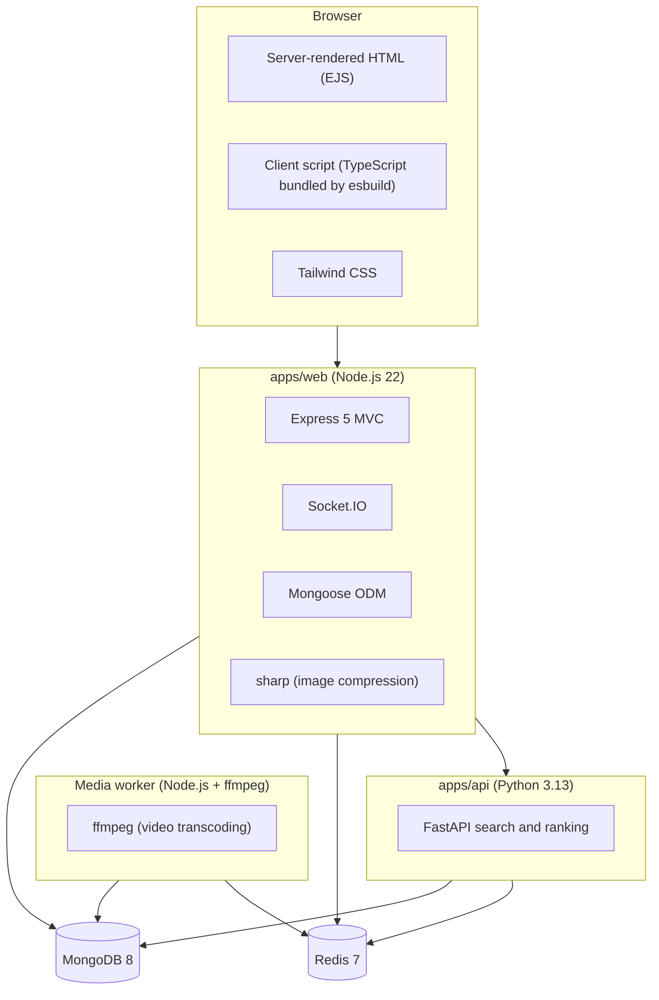
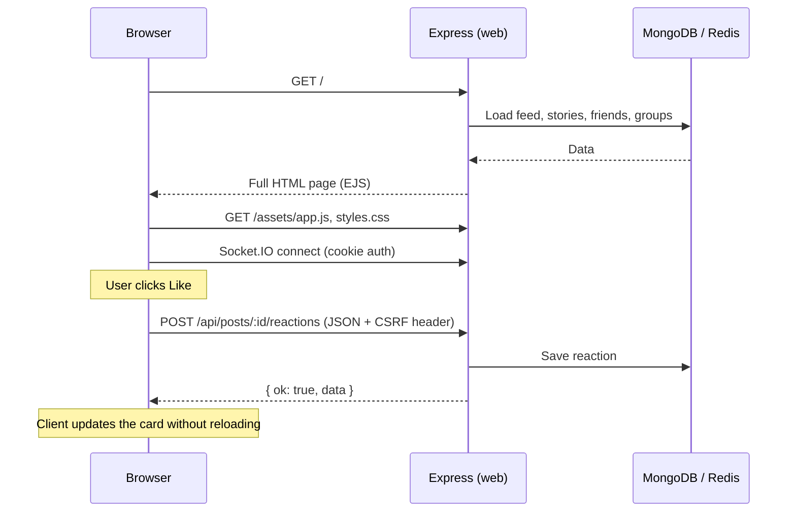

# Overview

Oremus is a full-stack social network. People can sign up, build a profile, post text, photos and videos, react and comment, add friends, follow people, join groups, chat in real time, share 24-hour stories and get notifications.

This page is the starting point. It explains what the product does, which technologies it uses and where the code lives. The other pages in [`docs/`](README.md) go deeper into each area.

## What users can do

| Area | Features |
|---|---|
| Account | Register, log in (with "remember me"), log out, reset password |
| Profile | Avatar and cover (pick from library or upload and crop), Facebook-style Intro and About (work, education, places, contact, basic info, relationship, hobbies), per-detail audience, Media tab with photo/video filter and sort |
| Posts | Text, unlimited photos and videos, feeling/activity, check-in with a map, visibility (public / followers / only me), edit, move to trash |
| Engagement | Six reactions (like, love, haha, wow, sad, angry), threaded comments, share link |
| Feed | Home feed that puts people you follow first, then newest posts |
| People | Follow (one-way), friendship (two-way, request/accept), "take a break", block |
| Groups | Public/private and visible/hidden groups, rules, membership questions, join requests, invites, post approval, admin/moderator roles |
| Search | Results for people, posts and groups; header dropdown with recent searches, typeahead suggestions and inline completion |
| Messaging | One-to-one chat between friends, delivered live with Socket.IO |
| Stories | Photo or text stories that disappear after 24 hours, viewers list, reactions, replies that go to chat, archive |
| Notifications | Live inbox for reactions, comments, follows, friend requests, group events, messages and story reactions |
| Search | Users, posts and groups in one search box |
| Display | Light, dark or system theme; responsive layout with mobile bottom navigation |

## Technology stack



| Layer | Technology | Why |
|---|---|---|
| Web server | Express 5, TypeScript | Simple MVC; pages and JSON API in one app |
| Views | EJS templates + Tailwind CSS | Fast first paint, no client framework needed |
| Client behaviour | One TypeScript file bundled with esbuild | Dialogs, reactions, uploads, chat, story viewer |
| Database | MongoDB with Mongoose | Flexible documents with schema validation and indexes |
| Cache, queues, rate limits | Redis | Feed/profile/search cache, rate limits, token denylist, Socket.IO adapter, video job queue |
| Real time | Socket.IO with Redis adapter | Live messages, notifications and relationship updates |
| Search | FastAPI (Python) | Separate service for cross-collection search |
| Media | sharp and ffmpeg | Smaller uploads with good quality |
| Validation | Zod | Every request body is checked before it reaches a service |
| Tests | Vitest, Supertest, pytest | Unit and HTTP tests |

## Repository layout

```text
Oremus/
├── apps/
│   ├── web/                     Express app, views, client code, media worker
│   │   ├── src/
│   │   │   ├── app.ts           Express setup and middleware order
│   │   │   ├── server.ts        HTTP + Socket.IO entry point
│   │   │   ├── media-worker.ts  Background video worker entry point
│   │   │   ├── config/          Environment, database, logger
│   │   │   ├── controllers/     HTTP handlers (thin)
│   │   │   ├── middleware/      Auth, CSRF, rate limit, uploads, errors
│   │   │   ├── media/           Image and video compression, job queue
│   │   │   ├── models/          All Mongoose schemas
│   │   │   ├── routes/          Page, auth and API routes
│   │   │   ├── services/        Business rules
│   │   │   ├── sockets/         Socket.IO server
│   │   │   ├── validators/      Zod request schemas
│   │   │   ├── views/           EJS templates
│   │   │   ├── views-or-client/ Browser TypeScript and Tailwind source
│   │   │   ├── scripts/         migrate.ts, seed.ts
│   │   │   └── tests/           Vitest tests
│   │   ├── public/assets/       Built CSS/JS, icons, images
│   │   └── uploads/             User uploads (local disk)
│   └── api/                     FastAPI search and ranking service
├── docs/                        This documentation
├── docker-compose.yml           MongoDB, Redis, api, web, media
└── .env.example                 Environment variable template
```

## How a page is built

Most screens are rendered on the server, then the client script adds interactivity.



## Where to go next

- New to the project? Read [Development](DEVELOPMENT.md) to run it locally.
- Want the big picture? Read [Architecture](ARCHITECTURE.md).
- Working on a feature? Jump to its page from the [documentation index](README.md).
