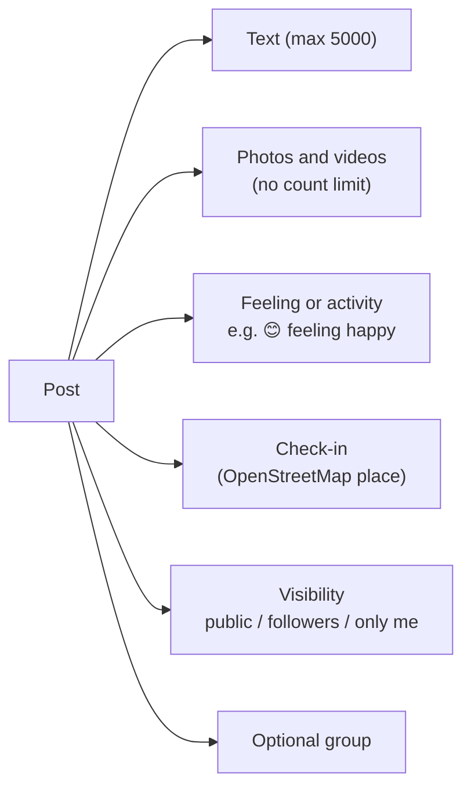
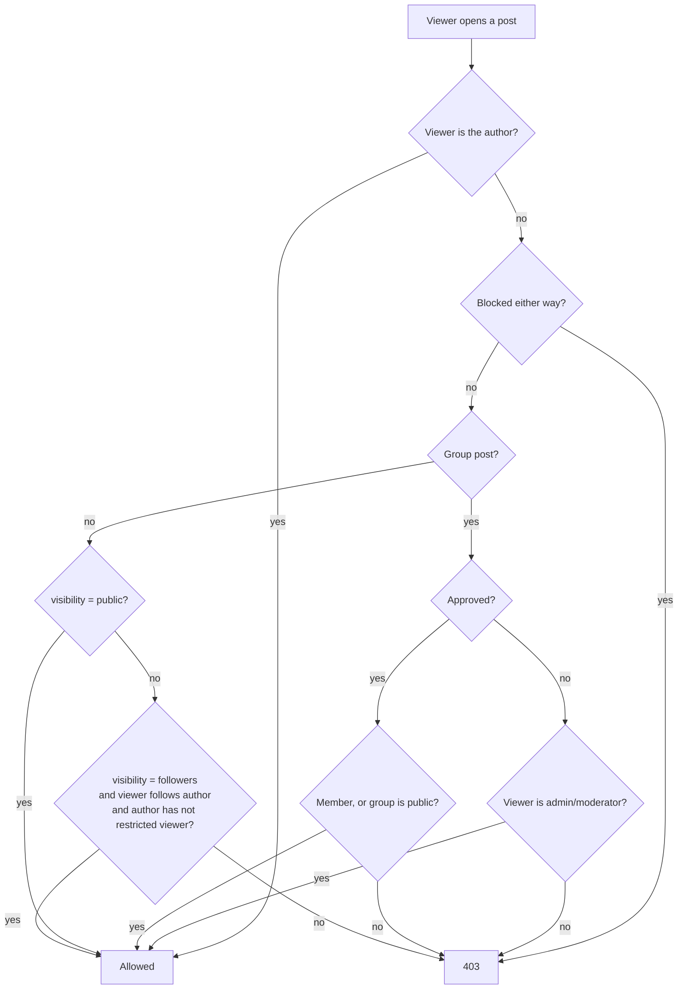
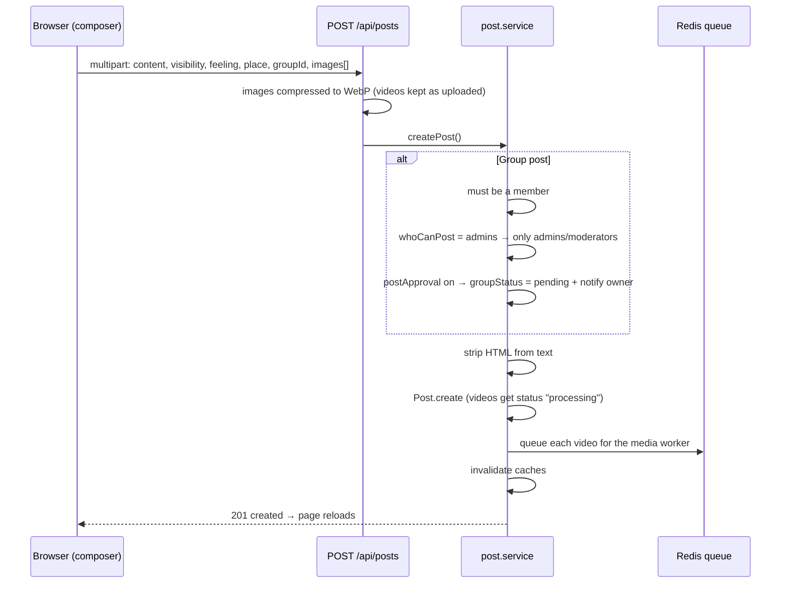
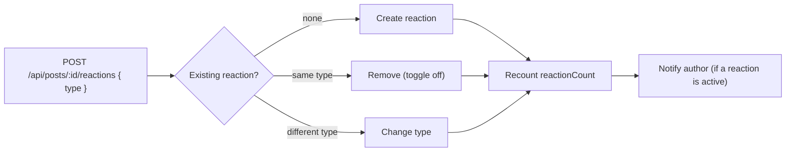
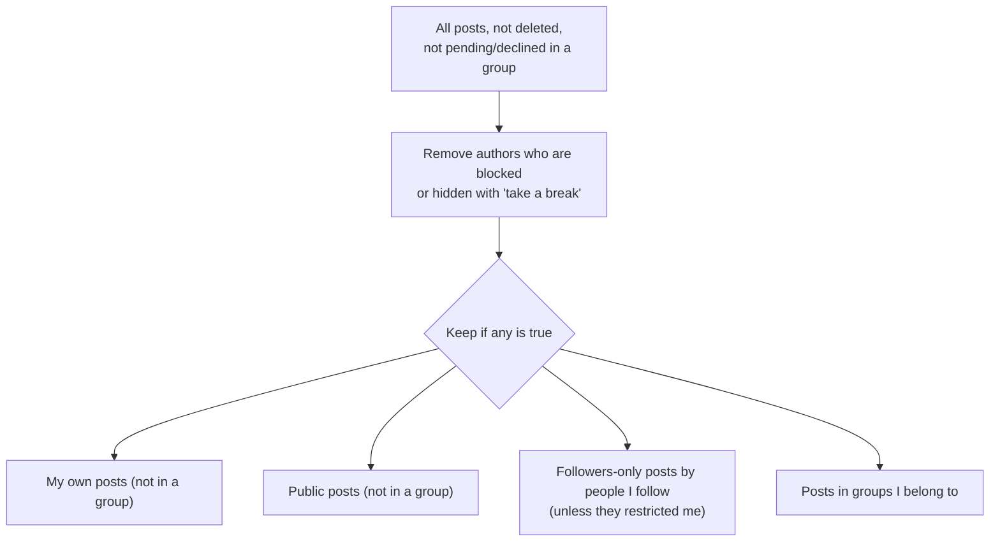

# Posts, reactions, comments and the home feed

Main files:

- [`services/post.service.ts`](../apps/web/src/services/post.service.ts) — create, edit, delete, react, comment, access rules
- [`services/feed.service.ts`](../apps/web/src/services/feed.service.ts) — home feed query and search proxy
- [`views/partials/post-card.ejs`](../apps/web/src/views/partials/post-card.ejs) — how a post looks
- [`views/partials/foot.ejs`](../apps/web/src/views/partials/foot.ejs) — composer and edit dialogs

## What a post can contain

A post needs at least one of: text, a photo/video, a feeling, or a check-in.



## Who can see a post

`assertCanAccessPost()` decides. The author can always see their own post.



Signed-out visitors can only open public posts that are not in a private group.

## Creating a post



`feeling` and `place` are sent as JSON strings inside the multipart form and validated by Zod (`postFeelingSchema`, `postPlaceSchema`).

## Editing a post and its media

**Edit post** opens a dialog laid out like **Create post**. The owner can change:

| What | How |
|---|---|
| Text | Text box with an emoji button |
| Audience | Public / Followers / Only me selector under the name. Not shown for group posts: they follow the group's privacy, and the server ignores `visibility` for them. |
| Feeling or activity | **Add to your post → 😊**; the same picker as Create post, including **Remove feeling/activity** |
| Check-in | **Add to your post → 📍**; place search or "Use my current location". The × on the map card removes it. |
| Photos and videos | Replace or remove from each tile, or add more with **Add to your post → 🖼** |

The current values come from the card's `data-post-edit` attribute (only rendered for the post's owner). The feeling and check-in views are the shared partial [`post-extra-views.ejs`](../apps/web/src/views/partials/post-extra-views.ejs), wired by `initPostExtras()` in `app.ts` for both dialogs.

`feeling` and `place` in the edit request work like this:

| Field value | Result |
|---|---|
| Not sent | Left as it is (older clients and API callers keep working) |
| `""` or `"null"` | Removed |
| JSON string | Replaced (validated like on create) |

The edit dialog always sends both, so removing a feeling or check-in is saved.

The edit dialog also sends a `layout` array describing the final order of media:

```json
[{ "id": "665f..." }, { "upload": 0 }, { "id": "6660..." }, { "upload": 1 }]
```

- `{ "id": ... }` keeps an existing photo/video.
- `{ "upload": n }` takes the n-th newly uploaded file.
- Anything not listed is removed.

Single media items can also be changed from their "…" menu:

| Action | Endpoint |
|---|---|
| Replace one photo/video | `PUT /api/posts/:postId/media/:mediaId` |
| Remove one photo/video | `DELETE /api/posts/:postId/media/:mediaId` (an empty post is moved to trash) |
| Move post to trash | `DELETE /api/posts/:postId` (soft delete, logged in AuditLog) |

## Media layout in the feed

The card shows at most five tiles. More media show a "+N" overlay on the last tile; the viewer can browse all of them.

| Count | Layout |
|---|---|
| 1 | Full width (a single video plays inline) |
| 2 | Two squares side by side |
| 3 | One tall tile on the left, two on the right |
| 4 | 2 × 2 grid |
| 5+ | Two tiles on top, three below, "+N" on the last |

```text
 1           2            3             4             5+
┌──────┐   ┌───┬───┐   ┌───┬───┐    ┌───┬───┐    ┌────┬────┐
│      │   │   │   │   │   │   │    │   │   │    │    │    │
│      │   └───┴───┘   │   ├───┤    ├───┼───┤    ├──┬─┴┬───┤
└──────┘               │   │   │    │   │   │    │  │  │+N │
                       └───┴───┘    └───┴───┘    └──┴──┴───┘
```

Clicking a tile opens the full-screen viewer with the post column (reactions and comments). Arrow keys move between items; videos play with controls.

## Reactions

There are six reactions: like, love, haha, wow, sad, angry.



`withReactionSummary()` adds `myReaction` and the three most used reaction types (`topReactions`) to each post for the stats row.

## Comments

- `POST /api/posts/:id/comments { content, parentId? }`
- `parentId` makes it a reply. The parent must belong to the same post.
- Comments from blocked users are hidden.
- The author of the post gets a notification.

### Editing and deleting comments

Hovering a comment shows a **…** button (always visible on phones) with **Edit** and **Delete**, like Facebook. It works the same on the post page, in a feed card and in the photo/video viewer.

| Who | Edit | Delete |
|---|---|---|
| The comment's author | Yes | Yes |
| The post's author | No | Yes, any comment on their post |
| Group admins and moderators (group posts) | No | Yes, any comment on the post |
| Anyone else | No | No |

- **Edit** turns the bubble into a text box. **Enter** saves, **Shift+Enter** adds a new line, **Esc** cancels. Saved comments show an **Edited** label (hover it for the time).
- **Delete** asks for confirmation. Deleting a top-level comment also deletes its replies. The post's comment count is recounted and every copy of the comment on the page is removed.
- Deletes are soft (`deletedAt`). When someone deletes another person's comment as a moderator, it is written to the AuditLog as `comment.delete`.
- `GET /api/posts/:postId` returns `canModerate` so the viewer knows whether to offer **Delete** on other people's comments.

| Action | Endpoint |
|---|---|
| Edit | `PATCH /api/comments/:commentId { content }` (1–1500 chars, 60 per hour) |
| Delete | `DELETE /api/comments/:commentId` → `{ removed: [ids], commentCount, postId }` |

## Sharing

**Share** opens a Facebook-style dialog ([`share-dialog.ejs`](../apps/web/src/views/partials/share-dialog.ejs), [`services/share.service.ts`](../apps/web/src/services/share.service.ts)):

| Option | What happens |
|---|---|
| **Share now** (Feed or a group) | `POST /api/posts/:id/shares` creates a post with `sharedPostId` and an optional caption; the original is embedded below it ([`shared-post.ejs`](../apps/web/src/views/partials/shared-post.ejs)). Group shares follow group rules (who can post, approval). |
| **Send in Messenger** | `POST /api/posts/:id/send` sends the link (and an optional note) into a chat with each picked friend. |
| **Copy link / Email / WhatsApp / Facebook / X / More options** | Client-only: clipboard, `mailto:`, share URLs, or the Web Share API. |

Rules:

- Sharing a share shares its original (`sharedPostId` always points at the original).
- Public posts and posts in public groups can be shared anywhere. The author may also share their own followers-only or private post, but not to a wider audience. Anything else can only be sent as a link or copied.
- Each viewer sees the original only if they could open it; otherwise the share shows "This content isn't available right now".
- `shareCount` on the original goes up on share and down when the share is deleted; the author gets a `share` notification.

## The home feed

`getFeed(userId, page, limit = FEED_PAGE_SIZE)` builds the feed with one MongoDB aggregation and caches each page for 45 seconds. A page holds 10 posts. The query fetches one extra row to know whether another page exists (`hasMore`), so no separate count is needed.

**Which posts are included:**



**Order:**

1. Posts by people you follow come first, ordered by **when you followed them** (most recent follow first).
2. Inside each author, newest posts first.
3. Everyone else after that, newest first.

This order is applied **before** pagination, so following someone new immediately brings their posts (even older ones) to the top.

### Infinite scroll

The home page renders only the first 10 posts. The rest load in chunks of 10 when the reader reaches the 4th post from the end (`GET /api/lists/feed`). The feed pages by offset because of its follow-priority order; posts already on the page are skipped. Group discussions and profile posts work the same way. See [Endless lists](INFINITE_SCROLL.md).

The FastAPI service also has a scoring endpoint (`POST /v1/feed/rank`) that mixes freshness, relationship and engagement. It is available but the home feed currently uses the MongoDB order above. See [Search and places](SEARCH_AND_PLACES.md).

## Feelings and check-ins

- Feelings and activities are defined in [`shared/feelings.ts`](../apps/web/src/shared/feelings.ts) and shared by the server (validation, display text) and the client (picker).
- Check-ins search places through the server (`GET /api/places?q=` and `GET /api/places/nearby?lat=&lon=`). A post with a place and no media shows a small map card built from OpenStreetMap tiles.
