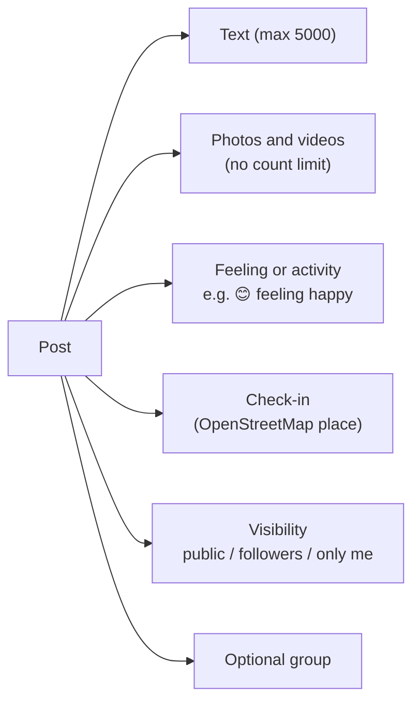
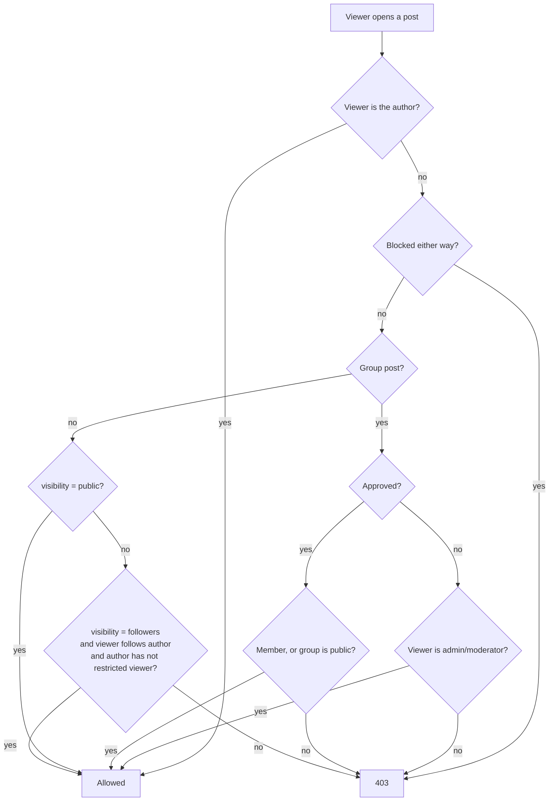
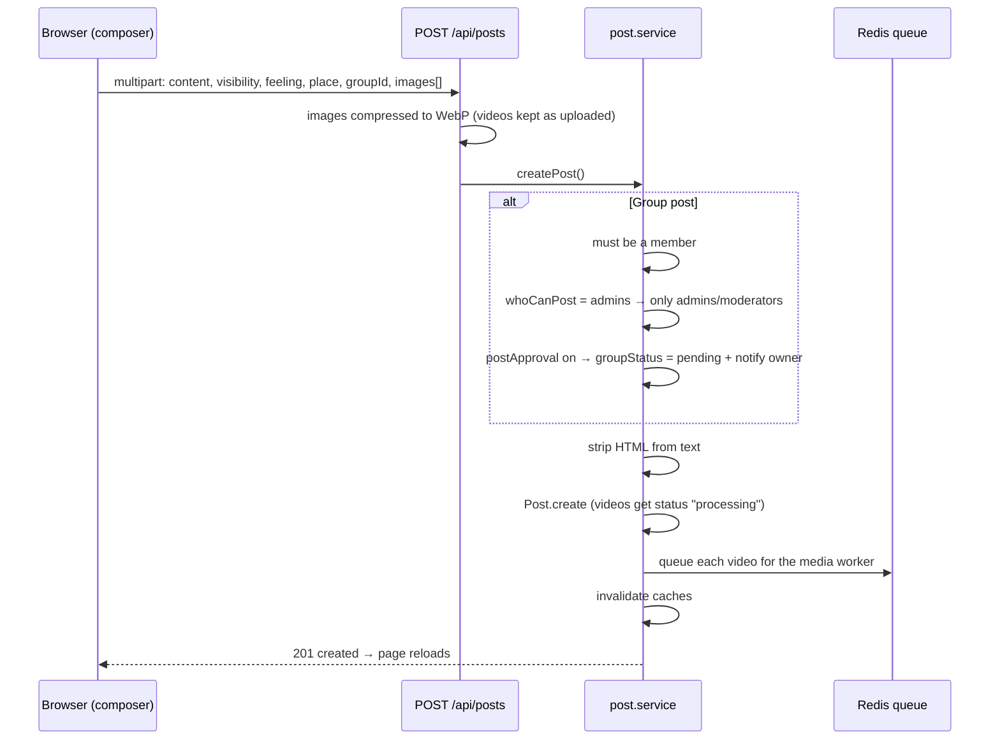
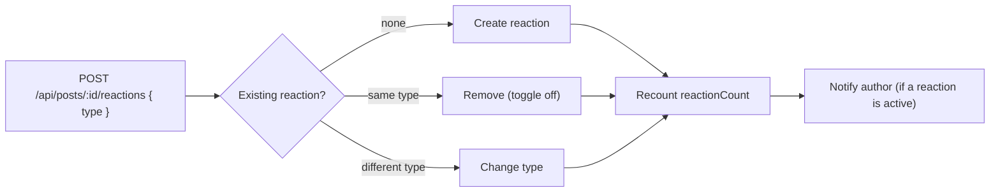
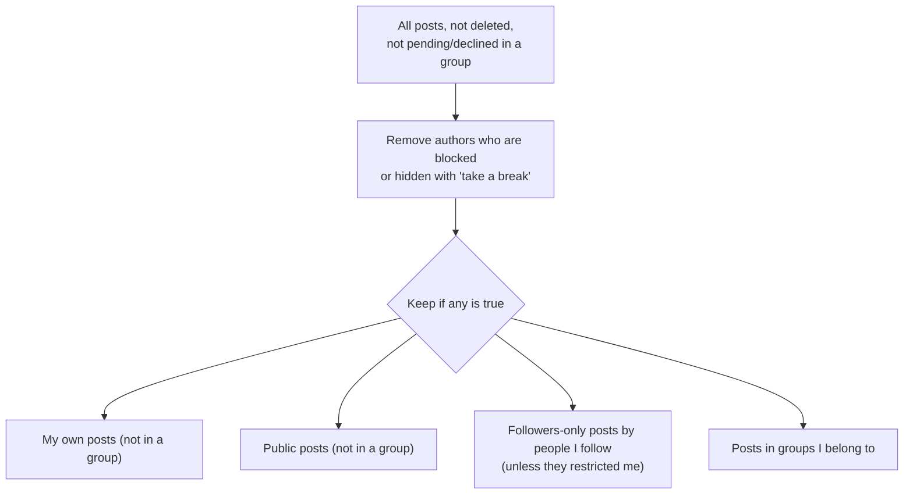

# Posts, reactions, comments and the home feed

Main files:

- [`services/post.service.ts`](../apps/web/src/services/post.service.ts) — create, edit, delete, react, comment, access rules
- [`services/feed.service.ts`](../apps/web/src/services/feed.service.ts) — home feed query and search proxy
- [`views/partials/post-card.ejs`](../apps/web/src/views/partials/post-card.ejs) — how a post looks
- [`views/partials/foot.ejs`](../apps/web/src/views/partials/foot.ejs) — composer and edit dialogs

## What a post can contain

A post needs at least one of: text, a photo/video, a feeling, or a check-in.



## Who can see a post

`assertCanAccessPost()` decides. The author can always see their own post.



Signed-out visitors can only open public posts that are not in a private group.

## Creating a post



`feeling` and `place` are sent as JSON strings inside the multipart form and validated by Zod (`postFeelingSchema`, `postPlaceSchema`).

## Editing a post and its media

The edit dialog sends a `layout` array describing the final order of media:

```json
[{ "id": "665f..." }, { "upload": 0 }, { "id": "6660..." }, { "upload": 1 }]
```

- `{ "id": ... }` keeps an existing photo/video.
- `{ "upload": n }` takes the n-th newly uploaded file.
- Anything not listed is removed.

Single media items can also be changed from their "…" menu:

| Action | Endpoint |
|---|---|
| Replace one photo/video | `PUT /api/posts/:postId/media/:mediaId` |
| Remove one photo/video | `DELETE /api/posts/:postId/media/:mediaId` (an empty post is moved to trash) |
| Move post to trash | `DELETE /api/posts/:postId` (soft delete, logged in AuditLog) |

## Media layout in the feed

The card shows at most five tiles. More media show a "+N" overlay on the last tile; the viewer can browse all of them.

| Count | Layout |
|---|---|
| 1 | Full width (a single video plays inline) |
| 2 | Two squares side by side |
| 3 | One tall tile on the left, two on the right |
| 4 | 2 × 2 grid |
| 5+ | Two tiles on top, three below, "+N" on the last |

```text
 1           2            3             4             5+
┌──────┐   ┌───┬───┐   ┌───┬───┐    ┌───┬───┐    ┌────┬────┐
│      │   │   │   │   │   │   │    │   │   │    │    │    │
│      │   └───┴───┘   │   ├───┤    ├───┼───┤    ├──┬─┴┬───┤
└──────┘               │   │   │    │   │   │    │  │  │+N │
                       └───┴───┘    └───┴───┘    └──┴──┴───┘
```

Clicking a tile opens the full-screen viewer with the post column (reactions and comments). Arrow keys move between items; videos play with controls.

## Reactions

There are six reactions: like, love, haha, wow, sad, angry.



`withReactionSummary()` adds `myReaction` and the three most used reaction types (`topReactions`) to each post for the stats row.

## Comments

- `POST /api/posts/:id/comments { content, parentId? }`
- `parentId` makes it a reply. The parent must belong to the same post.
- Comments from blocked users are hidden.
- The author of the post gets a notification.

## The home feed

`getFeed(userId, page, limit = 15)` builds the feed with one MongoDB aggregation and caches each page for 45 seconds.

**Which posts are included:**



**Order:**

1. Posts by people you follow come first, ordered by **when you followed them** (most recent follow first).
2. Inside each author, newest posts first.
3. Everyone else after that, newest first.

This order is applied **before** pagination, so following someone new immediately brings their posts (even older ones) to the top.

The FastAPI service also has a scoring endpoint (`POST /v1/feed/rank`) that mixes freshness, relationship and engagement. It is available but the home feed currently uses the MongoDB order above. See [Search and places](SEARCH_AND_PLACES.md).

## Feelings and check-ins

- Feelings and activities are defined in [`shared/feelings.ts`](../apps/web/src/shared/feelings.ts) and shared by the server (validation, display text) and the client (picker).
- Check-ins search places through the server (`GET /api/places?q=` and `GET /api/places/nearby?lat=&lon=`). A post with a place and no media shows a small map card built from OpenStreetMap tiles.
