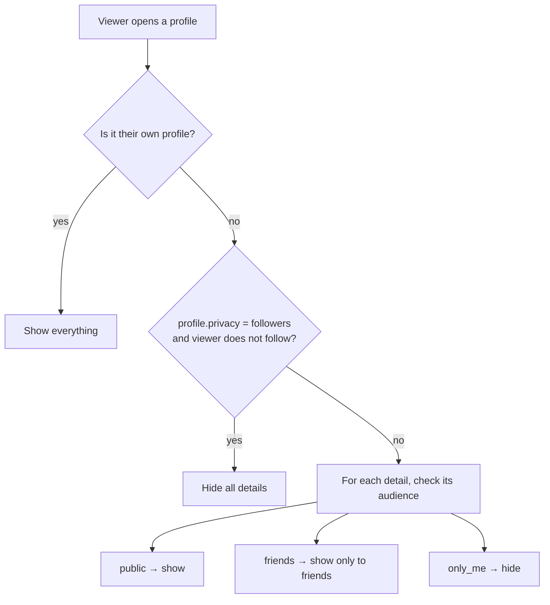

# Profiles

A profile at `/profile/:username` has three tabs: **Posts**, **About** and **Media**. This page explains what each tab shows, how people edit their details, and who can see what.

Main files:

- [`views/profile.ejs`](../apps/web/src/views/profile.ejs) — header, tabs, posts and media
- [`views/partials/profile-intro.ejs`](../apps/web/src/views/partials/profile-intro.ejs) — the Intro card in the left column
- [`views/partials/profile-about.ejs`](../apps/web/src/views/partials/profile-about.ejs) — the About tab with inline editors
- [`views/partials/profile-dialogs.ejs`](../apps/web/src/views/partials/profile-dialogs.ejs) — Edit profile, Edit details, photo picker
- [`views/partials/media-tile.ejs`](../apps/web/src/views/partials/media-tile.ejs) — one photo or video square
- [`services/user.service.ts`](../apps/web/src/services/user.service.ts) — loading profiles, privacy filtering, saving details
- [`controllers/page.controller.ts`](../apps/web/src/controllers/page.controller.ts) — `profile()` picks the tab, filter and sort

## Tabs

| Tab | URL | What it shows |
|---|---|---|
| Posts | `/profile/:username` | Intro card, Media preview and Friends on the left; posts on the right |
| About | `?tab=about&section=…` | Every detail, grouped into sections, with edit controls for the owner |
| Media | `?tab=media&type=…&sort=…` | All photos and videos from the person's posts |

Old links with `?tab=photos` or `?tab=videos` still work. They open the Media tab with that filter.

## Intro card (left column)

The Intro card follows the Facebook layout:

| Block | Content |
|---|---|
| Bio | Up to 240 characters. The owner sees **Add bio** / **Edit bio**. |
| Personal details | Lives in, From, birthday (day and month), relationship, joined date, "Followed by N people" |
| Links | Website and social links |
| Work | Company, position, dates and tenure ("3 years, 2 months") |
| Education | The first two schools, then "See more education" |
| Hobbies | Chips |

- Each block header has a pencil for the owner. It opens the matching About section.
- If a detail's audience is not Public, the owner sees a small lock or friends icon next to it.
- Empty blocks are hidden from visitors. The owner sees an "Add …" link instead.
- **See more about …** opens the About tab. **Edit details** opens the Intro switches (below).

### Choosing what appears in the Intro

**Edit details** opens a dialog with one switch per item: work, education, current city, hometown, relationship, birthday, joined date, followers, links and hobbies. Turned-off items are stored in `profile.introHidden`.

A switch only decides whether the item appears in the **Intro card**. It does not change who can see the item on the About tab — that is the item's audience.

The same dialog also has a folded section for name, username and profile visibility.

## About tab

| Section | Details |
|---|---|
| Overview | Current job, latest school, city, hometown, relationship, birthday, phone, email |
| Work and education | Workplaces, colleges and high schools (add, edit, remove) |
| Places lived | Current town/city, hometown |
| Contact and basic info | Phone, public email, website and social links, gender, pronouns, birth date, birth year, languages |
| Family and relationships | Relationship status |
| Details about you | About text, other names, favourite quotes |
| Hobbies and interests | Hobbies |

For the owner, every row has:

- a **pencil** that opens a small inline form (no page change), and
- for workplaces, schools and links, a **trash** button (asks for confirmation).

Lists such as languages and hobbies are typed as comma-separated text. Duplicates are removed.

## Who can see what

Two settings work together.

1. **Profile visibility** (`profile.privacy`): `public` or `followers`. With `followers`, people who do not follow you see none of your details.
2. **Audience per detail** (`profile.audience.*`): `public`, `friends` or `only_me`. The owner changes it with the selector next to each item on the About tab. It saves as soon as it changes.

| Audience field | Covers | Default |
|---|---|---|
| `work`, `education` | All workplaces / all schools | Public |
| `location`, `hometown` | Current city, hometown | Public |
| `birthday` | Day and month | Public |
| `birthYear` | Birth year | **Only me** |
| `relationship`, `gender`, `pronouns`, `languages` | The single value | Public |
| `contact` | Phone and public email | **Only me** |
| `links` | Website and social links | Public |

Filtering happens on the server in `visibleProfile()` ([user.service.ts](../apps/web/src/services/user.service.ts)). Hidden values are removed before the page is rendered, so they never reach the browser.

## Saving details

| What | Endpoint |
|---|---|
| Single values (bio, city, hometown, birthday, relationship, gender, pronouns, languages, hobbies, phone, email, about, other names, quotes, website) | `PATCH /api/profile/details` |
| Audience of one detail | `PATCH /api/profile/details` with `audience.<field>` |
| Intro switches | `PATCH /api/profile/details` with `intro.<item>` set to `1` or `0` |
| Workplaces | `POST /api/profile/work`, `PATCH` or `DELETE /api/profile/work/:itemId` |
| Schools | `POST /api/profile/education`, `PATCH` or `DELETE /api/profile/education/:itemId` |
| Social links | `POST /api/profile/links`, `PATCH` or `DELETE /api/profile/links/:itemId` |

HTML forms send flat names such as `audience.location` or `intro.work`. The validator (`profileDetailsSchema` in [validators/index.ts](../apps/web/src/validators/index.ts)) turns them into nested objects. A checkbox sends a hidden `0` first and then `1` when it is ticked; the last value wins.

Validation rules:

- Birthday must be a real date (31 February is rejected).
- Workplace end date must be after the start date. If "I currently work here" is ticked, the end date is cleared.
- Links must start with `http://` or `https://`.
- Up to 10 workplaces, 10 schools, 10 links, 10 languages and 20 hobbies.

Workplaces are kept sorted with current jobs first, then by start date. Schools are sorted by end year, newest first.

After every change the profile cache is cleared, so the next page load shows the new value.

## Media tab

The Media tab shows every photo and video from the person's posts (posts in groups are not included).

| Control | Values |
|---|---|
| Filter (`type`) | `all` (default), `photos`, `videos` — each chip shows a count |
| Sort (`sort`) | `newest` (default), `oldest`, `reactions` (most reactions), `comments` (most comments) |

- Filter and sort are in the URL, so a filtered view can be shared or bookmarked. Unknown values fall back to the defaults.
- Changing the sort reloads the page straight away (`data-autosubmit`). Without JavaScript an **Apply** button appears.
- Post visibility rules apply: visitors see media only from posts they are allowed to see.
- Videos show a play button and their poster frame. A video still being compressed shows **Processing…**.
- Videos that failed to compress are shown only to their owner, with a **Failed** label. See [Media](MEDIA.md).
- Clicking a tile opens the full-screen viewer. The owner also gets the "…" menu on each tile.

The **Media** card on the Posts tab shows the first nine items and the number of photos and videos.

## Limits

- The Media tab reads up to 200 posts with media; there is no paging yet.
- The counts on the Posts tab come from the latest 50 posts, so they can be lower than the real totals.
- Family members (linking another user as a relative) are not supported yet.
