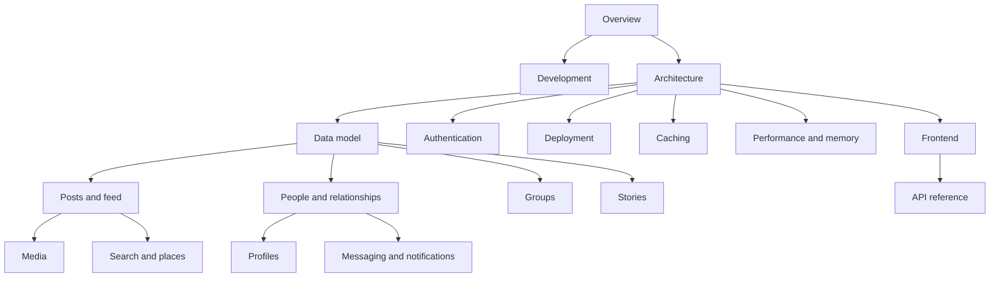

# Oremus documentation

Everything about how Oremus works, written in plain English with diagrams. Diagrams use [Mermaid](https://mermaid.js.org/), which GitHub, GitLab and VS Code (with a Mermaid extension) render automatically.

## Reading order

New to the project? Read these first, in order:

1. [Overview](OVERVIEW.md) — what the app does, the tech stack and the folder layout
2. [Development](DEVELOPMENT.md) — run it on your machine
3. [Architecture](ARCHITECTURE.md) — how the services and code layers fit together

Then open the page for the feature you are working on.

## All pages

| Page | What you will learn |
|---|---|
| [Overview](OVERVIEW.md) | Features, technology stack, repository layout, how a page is built |
| [Architecture](ARCHITECTURE.md) | Services, code layers, middleware order, request lifecycle, errors, caching, rate limits, background work |
| [Caching](CACHING.md) | Browser cache headers, Redis keys and TTLs, feed generations, invalidation and diagnostics |
| [Performance and memory](PERFORMANCE.md) | N+1 prevention, query indexes, memory bounds and verification commands |
| [Database setup and migrations](DATABASE.md) | One-command setup, reset, migration commands and how to add a migration |
| [Endless lists](INFINITE_SCROLL.md) | Infinite scroll for the feed, comments, chats, notifications, groups and more; cursors and the shared list API |
| [Data scripts](SCRIPTS.md) | Sample data seed (20 people with photos) and wipe scripts to reset the app to an empty state |
| [Data model](DATA_MODEL.md) | Every MongoDB collection and field, relationships, indexes, migrations and seed data |
| [Authentication and security](AUTHENTICATION.md) | Login, JWT cookies, refresh token rotation, logout, password reset, CSRF and other protections |
| [Posts and feed](POSTS_AND_FEED.md) | Creating and editing posts, who can see what, media layout, reactions, comments, home feed order |
| [Media](MEDIA.md) | Upload limits, photo compression, the background video worker, tuning |
| [People and relationships](SOCIAL_GRAPH.md) | Follow, friendship, take a break, block, profiles |
| [Profiles](PROFILES.md) | Intro card, About sections, who can see each detail, the Media tab |
| [Groups](GROUPS.md) | Group settings, roles, joining, invites, post approval |
| [Messaging and notifications](MESSAGING_AND_NOTIFICATIONS.md) | Socket.IO events, friends-only chat, notification types |
| [Stories](STORIES.md) | 24-hour stories, audience rules, the tray, views, reactions and replies |
| [Search and places](SEARCH_AND_PLACES.md) | FastAPI search, recent searches and typeahead suggestions, the ranking formula, place search for check-ins |
| [Frontend](FRONTEND.md) | Pages, EJS partials, the client script, Tailwind and theming |
| [API reference](API_REFERENCE.md) | Every endpoint with its body and error codes |
| [Deployment and operations](DEPLOYMENT.md) | Containers, environment variables, health checks, production checklist, scaling |

## Map of the documentation

## Keeping the docs up to date

- When you change behaviour, update the matching page in the same change.
- Add new pages to the table above and to the table of contents in the root [README](../README.md).
- Write for a new teammate: short sentences, one idea per paragraph, a diagram when a flow has more than three steps.
