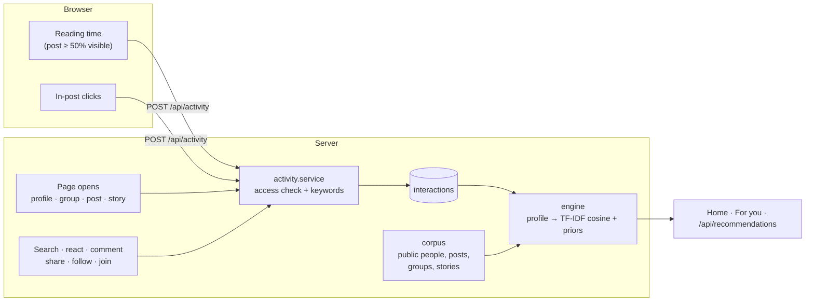

# Recommendations ("For you")

Oremus suggests **people, posts, groups and stories** from what each person does: what they search, how long they read posts about a subject, and what they click or open. Suggestions appear on the home page (story tray, a "Suggested for you" carousel in the feed, "People you may know" and "Groups for you" in the right column) and on the **For you** page (`/discover`), which also shows the interests the app has learned.

The model is a content-based recommender: TF-IDF vectors over English and Vietnamese text, a topic lexicon that links different wordings of the same subject, implicit feedback weighted by signal strength and time decay, and social priors (mutual friends, friends in a group). It runs inside the web app, needs no external service, and every suggestion comes with a reason.

## Code map

| File | Role |
|---|---|
| [`recommender/text.ts`](../apps/web/src/recommender/text.ts) | Tokenizer (diacritic folding, stopwords, bigrams), topic lexicon, feature vectors |
| [`recommender/documents.ts`](../apps/web/src/recommender/documents.ts) | What a post, profile, group, story or search "is about", as weighted text |
| [`recommender/engine.ts`](../apps/web/src/recommender/engine.ts) | Interest profile, IDF, similarity, scoring, reasons, interests list. Pure functions, unit-tested |
| [`services/activity.service.ts`](../apps/web/src/services/activity.service.ts) | Records signals (with access checks) and loads them |
| [`services/recommendation.service.ts`](../apps/web/src/services/recommendation.service.ts) | Builds the shared corpus, filters per viewer, ranks the four kinds, caches results |
| [`views-or-client/activity.ts`](../apps/web/src/views-or-client/activity.ts) | Browser tracking of reading time and in-post clicks |
| [`tests/recommender.test.ts`](../apps/web/src/tests/recommender.test.ts) | Engine, text analysis, payload and sample-data tests |

## How it works



### 1. Signals

| Signal | Recorded when | Base weight | Half-life |
|---|---|---|---|
| `search` | A keyword search lands on `/search` | 3 | 10 days |
| `open` | A profile, group or post page opens (2, 2, 1.5) | 1.5–2 | 21 days |
| `click` | A click inside a post that opens something in place (photo, video, comments, share dialog) | 1 | 14 days |
| `dwell` | The browser reports reading time on a post | up to 3, saturating: about ⅔ at 20 s, nearly all at 60 s | 21 days |
| `react`, `comment`, `share` | The action succeeds | 2, 3, 3 | 30 days |
| `follow`, `join` | You follow someone or join a group | 2.5, 3 | 45 days |
| `story_view` | You view someone else's story | 1 | 7 days |

- Repeats of the same signal on the same target add with diminishing returns (`1 + ln(count)`, at most 5 counted).
- Reading under 1.5 s is ignored; a single report is capped at 2 minutes per post.
- Re-opening the same thing within 10 minutes (searches 2 minutes, story views 30 minutes) is not a new signal.
- Signals are only stored when the viewer may see the target (block, audience, hidden group and story rules are re-checked) and never for your own content.
- Each row keeps the target's top 24 keywords as they were at that moment, so the profile never re-reads content later. Rows expire after 120 days (TTL index); the profile uses the last 90 days, at most 600 rows.

**Reading time in the browser.** A post counts as being read while at least half of it is visible (or 40% of the screen for a tall post), the tab is in front and the reader scrolled, moved or typed within the last 45 seconds. Time is summed per post and sent every 15 seconds and when the page is hidden (`fetch` with `keepalive`). Navigations are not tracked in the browser: the server records them when the page opens.

### 2. Text and topics

- Text is folded to lowercase without diacritics (`cà phê` → `ca phe`), so searches typed without accents match. English plurals are stemmed lightly.
- Stopwords (English and Vietnamese) are dropped; neighbouring content words also form bigrams (`ca_phe`, `machine_learning`). Punctuation breaks bigrams.
- Upper-case `AI` is the technology; lower-case `ai` is the Vietnamese "who". A lone `ai` typed in the search box means the technology.
- A lexicon of 25 topics (coffee, food, baking, travel, hiking, running, cycling, football, fitness, pets, gardening, wildlife, ocean, photography, music, art, design, tech, AI, gaming, books, film, study, fashion, business) adds `#topic` features. Topics are matched on the plain folded word sequence, so Vietnamese phrases made of common words (`âm nhạc`, `thời trang`, `thú cưng`) work, while names that share a word do not (`Trang` is not fashion). This is what lets "egg coffee", "cà phê muối" and "barista" find each other.
- Vectors use sublinear term frequency (`1 + ln(tf)`), are weighted by where the text comes from (a group's tags count more than its location) and are L2-normalised.

What describes each kind:

| Kind | Text used |
|---|---|
| Post | Content, shared post, place name, activity ("listening to …", not moods), group name and tags |
| Person | Bio, hobbies, About, public work and education, location, recent public posts. "Followers only" profiles: public posts only |
| Group | Name, tags, description, type, location, recent posts (public groups) |
| Story | Story text, plus the author's bio and hobbies at half weight |
| Search | The keywords |

### 3. Interest profile

Each group of identical signals contributes the target's keywords times its strength (base weight × repeats × `0.5^(age / half-life)`). The sum is L2-normalised and trimmed to 300 features. The profile also keeps:

- the signal that contributed most to each feature (to explain results),
- engagement per author and per group (affinity),
- what was clearly seen: opened, reacted, or read for 8 seconds or more.

### 4. Ranking

For every candidate:

```
score = 6 × relevance + 1.5 × affinity + 1.2 × social + 0.8 × popularity + 0.5 × freshness − penalty
relevance = cosine(profile ⊙ idf, item ⊙ idf) / max(best cosine in the pool, 0.25)
```

- **IDF** is computed over everything that can be suggested, so rare, specific words matter more than common ones.
- **Affinity**: how much you engaged with the author or group (0–1).
- **Social**: mutual friends (people, 5 = full), friends who are members (groups, 3 = full).
- **Popularity**: engagement relative to the pool (log scale). **Freshness**: posts halve every 3 days; stories fade over 24 hours; new members get a small boost.
- **Penalty**: stories you already viewed (−1); profiles you opened but did not follow (−0.3).

The reason shown is the content match ("Because you searched “coffee”", "Because you read posts about “marathon”", "Based on your interest in gaming") when the match is strong (relevance ≥ 0.35 or cosine ≥ 0.15). Otherwise it is the social or popularity reason ("3 mutual friends", "Popular on Oremus"). With no behaviour at all, ranking falls back to those priors.

### 5. Who is suggested

| Kind | Candidates | Never suggested |
|---|---|---|
| People | Every active account | You, people you blocked or who blocked you, "see less" people, friends, people you follow |
| Groups | Visible groups | Hidden groups, groups you joined |
| Posts | Original posts from the last 120 days: public posts and posts in public groups | Your posts, shares, posts by people you follow or blocked, posts in your groups, posts you reacted to, commented on, opened or read |
| Stories | Active public stories | Your stories, stories of people you follow (already in your tray) or blocked |

At most 2 posts per author and 1 story per author are suggested. Limits: 8 people, 6 groups, 8 posts, 8 stories.

## Caching and freshness

| What | Where | Lifetime | Invalidated by |
|---|---|---|---|
| Corpus (vectors and IDF of all candidates) | Process memory | 60 s | Time |
| Suggestions per viewer | Redis `rec:<userId>` | 120 s | Any new signal, follows, blocks, reactions, comments (see `invalidateSocialCaches`), clearing history, seeding |

Because a new signal drops the viewer's cache, the next page load already reflects what they just did.

## Privacy

- The For you page shows the learned interests and a **Clear history** button (`DELETE /api/activity`). Clearing removes every stored signal; posts, reactions and follows stay.
- Signals hold keywords only from content the viewer could see, so interests can never reveal private content.
- Signals expire after 120 days.

## API

| Method | Path | Notes |
|---|---|---|
| POST | `/api/activity` | `{ events: [{ type: "dwell", postId, ms } \| { type: "click", target: "post" \| "user" \| "group" \| "story", id }] }`, 1–50 events, `ms` ≤ 600000. 240 per minute → `{ stored }` |
| GET | `/api/recommendations` | `{ people, groups, posts, stories, interests, signalCount, personalized }`. 120 per minute |
| DELETE | `/api/activity` | Clear your behaviour history → `{ removed }` |

## Testing it

1. `npm run seed`, then sign in as `maya@example.com` / `CircleSpace123`. Maya starts with no history, so suggestions use mutual friends and popularity.
2. Search `scuba diving` (or `ca phe`, `marathon`, `machine learning`, `sourdough`, `IELTS`) and go back to Home: the story tray, the carousel and both right-column sections now lead with matching content, each with "Because you searched …".
3. Open a profile and read a few of their posts for 15+ seconds, then return: their subject shows up as "Because you read posts about …".
4. Open **For you** in the sidebar to see the learned interests; **Clear history** starts over.

`mai@example.com` (AI, IELTS, gaming) and `olivia@example.com` (pets, baking) come with a short history, so their pages are personalised right away. Eighteen sample people have one clear subject each, and none of them is connected to Maya. See [Sample data](SCRIPTS.md#sample-data-seed).

## Limits and next steps

- Collaborative filtering ("people who liked this also liked") is not used; it needs more users than the sample has.
- The corpus is rebuilt per process every minute. For tens of thousands of items, precompute vectors on write or move ranking to the FastAPI service.
- The topic lexicon is hand-written; extending it (or replacing it with embeddings) improves matching between different wordings.
