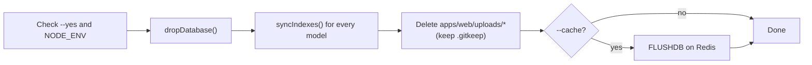

# Data scripts: sample data and wiping

This page covers the [sample data seed](#sample-data-seed) and the [wipe scripts](#commands) that reset the app to an empty state.

Two scripts return Oremus to a "fresh install" with no users, posts or cached data. Use them before a demo, after testing, or when local data is broken.

| Script | File | Clears |
|---|---|---|
| Wipe data | [`apps/web/src/scripts/wipe-data.ts`](../apps/web/src/scripts/wipe-data.ts) | MongoDB database + uploaded files (+ Redis with `--cache`) |
| Wipe cache | [`apps/web/src/scripts/wipe-cache.ts`](../apps/web/src/scripts/wipe-cache.ts) | Redis (cached reads and rate limits, or everything with `--all`) |

> **Warning:** wiping is permanent. There is no undo and no backup is made. Every account, post, message, group, story and uploaded photo/video is deleted.

## Commands

Run from the repository root. Arguments after `--` are passed to the script.

| Command | What it deletes |
|---|---|
| `npm run wipe:all -- --yes` | **Everything**: MongoDB database, all uploads, the whole Redis database. Use this to start from zero |
| `npm run wipe:data -- --yes` | MongoDB database and all uploads. Redis is kept |
| `npm run wipe:cache -- --yes` | Cached reads (`feed:`, `profile:`, `group:`, `search:`, `places:`, `cache:`) and rate-limit counters (`rate:`). Data, revoked tokens and the video queue are kept |
| `npm run wipe:cache -- --yes --all` | The whole Redis database (`FLUSHDB`): caches, rate limits, revoked tokens (`deny:`) and media jobs (`media:`) |

Without `--yes` the scripts change nothing. They print what would be deleted and exit with code 1.

Typical reset before a demo:

```bash
npm run wipe:all -- --yes
```

Then either register a new account in the browser, or load the sample data:

```bash
npm run seed
```

### When the app runs in Docker

MongoDB and Redis only `expose` their ports inside the Docker network, so the commands above fail from the host with `ECONNREFUSED` on port 6379 or 27017. Nothing is deleted in that case: the script connects before it wipes.

Run them in the one-shot `seed` container instead. It connects to the same MongoDB, Redis and `uploads` volume as `web`:

```bash
docker compose run --rm --build seed npm run wipe:all -- --yes
```

`wipe:data` and `wipe:cache` work the same way. Then restart the app and load the sample data if you want it:

```bash
docker compose restart web media
```

```bash
npm run seed
```

## What `wipe:data` does



1. Drops the whole MongoDB database from `MONGODB_URI`. Sessions (refresh tokens) live in MongoDB, so everyone is logged out.
2. Recreates the indexes of every collection. The app works right away; you don't need to run `db:migrate`. The `migrations` collection is gone too, so a later `db:migrate` runs the data migrations again; on an empty database they do nothing.
3. Deletes every file and folder in `apps/web/uploads` except `.gitkeep`.
4. With `--cache` (which is what `wipe:all` passes), it also flushes Redis.

How it differs from `db:reset`: `db:reset` only drops MongoDB. Uploads and Redis are kept, and indexes are not recreated.

## What `wipe:cache` does

By default only data that can be rebuilt is removed. The script scans for each prefix with `SCAN` and deletes in batches with `UNLINK`, which frees memory in the background so the server is not blocked.

Two kinds of keys are kept on purpose:

- `deny:*` (revoked access tokens). Deleting these would make tokens of users who just logged out valid again for up to 15 minutes.
- `media:*` (the video queue and file trash). Deleting these would leave uploaded videos stuck in "processing".

`--all` removes these too. Only use it together with wiping the data, which is exactly what `wipe:all` does.

## Safety checks

| Check | Behavior |
|---|---|
| No `--yes` | Prints the target and exits without changes |
| `NODE_ENV=production` | Refuses to run |
| `--allow-production` | Overrides the production check. Only use it for a demo or test server you are sure about |

The Docker Compose services run with `NODE_ENV=production`, so inside containers the extra flag is required:

```bash
docker compose exec web node dist/scripts/wipe-data.js --yes --cache --allow-production
docker compose exec web node dist/scripts/wipe-cache.js --yes --allow-production
```

After wiping, restart `web` and `media` so they drop any in-memory state:

```bash
docker compose restart web media
```

## Browser side

The scripts clean the server only. Browsers that visited the site still keep:

- **Cookies.** These are harmless: the session no longer exists, so the server clears them on the next request.
- **Service worker caches** (`oremus-*` in Cache Storage). The uploads cache may still show old photos. To clear it, open DevTools → Application → Storage → **Clear site data**, or log out before wiping (logging out deletes the uploads cache).

## Sample data (seed)

`npm run seed` ([`seed.ts`](../apps/web/src/scripts/seed.ts)) fills the app so every page looks like a real, active social network.

| Data | Amount |
|---|---|
| People | 2,000. The original 39 curated accounts stay unchanged; 1,961 deterministic crowd accounts add bios, locations, work, languages, interests and real portraits matched to the first name |
| Relationships | ~5,960 friendships, ~15,850 follows and 4 pending friend requests |
| Groups | 137 seed groups across 20 subjects (public/private, rules, moderators and roughly 45 members per generated group). Generated covers are all different |
| Posts | ~4,060, about 4,000 with a photo (the rest are hand-written text posts). Every account has at least one personal post and one group post. No two posts share a photo or a caption |
| Reactions / comments | ~194,000 reactions and ~5,500 comments/replies. Generated posts use bounded engagement so database size stays practical |
| Stories | ~690 active stories inside the 24-hour window: about two thirds with their own photo, the rest text on varied backgrounds |
| Chats | 11 conversations, ~40 messages (some unread) |
| Interests | Every sample account has survey answers (Maya's are hand-picked, the rest derived from bio, hobbies and posts). `new@example.com` has none, so signing in opens the interest survey |
| Behaviour signals | A short history for `mai@example.com` (AI, IELTS, gaming) and `olivia@example.com` (pets, baking). Maya starts with none |
| Notifications | Generated from the activity above; the last 12 hours stay unread |

Every sample account uses the password `CircleSpace123`. The demo account is **`maya@example.com`**: it has the most friends, chats, notifications and friend requests. Other accounts include `leo@example.com`, `anika@example.com`, `linh@example.com` and `khoa@example.com`. The full list is in [`seed-data.ts`](../apps/web/src/scripts/seed-data.ts).

### Files

| File | Role |
|---|---|
| [`seed-data.ts`](../apps/web/src/scripts/seed-data.ts) | The content: people, groups, posts, stories, chats, comment pools. Edit this file to change the sample |
| [`seed-data-topics.ts`](../apps/web/src/scripts/seed-data-topics.ts) | Topic-focused people, groups, posts, stories and behaviour signals for testing recommendations |
| [`seed-data-crowd.ts`](../apps/web/src/scripts/seed-data-crowd.ts) | Deterministically generates the large crowd, social graph, 120 extra groups, posts and stories without replacing curated fixtures. Hands out each library photo once |
| [`seed-photo-library.json`](../apps/web/src/scripts/seed-photo-library.json) | The crowd's photos per topic, with author, license and source of each. Rebuild with `npm run seed:photos` (slow, Commons rate-limits it) |
| [`seed-media.ts`](../apps/web/src/scripts/seed-media.ts) | Downloads and compresses photos |
| [`seed.ts`](../apps/web/src/scripts/seed.ts) | Inserts everything, generates reactions, comments and notifications |
| [`seed-stories.ts`](../apps/web/src/scripts/seed-stories.ts) | Refreshes only the sample stories |

### Photos

Photos are downloaded once on the first run, converted to WebP and stored in the Docker `uploads` volume. Later runs reuse these files. The first run downloads about 4,700 photos from Wikimedia Commons, which takes around half an hour. A warm seed takes about one minute.

- **Crowd posts, stories and group covers** come from [Wikimedia Commons](https://commons.wikimedia.org), limited to photos Commons rates as Quality Images. Each is used once. They are freely licensed, and many licenses ask for attribution: the author and license of every photo are in `seed-photo-library.json`. Keep that in mind before using the sample data outside a demo.
- **Curated posts** use hand-picked [Lorem Picsum](https://picsum.photos) photos (Unsplash). A photo that would repeat is swapped for a library photo of the same topic.
- **Avatars** for curated accounts come from [Pravatar](https://pravatar.cc). The crowd cycles through 358 portraits from [xsgames](https://xsgames.co/randomusers) and [randomuser.me](https://randomuser.me), matched to the first name, so a face can repeat across the 1,961 accounts.
- **Offline or rate-limited:** a post without its photo stays text-only and a person shows initials. No placeholder images are generated, so the seed still finishes.

### When the app runs in Docker

`npm run seed` now runs in a one-shot Docker container connected to the same MongoDB, Redis and named `uploads` volume as `web`. This makes Docker the default and prevents database records from pointing at photos that only exist on the host.

Build/start the application, then seed it:

```bash
docker compose up -d --build
npm run seed
```

If an older seed already put photos in `apps/web/uploads`, merge those files into Docker without deleting anything already in the volume:

```bash
npm run data:mirror:docker
```

The old command remains as a compatibility alias:

```bash
npm run seed:copy-docker
```

For host-only development, use `npm run seed:local`. To apply database migrations through Docker, use `npm run db:migrate:docker`.

The same applies to the wipe scripts: they cannot reach the containers' database from the host, and `uploads` on the host is not the container volume. Use the commands in [When the app runs in Docker](#when-the-app-runs-in-docker).

### Refreshing only the stories

Stories expire after 24 hours, so the sample stories disappear a day after seeding. This brings them back without touching people, posts, groups or chats:

```bash
npm run seed:stories
```

It replaces the stories a previous seed created, along with their views and reaction notifications. Stories posted by hand are kept. It needs the sample people, so run `npm run seed` once first. For host-only development, use `npm run seed:stories:local`.

### Running it again

Re-running is safe and gives the same result:

- Sample accounts and groups keep their ids, so logged-in sessions survive.
- Everything the sample accounts created (posts, comments, reactions, stories, chats, notifications, follows between sample accounts) is deleted and rebuilt relative to the current time, so stories never expire and posts look recent.
- Content from other accounts you registered yourself is kept. Note that anything you posted *while signed in as a sample account* is removed.
- Randomness is seeded, so reactions and comments are identical on every run.

For a fully clean start with sample data:

```bash
docker compose run --rm --build seed npm run wipe:all -- --yes
npm run seed
```
