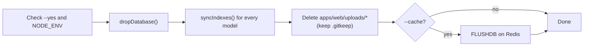

# Data scripts: sample data and wiping

This page covers the [sample data seed](#sample-data-seed) and the [wipe scripts](#commands) that reset the app to an empty state.

Two scripts return Oremus to a "fresh install" with no users, posts or cached data. Use them before a demo, after testing, or when local data is broken.

| Script | File | Clears |
|---|---|---|
| Wipe data | [`apps/web/src/scripts/wipe-data.ts`](../apps/web/src/scripts/wipe-data.ts) | MongoDB database + uploaded files (+ Redis with `--cache`) |
| Wipe cache | [`apps/web/src/scripts/wipe-cache.ts`](../apps/web/src/scripts/wipe-cache.ts) | Redis (cached reads and rate limits, or everything with `--all`) |

> **Warning:** wiping is permanent. There is no undo and no backup is made. Every account, post, message, group, story and uploaded photo/video is deleted.

## Commands

Run from the repository root. Arguments after `--` are passed to the script.

| Command | What it deletes |
|---|---|
| `npm run wipe:all -- --yes` | **Everything**: MongoDB database, all uploads, the whole Redis database. Use this to start from zero |
| `npm run wipe:data -- --yes` | MongoDB database and all uploads. Redis is kept |
| `npm run wipe:cache -- --yes` | Cached reads (`feed:`, `profile:`, `group:`, `search:`, `places:`, `cache:`) and rate-limit counters (`rate:`). Data, revoked tokens and the video queue are kept |
| `npm run wipe:cache -- --yes --all` | The whole Redis database (`FLUSHDB`): caches, rate limits, revoked tokens (`deny:`) and media jobs (`media:`) |

Without `--yes` the scripts change nothing. They print what would be deleted and exit with code 1.

Typical reset before a demo:

```bash
npm run wipe:all -- --yes
```

Then either register a new account in the browser, or load the sample data:

```bash
npm run seed
```

## What `wipe:data` does



1. Drops the whole MongoDB database from `MONGODB_URI`. Sessions (refresh tokens) live in MongoDB, so everyone is logged out.
2. Recreates the indexes of every collection. The app works right away; you don't need to run `db:migrate`. The `migrations` collection is gone too, so a later `db:migrate` runs the data migrations again; on an empty database they do nothing.
3. Deletes every file and folder in `apps/web/uploads` except `.gitkeep`.
4. With `--cache` (which is what `wipe:all` passes), it also flushes Redis.

How it differs from `db:reset`: `db:reset` only drops MongoDB. Uploads and Redis are kept, and indexes are not recreated.

## What `wipe:cache` does

By default only data that can be rebuilt is removed. The script scans for each prefix with `SCAN` and deletes in batches with `UNLINK`, which frees memory in the background so the server is not blocked.

Two kinds of keys are kept on purpose:

- `deny:*` (revoked access tokens). Deleting these would make tokens of users who just logged out valid again for up to 15 minutes.
- `media:*` (the video queue and file trash). Deleting these would leave uploaded videos stuck in "processing".

`--all` removes these too. Only use it together with wiping the data, which is exactly what `wipe:all` does.

## Safety checks

| Check | Behavior |
|---|---|
| No `--yes` | Prints the target and exits without changes |
| `NODE_ENV=production` | Refuses to run |
| `--allow-production` | Overrides the production check. Only use it for a demo or test server you are sure about |

The Docker Compose services run with `NODE_ENV=production`, so inside containers the extra flag is required:

```bash
docker compose exec web node dist/scripts/wipe-data.js --yes --cache --allow-production
docker compose exec web node dist/scripts/wipe-cache.js --yes --allow-production
```

After wiping, restart `web` and `media` so they drop any in-memory state:

```bash
docker compose restart web media
```

## Browser side

The scripts clean the server only. Browsers that visited the site still keep:

- **Cookies.** These are harmless: the session no longer exists, so the server clears them on the next request.
- **Service worker caches** (`oremus-*` in Cache Storage). The uploads cache may still show old photos. To clear it, open DevTools → Application → Storage → **Clear site data**, or log out before wiping (logging out deletes the uploads cache).

## Sample data (seed)

`npm run seed` ([`seed.ts`](../apps/web/src/scripts/seed.ts)) fills the app so every page looks like a real, active social network.

| Data | Amount |
|---|---|
| People | 38, each with avatar, cover photo, bio, work, education, hometown, birthday, languages, hobbies and links. 18 of them have one clear subject each (AI, specialty coffee, gaming, books, running, yoga, startups, fashion, diving, baking, film, pets, street photography, vegan food, fitness, jazz, data science, IELTS) and are not connected to Maya, for testing [recommendations](RECOMMENDATIONS.md) |
| Relationships | ~75 friendships, ~170 follows, 4 pending friend requests (3 waiting for Maya) |
| Groups | 17 (public and private, one with post approval and a pending join request; 12 topic groups) |
| Posts | ~130 in English and Vietnamese with ~80 photos, feelings, check-ins, group posts and a followers-only post, spread over the last 30 days |
| Reactions / comments | ~2,400 reactions, ~290 comments with replies |
| Stories | 36 photo and text stories with styles, views and reactions, all inside the 24-hour window (topic stories are public) |
| Chats | 11 conversations, ~40 messages (some unread) |
| Behaviour signals | A short history for `mai@example.com` (AI, IELTS, gaming) and `olivia@example.com` (pets, baking). Maya starts with none |
| Notifications | Generated from the activity above; the last 12 hours stay unread |

Every sample account uses the password `CircleSpace123`. The demo account is **`maya@example.com`**: it has the most friends, chats, notifications and friend requests. Other accounts include `leo@example.com`, `anika@example.com`, `linh@example.com` and `khoa@example.com`. The full list is in [`seed-data.ts`](../apps/web/src/scripts/seed-data.ts).

### Files

| File | Role |
|---|---|
| [`seed-data.ts`](../apps/web/src/scripts/seed-data.ts) | The content: people, groups, posts, stories, chats, comment pools. Edit this file to change the sample |
| [`seed-data-topics.ts`](../apps/web/src/scripts/seed-data-topics.ts) | Topic-focused people, groups, posts, stories and behaviour signals for testing recommendations |
| [`seed-media.ts`](../apps/web/src/scripts/seed-media.ts) | Downloads and compresses photos |
| [`seed.ts`](../apps/web/src/scripts/seed.ts) | Inserts everything, generates reactions, comments and notifications |

### Photos

Photos are downloaded once on the first run, converted to WebP and stored in `apps/web/uploads/` as `seed-photo-<id>-<size>.webp` and `seed-avatar-<id>.webp`. Later runs reuse these files. The first run needs internet and takes about 30 seconds.

- **Post, cover and story photos** come from [Lorem Picsum](https://picsum.photos) (Unsplash photos, free to use). Each caption was matched to a specific photo id.
- **Avatars** come from [Pravatar](https://pravatar.cc), placeholder portraits made for demos.
- **Offline:** photos fall back to generated gradients and avatars to initials, so the seed still finishes.

### When the app runs in Docker

In Docker Compose, `web` stores uploads in the named volume `uploads`, not in `apps/web/uploads` on your machine. A seed run on the host therefore writes the database correctly, but the container can't find the photos and every image shows as broken. The seed detects this and prints a warning.

Seed from the host and copy the photos into the container in one step:

```bash
npm run seed:docker
```

If you already seeded, copy the photos only:

```bash
npm run seed:copy-docker
```

Alternatively, seed inside the container. The image must be rebuilt after seed changes (`docker compose up --build -d`):

```bash
docker compose exec web node dist/scripts/seed.js
```

The same applies to `wipe:data`: run from the host, it clears `apps/web/uploads` and not the container volume. Use the `docker compose exec` commands in [Safety checks](#safety-checks).

### Running it again

Re-running is safe and gives the same result:

- Sample accounts and groups keep their ids, so logged-in sessions survive.
- Everything the sample accounts created (posts, comments, reactions, stories, chats, notifications, follows between sample accounts) is deleted and rebuilt relative to the current time, so stories never expire and posts look recent.
- Content from other accounts you registered yourself is kept. Note that anything you posted *while signed in as a sample account* is removed.
- Randomness is seeded, so reactions and comments are identical on every run.

For a fully clean start with sample data:

```bash
npm run wipe:all -- --yes
npm run seed
```
