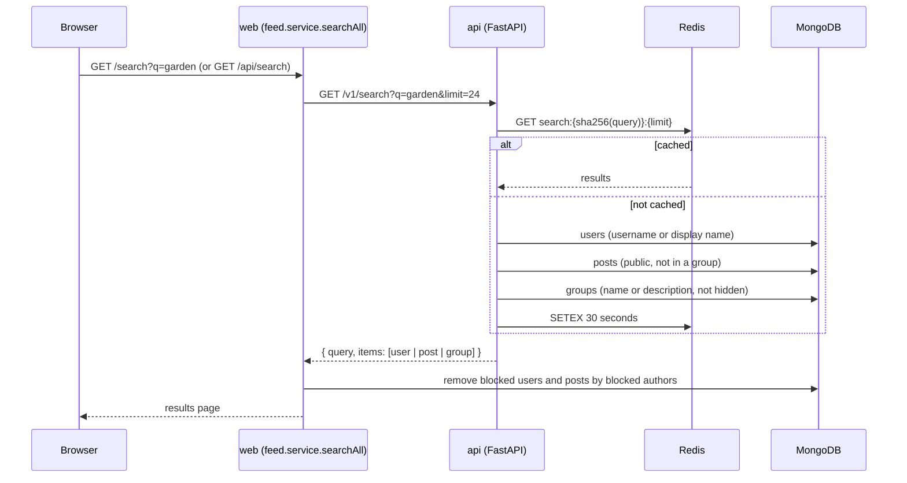
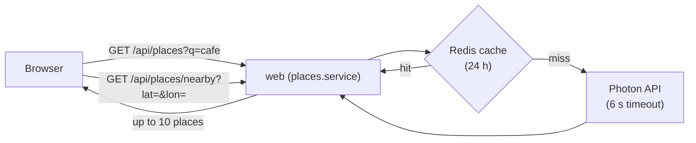

# Search, ranking and places

## Search

Search is handled by a separate Python service, [`apps/api`](../apps/api/app/main.py) (FastAPI). The web app calls it and then removes results the viewer should not see.



How matching works:

- The query is lowercased, trimmed and limited to 80 characters.
- It is matched as a case-insensitive "contains" (regex with special characters escaped).
- Results are split evenly between users, posts and groups.
- Only public posts outside groups are searchable. Hidden groups are never returned.

Each result has `id`, `kind`, `title`, `subtitle`, `image_url` and `url`.

If the API is down, `/v1/search` returns `503` and the search page shows an error; the rest of the site keeps working.

There is also a profile search: `/profile/:username?q=...` searches inside one person's posts.

## Feed ranking endpoint

The API also offers `POST /v1/feed/rank`, a transparent scoring formula:

```text
score = freshness + relationship + engagement

freshness    = 8 / (1 + age_in_hours / 18)
relationship = 6 if you follow the author + 3 if you are in the post's group
engagement   = min(ln(1 + reactions × 2 + comments × 3), 5)
```

```mermaid
xychart-beta
  title "Freshness score by post age"
  x-axis "Age (hours)" [0, 6, 12, 24, 48, 72, 96]
  y-axis "Score" 0 --> 8
  line [8, 6, 4.8, 3.4, 2.2, 1.6, 1.3]
```

The home feed does **not** call this endpoint today; it uses the MongoDB order described in [Posts and feed](POSTS_AND_FEED.md#the-home-feed). The endpoint is kept for experiments and is covered by `apps/api/tests/test_ranking.py`.

## Health

`GET /health` on the API pings MongoDB and Redis. Interactive API docs are at `http://localhost:8001/docs`.

## Places (check-ins)

Check-in search uses [Photon](https://photon.komoot.io), a free search engine built on OpenStreetMap data. The browser never calls Photon directly; it goes through the web server.



- Text search can be biased towards the user's location (rounded to about 10 km so nearby users share cache entries).
- "Use my current location" calls the reverse endpoint with the browser's coordinates (rounded to 4 decimals).
- Results are cleaned up and de-duplicated into `{ id, name, address, lat, lon, kind }`.
- Rate limit: 60 requests per minute per user.
- If Photon is unavailable the API returns `503 PLACES_UNAVAILABLE`.
- The Photon URL can be changed with the `PLACES_URL` environment variable.

Map previews on posts are drawn from OpenStreetMap tiles positioned around the point by the client script.
