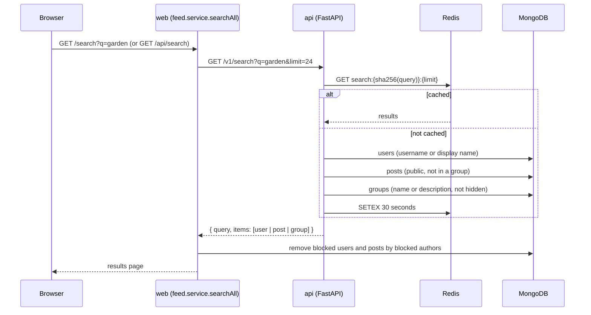
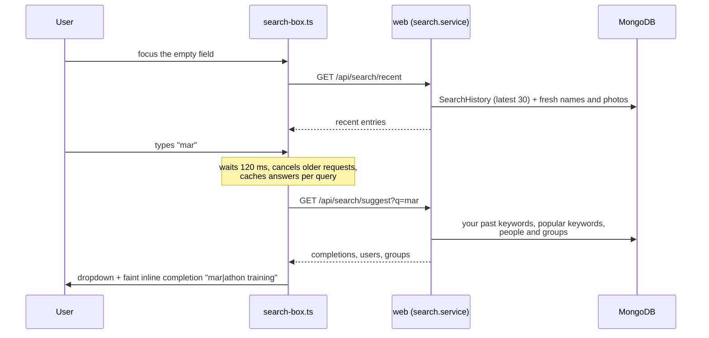
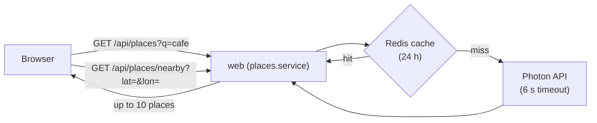

# Search, ranking and places

## Search

Search is handled by a separate Python service, [`apps/api`](../apps/api/app/main.py) (FastAPI). The web app calls it and then removes results the viewer should not see.



How matching works:

- The query is lowercased, trimmed and limited to 80 characters.
- It is matched as a case-insensitive "contains" (regex with special characters escaped).
- Results are split evenly between users, posts and groups.
- Only public posts outside groups are searchable. Hidden groups are never returned.

Each result has `id`, `kind`, `title`, `subtitle`, `image_url` and `url`.

If the API is down, `/v1/search` returns `503` and the search page shows an error; the rest of the site keeps working.

There is also a profile search: `/profile/:username?q=...` searches inside one person's posts.

## Search box: recent searches and suggestions

The search field in the header (and on the `/search` page) opens a Facebook-style dropdown.

- [`views/partials/search-box.ejs`](../apps/web/src/views/partials/search-box.ejs) — the markup
- [`views-or-client/search-box.ts`](../apps/web/src/views-or-client/search-box.ts) — the dropdown, keyboard and inline completion
- [`services/search.service.ts`](../apps/web/src/services/search.service.ts) — history, suggestions and ranking

Unlike the results page, suggestions are read straight from MongoDB by the web app. They do not go through the FastAPI service, so they stay fast and can use the viewer's friends and groups.

### What the dropdown shows

| Input | Dropdown |
|---|---|
| Empty | **Recent**: keywords (clock icon), profiles and groups you searched for, newest first. Each row has a × to remove it, and **Clear all** removes everything. |
| Text typed | Keyword completions, then up to 5 people, then up to 3 groups, then **Search for "…"** |



### Inline completion

While you type, the best completion appears faintly after your text inside the field, for example `mar` + `athon training`. Press **Tab** or **→** (with the cursor at the end) to accept it, so you do not have to type the whole word.

The completion is the first suggestion that starts with what you typed. The typed part of each suggestion is shown in normal weight and the rest in bold, like Facebook.

### Keyboard

| Key | Action |
|---|---|
| ↑ / ↓ | Move through the rows (and back to the field) |
| Enter | Open the selected row, or search for the typed text |
| Tab / → | Accept the inline completion |
| Esc | Close the dropdown |

The field is an ARIA combobox (`aria-expanded`, `aria-activedescendant`, `role="option"` rows), so screen readers announce the selected row.

### How suggestions are ranked

| Kind | Source | Order |
|---|---|---|
| Keywords (max 5) | 1. Your own past searches that start with the text. 2. Keywords everyone searched most (`SearchTerm.count`). 3. People and group names that start with the text. | In that order; duplicates removed |
| People (max 5) | Display name has a word starting with the text, or username starts with it | Friends first, then names that start with the text, then A–Z |
| Groups (max 3) | Name has a word starting with the text | Groups you joined first, then names that start with the text, then A–Z |

Rules that always apply:

- You never see yourself or people you blocked (or who blocked you).
- Hidden groups appear only to their members.
- Matching ignores upper and lower case but **not** Vietnamese accents: "nguyen" does not find "Nguyễn".

### What is remembered

| Action | Saved as |
|---|---|
| A keyword search reaches `/search?q=` (from the header, the search page or a suggestion) | `query` entry, and +1 on that keyword's global count |
| You open a profile or group from the dropdown | `user` or `group` entry |

- Searching the same thing again moves it back to the top instead of adding a copy.
- Each person keeps at most 30 entries; older ones are deleted.
- Names and photos are looked up fresh every time, so renamed profiles show the new name.
- Entries for deleted or blocked people, and for hidden groups you left, are skipped.
- Only you can see your recent searches.

Rate limits: 240 suggestion requests and 120 history writes per minute per user.

## Feed ranking endpoint

The API also offers `POST /v1/feed/rank`, a transparent scoring formula:

```text
score = freshness + relationship + engagement

freshness    = 8 / (1 + age_in_hours / 18)
relationship = 6 if you follow the author + 3 if you are in the post's group
engagement   = min(ln(1 + reactions × 2 + comments × 3), 5)
```

```mermaid
xychart-beta
  title "Freshness score by post age"
  x-axis "Age (hours)" [0, 6, 12, 24, 48, 72, 96]
  y-axis "Score" 0 --> 8
  line [8, 6, 4.8, 3.4, 2.2, 1.6, 1.3]
```

The home feed does **not** call this endpoint today; it uses the MongoDB order described in [Posts and feed](POSTS_AND_FEED.md#the-home-feed). The endpoint is kept for experiments and is covered by `apps/api/tests/test_ranking.py`.

## Health

`GET /health` on the API pings MongoDB and Redis. Interactive API docs are at `http://localhost:8001/docs`.

## Places (check-ins)

Check-in search uses [Photon](https://photon.komoot.io), a free search engine built on OpenStreetMap data. The browser never calls Photon directly; it goes through the web server.



- Text search can be biased towards the user's location (rounded to about 10 km so nearby users share cache entries).
- "Use my current location" calls the reverse endpoint with the browser's coordinates (rounded to 4 decimals).
- Results are cleaned up and de-duplicated into `{ id, name, address, lat, lon, kind }`.
- Rate limit: 60 requests per minute per user.
- If Photon is unavailable the API returns `503 PLACES_UNAVAILABLE`.
- The Photon URL can be changed with the `PLACES_URL` environment variable.

Map previews on posts are drawn from OpenStreetMap tiles positioned around the point by the client script.
