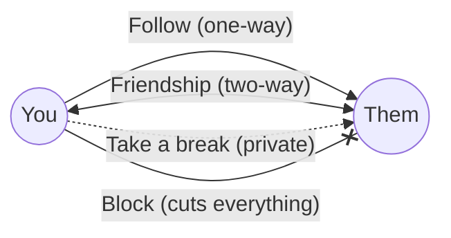
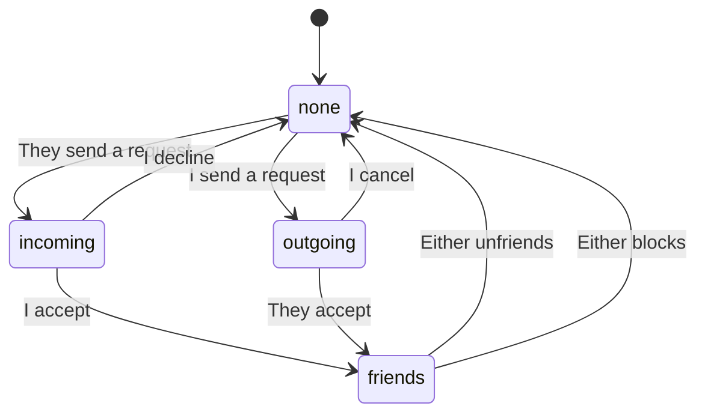
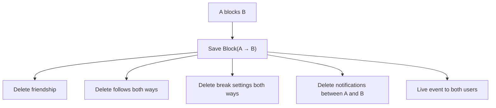

# People: follow, friends, take a break, block

Oremus has four kinds of relationships between two people. They are separate on purpose, so each one can change without breaking the others.

Main files:

- [`services/user.service.ts`](../apps/web/src/services/user.service.ts) — profiles and follow
- [`services/friendship.service.ts`](../apps/web/src/services/friendship.service.ts) — friend requests
- [`services/social.service.ts`](../apps/web/src/services/social.service.ts) — take a break and block
- Views: `partials/follow-button.ejs`, `partials/friend-controls.ejs`, `partials/break-dialog.ejs`

## Summary

| Relationship | Direction | Needs approval | What it does |
|---|---|---|---|
| Follow | One-way | No | Their posts come first in your feed; you can see their followers-only posts and stories |
| Friend | Two-way | Yes | Unlocks chat; accepting also makes you follow each other |
| Take a break | One-way, private | No | Hide their posts/stories from your feed, or hide your followers-only content from them |
| Block | Both ways | No | Cuts off everything between you |

## Follow

`POST /api/users/:userId/follow` toggles following.

- You cannot follow yourself or someone in a block relationship.
- The person you follow gets a "started following you" notification.
- Following is independent of friendship: you can follow someone who is not your friend.

## Friendship

A friendship is stored once per pair (the two ids are sorted). `requesterId` remembers who asked.

`POST /api/users/:userId/friendship { action }` where `action` is `request`, `cancel`, `accept`, `decline` or `unfriend`.

The state names are what the UI shows from **your** point of view: `none`, `outgoing` (you asked), `incoming` (they asked), `friends`, or `self`.

What happens on each action:

| Action | Effects |
|---|---|
| `request` | Create pending friendship, notify them (`friend_request`) |
| `cancel` / `decline` | Delete the pending friendship and its notification |
| `accept` | Mark accepted, create or reuse the private conversation, make both people follow each other, notify the requester (`friend_accept`) |
| `unfriend` | Delete the friendship and both follows. Chat history is kept but chat is locked |

After any change, both users get a live `friendship:changed` event so open pages update their buttons.

Two people sending requests at the same moment is handled by the unique index: the second insert fails and the code returns the current state instead.

## Take a break

`POST /api/users/:userId/break { seeLess, restrictPosts }` saves a private `SocialPreference`. The other person is never told.

| Option | Effect |
|---|---|
| `seeLess` | Their posts and stories disappear from your home feed and story tray. You can still visit their profile. |
| `restrictPosts` | They can no longer see your **followers-only** posts and stories, even if they follow you. Public content stays visible. |

Friendship and chat stay as they are.

## Block

`POST /api/users/:userId/block { blocked: true | false }`.

While a block exists (in either direction):

- B cannot see A's profile (it looks like it does not exist), posts, comments or stories, and the other way round.
- Neither can follow, friend, message, react, comment or invite the other.
- Notifications between them are not created.
- Message history is kept in the database but the chat is locked.

**Unblocking does not restore anything.** Friendship and follows must be created again.

## Profiles

`/profile/:username` shows the profile with tabs for posts, about, friends and photos.

- `profile.privacy = followers` hides bio, location, website and cover from people who do not follow you.
- Profile counts (followers, following, friends) are cached in Redis for 2 minutes.
- The photo library (`GET /api/profile/photos`) lists your post images and previous avatars/covers so you can reuse them.
- Settings at `/settings` change profile details, photos, story audience and theme.
