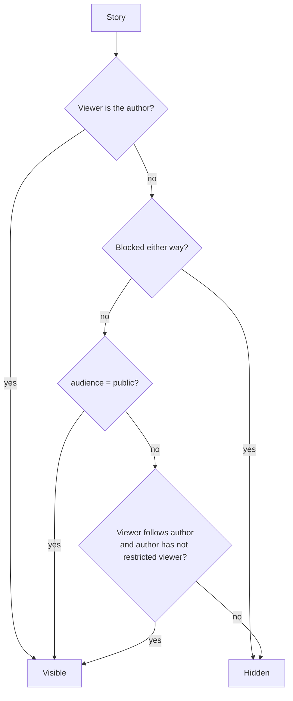
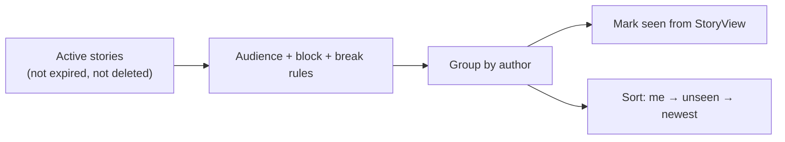
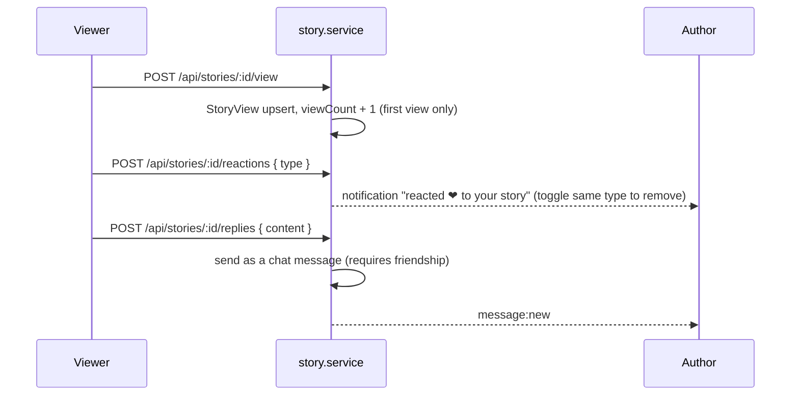

# Stories

Stories are photos, videos or short texts that disappear after 24 hours.

Main files:

- [`services/story.service.ts`](../apps/web/src/services/story.service.ts)
- [`controllers/story.controller.ts`](../apps/web/src/controllers/story.controller.ts)
- [`shared/story-style.ts`](../apps/web/src/shared/story-style.ts) — fonts, effects, animations, backgrounds and `storyTextAttrs()`, shared by server and browser
- Views: `partials/story-tray.ejs` (the row at the top of home), `partials/story-thumb.ejs` (static card used by the tray and archive), `stories/index.ejs` (full-screen viewer), `stories/archive.ejs`; the composer dialog lives in `partials/foot.ejs`

## Creating a story

A story has a photo, a video, or text on a background (12 gradients/solids, see `STORY_BACKGROUNDS`). Text (max 250 characters) can sit on top of any of them and is styled like Facebook stories:

| Field | Values |
| --- | --- |
| `font` | `classic`, `serif`, `script`, `typewriter`, `strong`, `retro` (Google Fonts with Vietnamese glyphs, loaded in `head.ejs`) |
| `textColor` | any `#rrggbb` |
| `textAlign` | `left`, `center`, `right` |
| `textEffect` | `none`, `shadow`, `outline`, `highlight`, `glow`, `neon` |
| `textAnimation` | `none`, `fade`, `zoom`, `slide`, `bounce`, `pulse` (disabled under `prefers-reduced-motion`) |
| `textSize` | 0.5 – 2.5 (multiplier) |
| `textX`, `textY` | 0 – 100, the text's centre as a % of the card (set by dragging the text in the composer, or arrow keys) |

`POST /api/stories` (multipart: `media`, `text`, `background`, `audience` + the fields above). The validator folds the text fields into `story.style`; stories created before styling have `style: null` and keep the old look (centred text, or a caption under the photo).

- Photos are compressed like every other image (see [Media](MEDIA.md)).
- Videos: MP4, WebM or MOV, up to 100 MB. The composer rejects clips over 60 seconds; the viewer plays at most 60 seconds. Story videos are served as uploaded (they are not sent to the media worker).
- Text size uses container query units (`cqw`), so the composer preview, the viewer and the thumbnails all render the same layout at different sizes.
- The CSP forbids inline `style` attributes, so server-rendered thumbnails carry `data-story-style` and the client bundle applies it.
- `audience` is `public` or `followers`. If not sent, the user's default from Settings is used (`PATCH /api/stories/settings`).
- `expiresAt` is set to 24 hours from now. Expired stories are filtered out by every query; nothing has to delete them.

## Who can see a story

## The story tray

The tray on the home page shows one circle per author.

- It includes your own stories, and stories from people you follow (minus people hidden with "take a break").
- On a profile page, that person's public stories are added even if you do not follow them.
- Stories of one author are grouped and played oldest first.
- Order of the tray: **you first**, then authors with **unseen** stories, then most recent.
- Opening an author starts at their first unseen story.

## Viewing, reacting and replying

- Video stories drive the progress bar from playback time and advance when the clip ends. Playback tries sound first and falls back to muted if the browser blocks autoplay; the speaker button (or `M`) toggles sound.
- Story reactions: `love`, `haha`, `angry`, `sad`, `like`.
- You cannot react or reply to your own story.
- Replies need a friendship, because they are delivered in Messages.

## For the author

- `GET /api/stories/:id/viewers` — who viewed and how they reacted (author only).
- `DELETE /api/stories/:id` — delete (soft delete).
- `/stories/archive` — every story you have posted, including expired ones.
