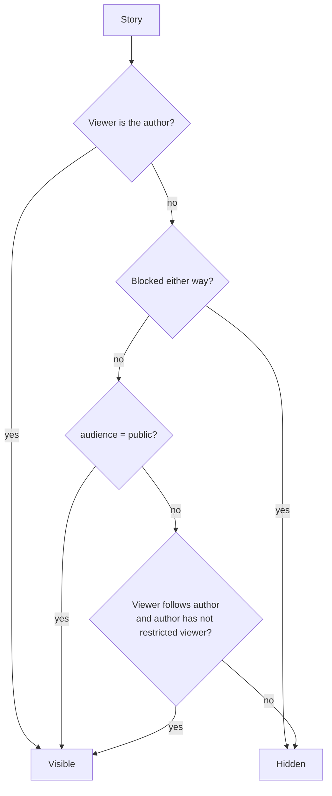
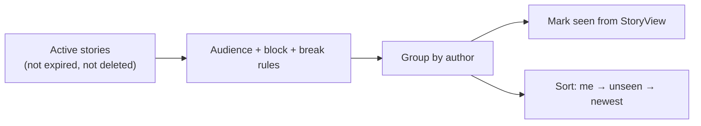
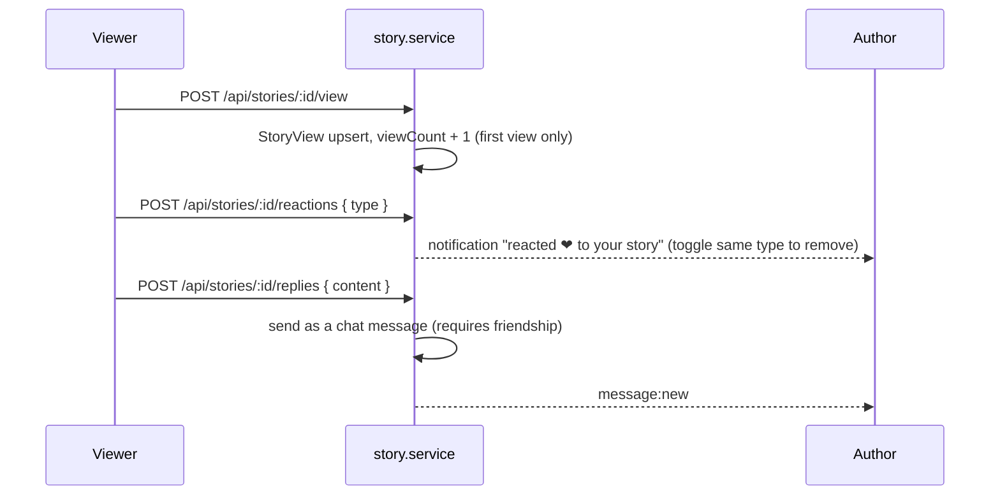

# Stories

Stories are photos or short texts that disappear after 24 hours.

Main files:

- [`services/story.service.ts`](../apps/web/src/services/story.service.ts)
- [`controllers/story.controller.ts`](../apps/web/src/controllers/story.controller.ts)
- Views: `partials/story-tray.ejs` (the row at the top of home), `stories/index.ejs` (full-screen viewer), `stories/archive.ejs`

## Creating a story

A story has either a photo or text on a coloured background (`sunset`, `ocean`, `forest`, `night`, `candy`, `sun`). Text can be added on top of a photo too (max 250 characters).

`POST /api/stories` (multipart: `media`, `text`, `background`, `audience`)

- The photo is compressed like every other image (see [Media](MEDIA.md)).
- `audience` is `public` or `followers`. If not sent, the user's default from Settings is used (`PATCH /api/stories/settings`).
- `expiresAt` is set to 24 hours from now. Expired stories are filtered out by every query; nothing has to delete them.

## Who can see a story

## The story tray

The tray on the home page shows one circle per author.

- It includes your own stories, and stories from people you follow (minus people hidden with "take a break").
- On a profile page, that person's public stories are added even if you do not follow them.
- Stories of one author are grouped and played oldest first.
- Order of the tray: **you first**, then authors with **unseen** stories, then most recent.
- Opening an author starts at their first unseen story.

## Viewing, reacting and replying

- Story reactions: `love`, `haha`, `angry`, `sad`, `like`.
- You cannot react or reply to your own story.
- Replies need a friendship, because they are delivered in Messages.

## For the author

- `GET /api/stories/:id/viewers` — who viewed and how they reacted (author only).
- `DELETE /api/stories/:id` — delete (soft delete).
- `/stories/archive` — every story you have posted, including expired ones.
