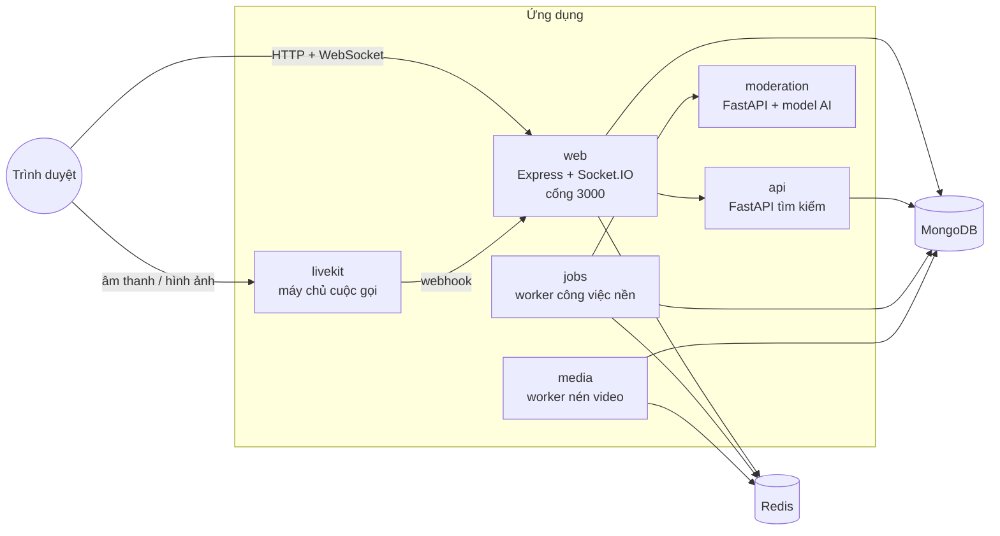
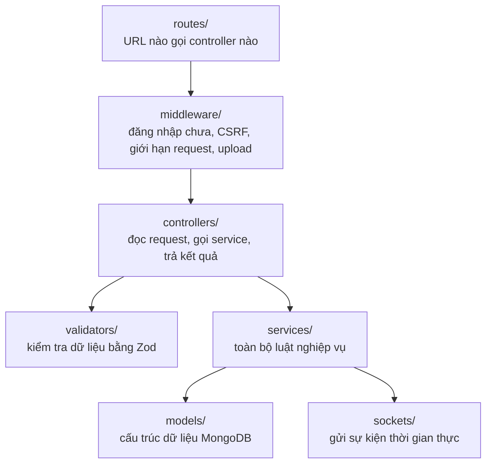
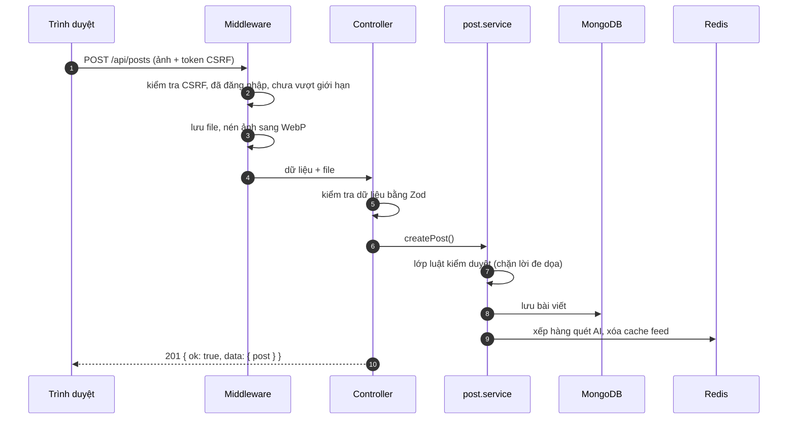
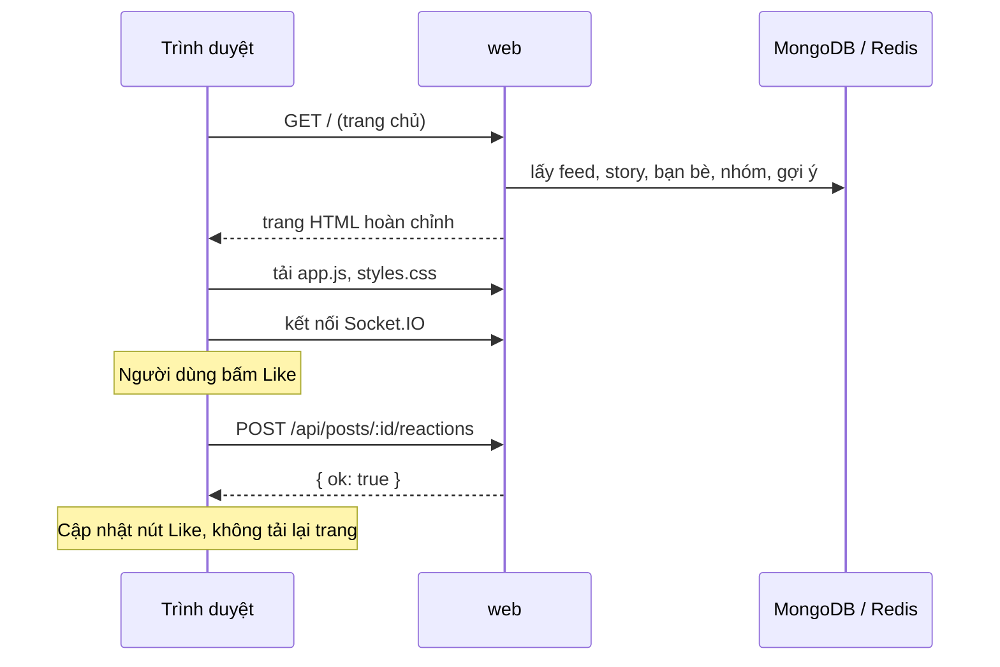
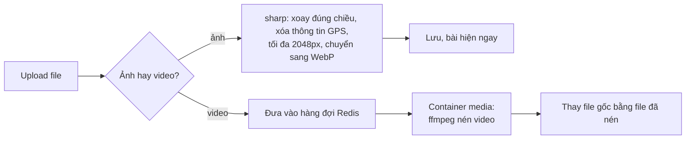
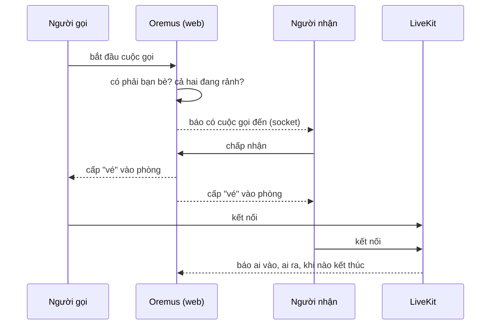
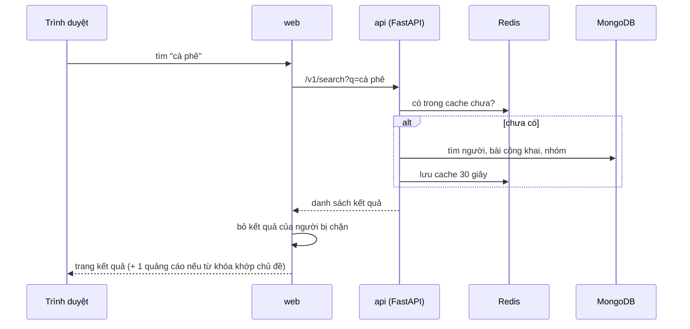
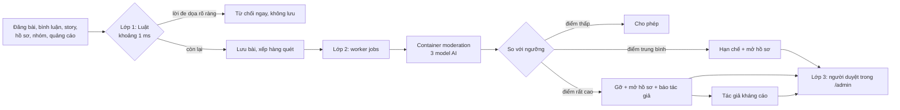
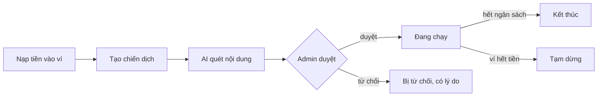

# Oremus: web hoạt động như thế nào

Tài liệu này giải thích toàn bộ project bằng tiếng Việt, viết ngắn gọn để đọc hiểu và trình bày. Muốn biết chi tiết từng phần thì mở file tiếng Anh tương ứng trong thư mục `docs/` (có ghi link ở cuối mỗi mục).

Sơ đồ viết bằng Mermaid. VS Code (cài extension Mermaid) hoặc GitHub sẽ tự vẽ ra hình.

---

## 1. Oremus là gì

Oremus là một **mạng xã hội** giống Facebook/Instagram thu nhỏ. Người dùng có thể:

- Đăng ký, đăng nhập, quên mật khẩu.
- Tạo trang cá nhân (ảnh đại diện, ảnh bìa, giới thiệu bản thân).
- Đăng bài có chữ, ảnh, video, cảm xúc, check-in địa điểm.
- Thả cảm xúc (6 loại: like, love, haha, wow, sad, angry), bình luận, chia sẻ.
- Kết bạn, theo dõi, chặn, "tạm nghỉ" với một người.
- Tham gia nhóm (công khai, riêng tư, ẩn), duyệt thành viên, duyệt bài.
- Nhắn tin trực tiếp, nhận thông báo theo thời gian thực.
- Đăng story tự xóa sau 24 giờ.
- Gọi thoại và gọi video với bạn bè.
- Tìm kiếm người, bài viết, nhóm.
- Nhận gợi ý "Dành cho bạn" (người, bài, nhóm, story) dựa trên sở thích.

Ngoài ra có các công cụ cho chủ nền tảng:

- **Trang quản trị** `/admin` cho nhân viên.
- **Kiểm duyệt nội dung bằng AI** (phát hiện chửi tục, thù ghét, ảnh nhạy cảm).
- **Quảng cáo tự phục vụ**: người dùng nạp ví, tạo chiến dịch, hệ thống tự chèn quảng cáo vào feed và trang tìm kiếm.

---

## 2. Công nghệ sử dụng

| Phần | Công nghệ | Vai trò |
|---|---|---|
| Web server | Node.js, Express 5, TypeScript | Trả về trang HTML và API JSON |
| Giao diện | EJS (HTML render sẵn ở server) + Tailwind CSS | Trang tải nhanh, không cần React/Vue |
| Code chạy trên trình duyệt | TypeScript, đóng gói bằng esbuild | Mở dialog, thả cảm xúc, upload, chat… |
| Cơ sở dữ liệu | MongoDB + Mongoose | Lưu người dùng, bài viết, bình luận… |
| Bộ nhớ đệm, hàng đợi | Redis | Cache, giới hạn số request, hàng đợi công việc, đồng bộ socket |
| Thời gian thực | Socket.IO | Tin nhắn, thông báo đến ngay không cần tải lại trang |
| Tìm kiếm | Python FastAPI (`apps/api`) | Dịch vụ tìm kiếm riêng |
| AI kiểm duyệt | Python FastAPI + PyTorch + Hugging Face (`apps/moderation`) | Chạy model AI chấm điểm chữ và ảnh |
| Xử lý ảnh | sharp | Nén ảnh sang WebP |
| Xử lý video | ffmpeg | Nén video, cắt khung hình để AI quét |
| Gọi thoại/video | LiveKit | Máy chủ truyền âm thanh, hình ảnh |
| Hàng đợi công việc nền | BullMQ (chạy trên Redis) | Quét kiểm duyệt, tính tiền quảng cáo, cuộc gọi |
| Kiểm tra dữ liệu đầu vào | Zod | Mọi request đều được kiểm tra trước khi xử lý |
| Kiểm thử | Vitest, pytest | Test tự động |
| Triển khai | Docker Compose | Chạy tất cả bằng một lệnh |

---

## 3. Kiến trúc tổng thể

Hệ thống chia thành nhiều **container Docker**, mỗi container làm một việc:



| Container | Làm gì |
|---|---|
| `web` | Trung tâm. Nhận mọi request của người dùng, trả trang HTML, API JSON, chạy Socket.IO. |
| `jobs` | Làm việc chạy nền: quét nội dung bằng AI, tính tiền quảng cáo mỗi phút, dọn dẹp cuộc gọi. |
| `media` | Nén video bằng ffmpeg (việc nặng nên không làm ngay trong request). |
| `api` | Dịch vụ tìm kiếm viết bằng Python. |
| `moderation` | Chứa 3 model AI, nhận chữ/ảnh và trả về điểm vi phạm. |
| `livekit` | Truyền âm thanh và video của cuộc gọi. |
| `mongo` | Cơ sở dữ liệu chính. |
| `redis` | Cache, hàng đợi, giới hạn request, danh sách token đã đăng xuất. |

**Vì sao tách nhiều container?** Việc nặng (AI, nén video) chạy riêng nên không làm chậm trang web. Một phần bị lỗi (ví dụ AI chưa tải xong) thì phần còn lại vẫn chạy bình thường.

---

## 4. Bên trong web server: mô hình MVC nhiều lớp

Code của `apps/web/src` chia thành các lớp. Một request đi từ trên xuống dưới:



| Lớp | Quy tắc |
|---|---|
| Routes | Chỉ nối URL với controller, không có logic. |
| Middleware | Việc request nào cũng cần: xác định người dùng, chống CSRF, chống spam, nhận file. |
| Controllers | Mỏng. Kiểm tra dữ liệu, gọi một service, trả về `{ ok: true, data }` hoặc render trang. |
| Services | Nơi chứa mọi luật: ai được xem bài này, ai được duyệt thành viên, chặn người thì xảy ra gì. |
| Models | Định nghĩa dữ liệu, giá trị mặc định, index. |
| Views | File `.ejs` tạo ra HTML. |

**Ví dụ: đăng một bài có 2 ảnh**



Mọi lỗi đều trả về cùng một dạng: `{ ok: false, error: { code, message } }`, nên phía trình duyệt xử lý lỗi ở một chỗ.

Chi tiết: [ARCHITECTURE.md](ARCHITECTURE.md), [API_REFERENCE.md](API_REFERENCE.md).

---

## 5. Cách một trang được hiển thị

Trang được **render sẵn ở server** (Server-Side Rendering) rồi mới gửi về, sau đó code JavaScript thêm phần tương tác.



Ưu điểm: trang hiện ra nhanh, không cần framework phía client.

Feed dùng **cuộn vô hạn**: trang đầu có 10 bài, khi cuộn gần hết thì tải thêm 10 bài nữa qua `GET /api/lists/feed`.

Chi tiết: [FRONTEND.md](FRONTEND.md), [INFINITE_SCROLL.md](INFINITE_SCROLL.md).

---

## 6. Đăng nhập và bảo mật

- Mật khẩu được băm bằng **bcrypt**, không lưu mật khẩu gốc.
- Đăng nhập xong, server cấp 2 **JWT** trong cookie `HttpOnly` (JavaScript không đọc được nên khó bị đánh cắp):
  - `access_token`: sống 15 phút, chứng minh bạn là ai.
  - `refresh_token`: sống 1 ngày (30 ngày nếu chọn "ghi nhớ"), dùng để xin access token mới.
- **Xoay vòng refresh token**: mỗi lần dùng sẽ được cấp token mới. Nếu một token cũ bị dùng lại (dấu hiệu bị đánh cắp), cả "họ" token đó bị thu hồi.
- Đăng xuất thì token được đưa vào **danh sách chặn** trong Redis.
- **CSRF**: mọi request thay đổi dữ liệu phải kèm token CSRF, chống trang web lạ gửi request thay bạn.
- **Giới hạn request** (rate limit): ví dụ đăng nhập tối đa 10 lần/15 phút, đăng bài 20 bài/giờ. Vượt quá thì trả lỗi `429`.
- **helmet** thêm các header bảo mật, có Content Security Policy chặn script lạ.

Chi tiết: [AUTHENTICATION.md](AUTHENTICATION.md).

---

## 7. Bài viết, feed, quan hệ

**Ai được xem bài:** bài có 3 chế độ: Công khai, Người theo dõi, Chỉ mình tôi. Bài trong nhóm theo quyền riêng tư của nhóm. Người bị chặn không bao giờ thấy nhau.

**Thứ tự feed trang chủ:** bài của người bạn theo dõi lên trước (người mới theo dõi gần đây nhất lên đầu), sau đó là bài mới nhất.

**Quan hệ:**
- *Theo dõi*: một chiều, không cần đồng ý.
- *Bạn bè*: hai chiều, phải gửi lời mời và được chấp nhận. Chỉ bạn bè mới nhắn tin và gọi cho nhau được.
- *Chặn*: hai người biến mất khỏi mắt nhau.
- *Tạm nghỉ*: bớt thấy một người mà không cần hủy kết bạn.

**Xóa mềm:** bài, bình luận, story, tài khoản khi xóa chỉ được đánh dấu `deletedAt`, không xóa thật, để có thể khôi phục.

Chi tiết: [POSTS_AND_FEED.md](POSTS_AND_FEED.md), [SOCIAL_GRAPH.md](SOCIAL_GRAPH.md), [GROUPS.md](GROUPS.md), [STORIES.md](STORIES.md).

---

## 8. Ảnh và video



- Ảnh nén ngay trong request vì nhanh.
- Video nén ở nền vì có thể mất vài phút. Bài vẫn đăng được ngay với video gốc, sau đó video tự được thay bằng bản nhẹ hơn.

Chi tiết: [MEDIA.md](MEDIA.md).

---

## 9. Nhắn tin và thông báo thời gian thực

- Dùng **Socket.IO**. Khi đăng nhập, trình duyệt mở một kết nối giữ liên tục với server.
- Mỗi người dùng vào một "phòng" tên `user:{id}`. Muốn gửi gì cho ai thì server phát sự kiện vào phòng của người đó.
- Socket.IO dùng **Redis adapter**, nên nếu chạy nhiều server web thì sự kiện vẫn đến đúng người.
- Tin nhắn và thông báo được **lưu vào MongoDB trước**, rồi mới gửi qua socket. Người đang offline sẽ thấy khi vào lại.

Chi tiết: [MESSAGING_AND_NOTIFICATIONS.md](MESSAGING_AND_NOTIFICATIONS.md).

---

## 10. Gọi thoại và gọi video



- Oremus chỉ lo phần "mời, chấp nhận, cấp vé". Âm thanh và hình ảnh đi qua máy chủ **LiveKit** (công nghệ WebRTC).
- Chỉ gọi được cho bạn bè. Cuộc gọi không bị ghi âm.

Chi tiết: [CALLS.md](CALLS.md).

---

## 11. Tìm kiếm



- Tìm kiếm tách thành dịch vụ Python riêng để sau này có thể đổi sang công cụ mạnh hơn (Elasticsearch/OpenSearch) mà không sửa web.
- Ô tìm kiếm có gợi ý khi đang gõ và lịch sử tìm kiếm gần đây.
- Nếu dịch vụ tìm kiếm bị lỗi, chỉ trang tìm kiếm báo lỗi, phần còn lại vẫn chạy.

Chi tiết: [SEARCH_AND_PLACES.md](SEARCH_AND_PLACES.md).

---

## 12. Hệ thống gợi ý "Dành cho bạn"

Đây là một **hệ gợi ý dựa trên nội dung** (content-based recommender), tự viết, chạy ngay trong web, không cần dịch vụ ngoài.

**Bước 1: Thu thập tín hiệu hành vi.** Mỗi khi người dùng làm gì đó, hệ thống ghi lại một "tín hiệu":

| Hành động | Trọng số | Giảm một nửa sau |
|---|---|---|
| Tìm kiếm | 3 | 10 ngày |
| Mở trang cá nhân/nhóm/bài | 1.5 đến 2 | 21 ngày |
| Đọc bài (đo thời gian bài nằm trên màn hình) | tối đa 3 | 21 ngày |
| Thả cảm xúc, bình luận, chia sẻ | 2 đến 3 | 30 ngày |
| Theo dõi, vào nhóm | 2.5 đến 3 | 45 ngày |
| Sở thích chọn lúc đăng ký | 2.5 | 60 ngày |

Tín hiệu càng cũ thì càng ít giá trị (**suy giảm theo thời gian**).

**Bước 2: Biến chữ thành vector (TF-IDF).**
- Văn bản được chuyển về chữ thường, bỏ dấu (`cà phê` → `ca phe`), bỏ từ vô nghĩa (stopword), ghép cặp từ liền nhau (`ca_phe`).
- Có một **từ điển 25 chủ đề** (cà phê, du lịch, gaming, âm nhạc…). Nhờ vậy "cà phê muối", "barista", "espresso" đều được hiểu là chủ đề Cà phê.
- Mỗi bài, mỗi người, mỗi nhóm thành một vector. Sở thích của người dùng cũng là một vector (tổng hợp từ các tín hiệu ở bước 1).

**Bước 3: Chấm điểm và xếp hạng.**

```
điểm = 6 × độ liên quan + 1.5 × mức tương tác với tác giả + 1.2 × yếu tố xã hội
     + 0.8 × độ phổ biến + 0.5 × độ mới − điểm phạt
```

- *Độ liên quan*: độ giống nhau (cosine) giữa vector sở thích và vector nội dung.
- *Yếu tố xã hội*: số bạn chung, số bạn bè đang ở trong nhóm.
- *Điểm phạt*: story đã xem rồi, trang cá nhân đã mở mà không theo dõi.

**Bước 4: Giải thích.** Mỗi gợi ý kèm lý do, ví dụ "Vì bạn đã tìm 'coffee'" hoặc "3 bạn chung".

Chi tiết: [RECOMMENDATIONS.md](RECOMMENDATIONS.md).

---

## 13. Kiểm duyệt nội dung bằng AI (phát hiện nhạy cảm, thô tục)

Toàn bộ chạy **trên máy chủ của mình**, không gửi dữ liệu ra ngoài. Có 3 lớp, và **con người luôn là người quyết định cuối cùng**.



### Lớp 1: Bộ luật từ khóa (`apps/web/src/moderation/rules.ts`)

Chạy ngay lúc người dùng bấm đăng.

- **Chuẩn hóa văn bản** để chống lách luật:
  - Đổi chữ số giả chữ cái: `ng0` → `ngo`, `d1t` → `dit`.
  - Gộp chữ kéo dài: `nguuuu` → `ngu`.
  - Gộp chữ bị tách: `n g u`, `n.g.u` → `ngu`.
- **Danh sách CHẶN** (block): chỉ gồm lời đe dọa trực tiếp và xúi tự tử ("tao giết mày", "kill yourself"…). Khớp thì bài **bị từ chối, không được lưu**.
- **Danh sách GẮN CỜ** (flag): từ chửi tục ("đm", "vcl", "óc chó"…), từ kỳ thị vùng miền, giới tính, từ liên quan tình dục, spam (lừa đảo, quá 4 đường link). Lớp này **không chặn**, chỉ đảm bảo bài được người thật xem lại.
- **Điểm tinh tế với tiếng Việt:** từ có dấu được so khớp đúng như viết. Nếu bỏ dấu thì "lồn" sẽ thành "lon" (cái lon), gây chặn nhầm.

### Lớp 2: Model AI (`apps/moderation`)

Đây là một dịch vụ Python FastAPI riêng, chứa 3 model tải từ Hugging Face:

| Model | Dùng cho | Phát hiện |
|---|---|---|
| `tarudesu/ViHateT5-base-HSD` | Tiếng Việt | Ngôn từ xúc phạm, thù ghét |
| `unitary/multilingual-toxic-xlm-roberta` | Ngôn ngữ khác | Ngôn từ độc hại |
| `Falconsai/nsfw_image_detection` | Ảnh và khung hình video | Ảnh khỏa thân, nhạy cảm |

Cách hoạt động:

1. Người dùng đăng bài, bài được lưu và một **công việc quét** được đẩy vào hàng đợi (BullMQ trên Redis). Người dùng **không phải chờ**.
2. Container `jobs` lấy công việc ra và gửi HTTP đến container `moderation`:
   - `POST /v1/text` với nội dung chữ.
   - `POST /v1/image` với từng ảnh (thu nhỏ còn 384px). Video thì dùng ffmpeg cắt tối đa 5 khung hình.
   - Mỗi request phải có mã bí mật `x-moderation-secret`, không có thì bị từ chối.
3. **Chọn model theo ngôn ngữ:** chữ có dấu tiếng Việt thì dùng ViHateT5. Chữ không dấu nhưng trông giống tiếng Việt ("may ngu qua") thì chạy **cả hai** model, vì người ta hay chửi không dấu.
4. Bài dài được cắt thành đoạn 180 từ (tối đa 4 đoạn) để chửi ở cuối bài cũng không lọt.
5. Model trả về điểm từ 0 đến 1 cho 3 nhóm: `hate` (thù ghét), `harassment` (xúc phạm), `sexual` (nhạy cảm).
6. Nếu lớp luật đã gắn cờ thì điểm nhóm đó được nâng lên ít nhất 0.75, để chắc chắn có người xem.

**Phiên bản model được khóa cứng** bằng mã commit trong `apps/moderation/app/engines.py`. Model chỉ thay đổi khi lập trình viên chủ động sửa code. File model (khoảng 2.5 GB) tự tải về lần đầu và lưu trong volume Docker.

### So sánh điểm với ngưỡng

| Nhóm | Ngưỡng xem xét | Ngưỡng gỡ | Được tự động gỡ? |
|---|---|---|---|
| harassment (xúc phạm) | 0.6 | 0.97 | Có |
| hate (thù ghét) | 0.6 | 0.95 | Không, chỉ mở hồ sơ |
| sexual (nhạy cảm) | 0.6 | 0.95 | Không, chỉ mở hồ sơ |
| violence, self_harm, spam | 0.5 | 0.95 trở lên | Không (chỉ đến từ lớp luật) |

- Dưới ngưỡng xem xét: bài được duyệt.
- Từ ngưỡng xem xét trở lên: bài bị **hạn chế** (vẫn mở được bằng link, nhưng không lên feed và tìm kiếm) và mở hồ sơ cho người duyệt.
- Từ ngưỡng gỡ trở lên **và** nhóm đó cho phép tự gỡ: bài bị **gỡ**, file chuyển vào thư mục cách ly, tác giả nhận thông báo.

**Vì sao chỉ "xúc phạm" được tự gỡ?** Ngưỡng được chọn dựa trên đo đạc thực tế (`apps/moderation/eval/evaluate.py`, 169 câu tiếng Việt được gán nhãn tay). Chỉ cho máy tự gỡ khi độ chính xác (precision) ≥ 0.9:
- harassment đạt precision 1.0 từ ngưỡng 0.9 trở lên.
- hate chỉ đạt 0.33, vì model hay nhầm câu chửi thường thành thù ghét.
- sexual: thử trên 300 ảnh đại diện bình thường, có 1 ảnh chân dung phụ nữ bị chấm 0.9989, nên luôn để người quyết.

Admin có thể chỉnh các ngưỡng này trong trang quản trị.

### Trạng thái của một bài

| Trạng thái | Ai thấy |
|---|---|
| `pending` | Mọi người. Bài chữ đang chờ quét (thường vài giây). |
| `held` | Chỉ tác giả. Bài có ảnh/video đang chờ quét. |
| `approved` | Mọi người. |
| `limited` | Mở được bằng link, nhưng không lên feed, gợi ý, tìm kiếm. |
| `removed` | Chỉ tác giả và nhân viên. |

### Lớp 3: Người duyệt

- Hồ sơ vi phạm nằm trong `/admin`, mục *Safety*, cái ưu tiên cao xếp trước.
- **Gỡ nội dung** thì tác giả bị tính một "gậy": lần 1 cảnh cáo, lần 2 khóa 24 giờ, lần 3 khóa 7 ngày, lần 4 chỉ đề xuất cấm. Hệ thống **không bao giờ tự cấm** tài khoản.
- **Báo cáo** của người dùng chỉ tăng độ ưu tiên, không tự gỡ bài, để tránh bị nhiều người hùa nhau báo cáo.
- Tác giả được **kháng cáo** một lần trong phần Cài đặt.
- Nếu AI lỗi mãi không quét được, bài vẫn được hiện (không bị kẹt), còn bài có ảnh/video thì chuyển cho người kiểm tra.

### Bốn chế độ chạy (`MODERATION_MODE`)

| Chế độ | Ý nghĩa |
|---|---|
| `off` | Tắt (mặc định). |
| `shadow` | Quét và ghi kết quả, nhưng người dùng không bị ảnh hưởng. Dùng để thử trước. |
| `enforce` | Áp dụng thật. Điểm lưng chừng, hoặc loại vi phạm không bật tự gỡ, thì bị hạn chế chờ người duyệt. |
| `auto` | AI tự quyết luôn, không chờ người: từ ngưỡng `block` trở lên thì gỡ (mọi loại), giữa `review` và `block` thì đăng. Vẫn mở case để admin xem lại và đảo ngược sau. Dễ gỡ nhầm hơn, vì model ảnh từng chấm ảnh chân dung bình thường là nhạy cảm. |

### Giới hạn (nên nói thật khi trình bày)

- Model ảnh chỉ phát hiện khỏa thân, không nhận ra bạo lực, máu me.
- Video chỉ quét tối đa 5 khung hình.
- Âm thanh và cuộc gọi không được quét.
- Tin nhắn riêng chỉ qua lớp luật, không qua AI.
- Bộ test 169 câu là tự viết, không lấy từ dữ liệu thật, nên kết quả đo là mức lạc quan.

Chi tiết: [MODERATION.md](MODERATION.md).

---

## 14. Quảng cáo



**Quảng cáo hiện ở đâu:**
- **Feed trang chủ:** sau bài thứ 3, rồi cứ 8 bài lại có 1 quảng cáo (bài 11, 19, 27…).
- **Trang tìm kiếm:** nếu từ khóa khớp một chủ đề (ví dụ "chơi game" khớp Gaming) thì hiện 1 quảng cáo về chủ đề đó ở đầu kết quả.

**Chọn quảng cáo nào:** xếp theo giá thầu (giá mỗi 1.000 lượt xem), cộng một chút ngẫu nhiên, và được nhân 1.5 nếu chủ đề quảng cáo khớp với:
- sở thích người dùng chọn lúc đăng ký, hoặc
- chủ đề người dùng vừa tìm kiếm, đọc, mở gần đây (lấy từ hệ gợi ý ở mục 12).

**Không hiện quảng cáo khi:** người xem đã chặn nhà quảng cáo hoặc chủ đề đó, đã ẩn quảng cáo, đã xem 3 lần trong ngày, hoặc chiến dịch đã hết ngân sách.

**Chủ quảng cáo** thấy quảng cáo của chính mình ở vị trí đầu, có nhãn "Your preview". Lượt xem này không bị tính tiền.

**Tính tiền:**
- Lượt xem chỉ được tính khi quảng cáo hiện ít nhất một nửa trên màn hình trong 1 giây.
- Mỗi phút, worker `jobs` cộng dồn lượt xem và trừ tiền trong ví.
- Mọi giao dịch được ghi vào **sổ cái** (`LedgerEntry`) chỉ thêm không sửa, mỗi dòng có khóa riêng nên chạy lại cũng không trừ tiền hai lần.
- Có tích hợp cổng thanh toán **VNPay** (hiện mới thử với dữ liệu giả lập).

Chi tiết: [ADS.md](ADS.md).

---

## 15. Trang quản trị

- `/admin` xây bằng **AdminJS**, dùng chung đăng nhập với web.
- 3 vai trò: `user`, `moderator`, `admin`.
  - Moderator: duyệt hồ sơ vi phạm, ẩn bài, cảnh cáo, khóa tạm thời.
  - Admin: thêm quyền cấm tài khoản, đổi vai trò, duyệt quảng cáo, quản lý ví, chỉnh ngưỡng kiểm duyệt.
- Có bảng điều khiển theo dõi hàng đợi, công việc lỗi, số liệu hệ thống.
- Mọi hành động của nhân viên được ghi **nhật ký kiểm toán** (audit log).

Chi tiết: [ADMIN.md](ADMIN.md).

---

## 16. Cache và hiệu năng

Redis lưu tạm những dữ liệu đọc nhiều để không phải hỏi MongoDB mỗi lần:

| Dữ liệu | Thời gian lưu |
|---|---|
| Feed trang chủ | 45 giây |
| Hồ sơ người dùng | 120 giây |
| Thông tin nhóm | 180 giây |
| Kết quả tìm kiếm | 30 giây |
| Gợi ý "Dành cho bạn" | 120 giây |

Khi có thay đổi (đăng bài, thả cảm xúc, theo dõi…) thì cache liên quan bị xóa để người dùng thấy dữ liệu mới.

Mẹo xóa cache feed: thay vì đi tìm và xóa từng khóa, hệ thống tăng một **số phiên bản**. Khóa cũ không còn được dùng nữa và tự hết hạn.

Chi tiết: [CACHING.md](CACHING.md), [PERFORMANCE.md](PERFORMANCE.md).

---

## 17. Chạy project

```bash
docker compose --profile moderation --profile calls up -d
```

- `--profile moderation` bật container AI (cần khoảng 3 GB RAM, lần đầu tải khoảng 2.5 GB model).
- `--profile calls` bật LiveKit cho cuộc gọi.
- Web chạy ở `http://localhost:3000`.
- Có script tạo dữ liệu mẫu: 2.000 người dùng, khoảng 8.000 bài viết (xem [SCRIPTS.md](SCRIPTS.md)).

Chi tiết: [DEVELOPMENT.md](DEVELOPMENT.md), [DEPLOYMENT.md](DEPLOYMENT.md).

---

## 18. Câu hỏi thầy có thể hỏi

**Vì sao dùng MongoDB mà không dùng SQL?**
Dữ liệu mạng xã hội có nhiều phần lồng nhau (hồ sơ trong người dùng, danh sách ảnh trong bài viết). MongoDB lưu cả khối cùng nhau nên đọc nhanh. Những quan hệ lớn (theo dõi, cảm xúc, bình luận) vẫn tách thành bảng riêng.

**Vì sao không dùng React?**
Trang render sẵn ở server hiện ra nhanh hơn và đơn giản hơn. Phần tương tác chỉ cần một file TypeScript.

**AI kiểm duyệt có gửi dữ liệu ra ngoài không?**
Không. Model chạy trong container `moderation` trên máy chủ của mình.

**Vì sao không để AI tự gỡ hết bài vi phạm?**
Model có thể sai. Chỉ nhóm "xúc phạm" đạt độ chính xác đủ cao (≥ 0.9) mới được tự gỡ. Các nhóm khác chỉ mở hồ sơ để người quyết.

**Nếu AI chậm thì người dùng có phải chờ không?**
Không. Bài được lưu ngay, việc quét chạy ở nền qua hàng đợi. Bài chữ hiện ngay, bài có ảnh chỉ tác giả thấy cho đến khi quét xong (thường vài giây).

**Chống lách luật kiểu viết "đ.m", "ng0", "nguuuu" thế nào?**
Lớp luật chuẩn hóa văn bản trước khi so khớp: đổi số thành chữ, gộp chữ lặp, gộp chữ bị tách. Model AI cũng được chạy với chữ không dấu.

**Hệ gợi ý có dùng AI không?**
Không dùng mạng nơ-ron. Đó là thuật toán TF-IDF + độ tương đồng cosine + trọng số theo thời gian, tự viết, giải thích được vì sao gợi ý.

**Làm sao để tin nhắn đến ngay?**
Socket.IO giữ kết nối liên tục giữa trình duyệt và server. Server đẩy tin nhắn vào phòng riêng của người nhận.

**Bảo mật đăng nhập ra sao?**
Mật khẩu băm bcrypt, JWT trong cookie HttpOnly, refresh token xoay vòng, chống CSRF, giới hạn số lần thử đăng nhập.
